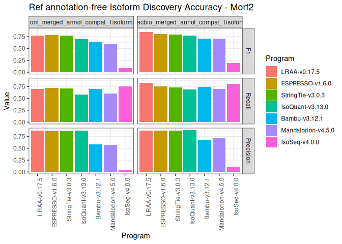
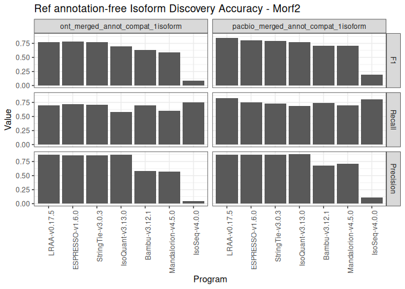
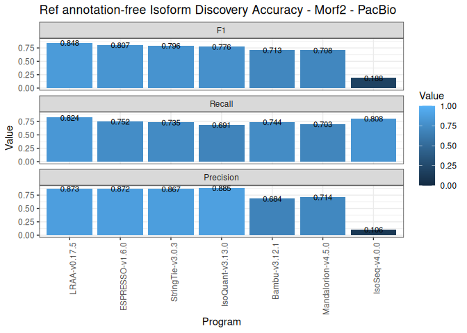
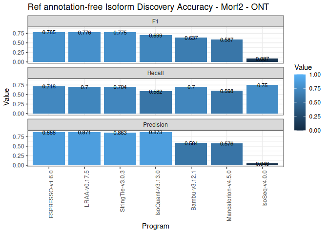
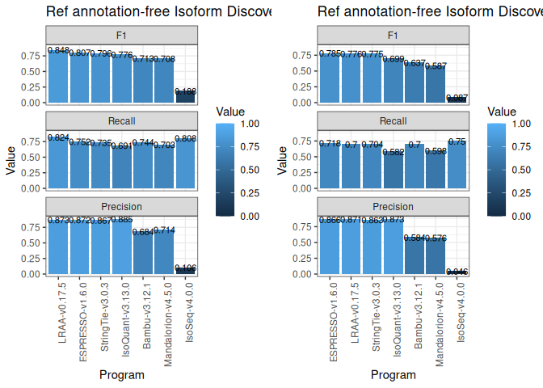
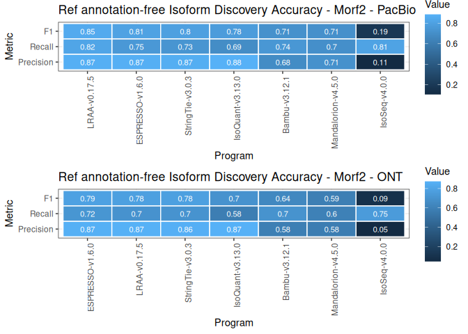
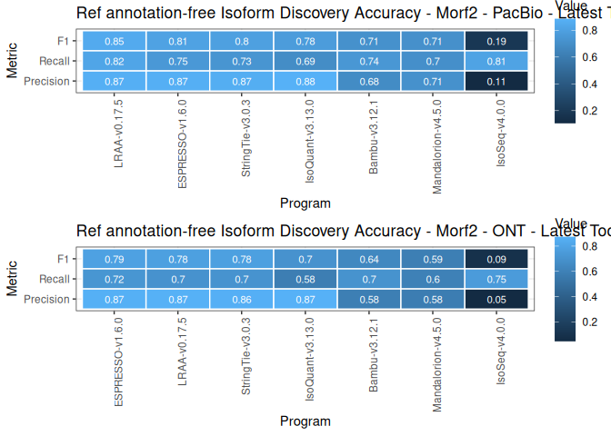

Morf2_denovo_eval.Rmd
================
2025-02-15

``` r
df = read.csv("morf2.full_transcriptome_TPR_FDR_F1.tsv", header=T, sep="\t") %>%
  dplyr::select(Program, Metric, Value, data_name) %>%
  filter(Metric != 'novelTPR')

df$data_name = str_replace(df$data_name, "morf2_", "")

df %>% head()
```

    ##         Program   Metric     Value                        data_name
    ## 1  LRAA-v0.17.5 knownTPR 0.6995565 ont_merged_annot_compat_1isoform
    ## 2  LRAA-v0.17.5 novelFDR 0.1292548 ont_merged_annot_compat_1isoform
    ## 3  LRAA-v0.17.5       F1 0.7758197 ont_merged_annot_compat_1isoform
    ## 4 Bambu-v3.12.1 knownTPR 0.6999261 ont_merged_annot_compat_1isoform
    ## 5 Bambu-v3.12.1 novelFDR 0.4163328 ont_merged_annot_compat_1isoform
    ## 6 Bambu-v3.12.1       F1 0.6365317 ont_merged_annot_compat_1isoform

``` r
df = df %>% spread(key=Metric, value=Value) 

df = df %>% dplyr::rename(Recall = `knownTPR`) %>% mutate(Precision = 1-novelFDR) %>% select(-novelFDR)

df = df %>% gather(key=Metric, value=Value, F1, Recall, Precision)
```

``` r
program_ranking = df %>% filter(Metric == "F1") %>% group_by(Program) %>% 
  summarize(mean_F1 = mean(Value)) %>% arrange(dplyr::desc(mean_F1)) %>% pull(Program)

df$Program = factor(df$Program, levels=program_ranking)
```

``` r
df$Metric = factor(df$Metric, levels = c("F1", "Recall", "Precision"))
```

``` r
df %>% ggplot(aes(x=Program, y=Value, fill=Program)) + geom_col() +
  theme_bw() +
  facet_grid(vars(Metric), vars(data_name)) +
  theme(axis.text.x = element_text(angle = 90, hjust = 1)) +
  ggtitle("Ref annotation-free Isoform Discovery Accuracy - Morf2")
```

<!-- -->

``` r
df %>% ggplot(aes(x=Program, y=Value)) + geom_col() +
  theme_bw() +
  facet_grid(vars(Metric), vars(data_name)) +
  theme(axis.text.x = element_text(angle = 90, hjust = 1)) +
  ggtitle("Ref annotation-free Isoform Discovery Accuracy - Morf2")
```

<!-- -->

``` r
get_latest_programs = function(data_df) {

  program_versions = data_df %>%
    distinct(Program) %>%
    mutate(Program = as.character(Program),
           Tool = str_remove(Program, "-v[0-9].*$"),
           Version = str_match(Program, "-v([0-9][0-9A-Za-z.\\-]*)$")[, 2])

  latest_versioned_programs = program_versions %>%
    filter(! is.na(Version)) %>%
    group_by(Tool) %>%
    arrange(dplyr::desc(numeric_version(Version)), .by_group = TRUE) %>%
    dplyr::slice(1) %>%
    ungroup()

  unversioned_programs = program_versions %>%
    filter(is.na(Version))

  bind_rows(latest_versioned_programs, unversioned_programs) %>%
    pull(Program)
}

latest_programs = get_latest_programs(df)

latest_programs
```

    ## [1] "Bambu-v3.12.1"      "ESPRESSO-v1.6.0"    "IsoQuant-v3.13.0"  
    ## [4] "IsoSeq-v4.0.0"      "LRAA-v0.17.5"       "Mandalorion-v4.5.0"
    ## [7] "StringTie-v3.0.3"

``` r
pacbio_only_df =  df %>% filter(grepl("pacbio", data_name)) 

pacbio_only_rankings = pacbio_only_df  %>% filter(Metric == "F1") %>% arrange(dplyr::desc(Value)) %>% 
  pull(Program)

pacbio_only_df$Program = factor(pacbio_only_df$Program, levels=pacbio_only_rankings)
```

``` r
pacbio_only_plot = pacbio_only_df %>% 
  ggplot(aes(x=Program, y=Value, fill=Value)) + 
  geom_col() +
  geom_text(aes(label = round(Value, 3)), 
            vjust = 0.5, 
            size = 3) +
  scale_fill_gradient(limits = c(0, 1)) +
  theme_bw() +
  facet_wrap(~Metric, ncol=1) +
  theme(axis.text.x = element_text(angle = 90, hjust = 1)) +
  ggtitle("Ref annotation-free Isoform Discovery Accuracy - Morf2 - PacBio")


pacbio_only_plot
```

<!-- -->

``` r
ggsave(pacbio_only_plot, file="pacbio_only_plot.summary.pdf", width=6, height=6)
```

``` r
ONT_only_df =  df %>% filter(grepl("ont_", data_name)) 

ONT_only_rankings = ONT_only_df  %>% filter(Metric == "F1") %>% arrange(dplyr::desc(Value)) %>% 
  pull(Program)

ONT_only_df$Program = factor(ONT_only_df$Program, levels=ONT_only_rankings)
```

``` r
ONT_only_plot = ONT_only_df %>% 
  ggplot(aes(x=Program, y=Value, fill=Value)) + 
  geom_col() +
  geom_text(aes(label = round(Value, 3)), 
            vjust = 0.5, 
            size = 3) +
  scale_fill_gradient(limits = c(0, 1)) +
  theme_bw() +
  facet_wrap(~Metric, ncol=1) +
  theme(axis.text.x = element_text(angle = 90, hjust = 1)) +
  ggtitle("Ref annotation-free Isoform Discovery Accuracy - Morf2 - ONT")


ONT_only_plot
```

<!-- -->

``` r
library(gridExtra)
```

    ## 
    ## Attaching package: 'gridExtra'

    ## The following object is masked from 'package:dplyr':
    ## 
    ##     combine

``` r
grid.arrange(pacbio_only_plot, ONT_only_plot, ncol = 2)
```

<!-- -->

``` r
pacbio_only_plot = pacbio_only_df %>% 
  mutate(Metric = forcats::fct_rev(factor(Metric))) %>% # Reverse the factor levels in the data itself
  ggplot(aes(x=Program, y=Metric, fill=Value)) + 
  geom_tile(color = "white", size = 0.5) +
  geom_text(aes(label = round(Value, 2)), 
            size = 3, 
            color = "white") +
  #scale_fill_gradient(limits = c(0, 1), low = "white", high = "steelblue") +
  theme_bw() +
  theme(axis.text.x = element_text(angle = 90, hjust = 1)) +
  ggtitle("Ref annotation-free Isoform Discovery Accuracy - Morf2 - PacBio") +
  labs(x = "Program", y = "Metric")
```

    ## Warning: Using `size` aesthetic for lines was deprecated in ggplot2 3.4.0.
    ## ℹ Please use `linewidth` instead.
    ## This warning is displayed once per session.
    ## Call `lifecycle::last_lifecycle_warnings()` to see where this warning was
    ## generated.

``` r
ONT_only_plot = ONT_only_df %>% 
  mutate(Metric = forcats::fct_rev(factor(Metric))) %>% # Reverse the factor levels in the data itself
  ggplot(aes(x=Program, y=Metric, fill=Value)) + 
  geom_tile(color = "white", size = 0.5) +
  geom_text(aes(label = round(Value, 2)), 
            size = 3, 
            color = "white") +
  #scale_fill_gradient(limits = c(0, 1), low = "white", high = "steelblue") +
  theme_bw() +
  theme(axis.text.x = element_text(angle = 90, hjust = 1)) +
  ggtitle("Ref annotation-free Isoform Discovery Accuracy - Morf2 - ONT") +
  labs(x = "Program", y = "Metric")

combined_morf_denovo_plot = grid.arrange(pacbio_only_plot, ONT_only_plot, ncol = 1)
```

<!-- -->

``` r
ggsave(combined_morf_denovo_plot, file="combined_morf_denovo_plot.pdf", height=6, width=6)

combined_morf_denovo_plot
```

    ## TableGrob (2 x 1) "arrange": 2 grobs
    ##   z     cells    name           grob
    ## 1 1 (1-1,1-1) arrange gtable[layout]
    ## 2 2 (2-2,1-1) arrange gtable[layout]

``` r
latest_pacbio_only_df = df %>%
  filter(grepl("pacbio", data_name),
         as.character(Program) %in% latest_programs)

latest_pacbio_only_rankings = latest_pacbio_only_df %>%
  filter(Metric == "F1") %>%
  arrange(dplyr::desc(Value)) %>%
  pull(Program)

latest_pacbio_only_df$Program = factor(latest_pacbio_only_df$Program,
                                       levels=latest_pacbio_only_rankings)

latest_ONT_only_df = df %>%
  filter(grepl("ont_", data_name),
         as.character(Program) %in% latest_programs)

latest_ONT_only_rankings = latest_ONT_only_df %>%
  filter(Metric == "F1") %>%
  arrange(dplyr::desc(Value)) %>%
  pull(Program)

latest_ONT_only_df$Program = factor(latest_ONT_only_df$Program,
                                    levels=latest_ONT_only_rankings)

latest_pacbio_only_plot = latest_pacbio_only_df %>%
  mutate(Metric = forcats::fct_rev(factor(Metric))) %>%
  ggplot(aes(x=Program, y=Metric, fill=Value)) +
  geom_tile(color = "white", size = 0.5) +
  geom_text(aes(label = round(Value, 2)),
            size = 3,
            color = "white") +
  theme_bw() +
  theme(axis.text.x = element_text(angle = 90, hjust = 1)) +
  ggtitle("Ref annotation-free Isoform Discovery Accuracy - Morf2 - PacBio - Latest Tools") +
  labs(x = "Program", y = "Metric")

latest_ONT_only_plot = latest_ONT_only_df %>%
  mutate(Metric = forcats::fct_rev(factor(Metric))) %>%
  ggplot(aes(x=Program, y=Metric, fill=Value)) +
  geom_tile(color = "white", size = 0.5) +
  geom_text(aes(label = round(Value, 2)),
            size = 3,
            color = "white") +
  theme_bw() +
  theme(axis.text.x = element_text(angle = 90, hjust = 1)) +
  ggtitle("Ref annotation-free Isoform Discovery Accuracy - Morf2 - ONT - Latest Tools") +
  labs(x = "Program", y = "Metric")

latest_combined_morf_denovo_plot = grid.arrange(latest_pacbio_only_plot,
                                                latest_ONT_only_plot,
                                                ncol = 1)
```

<!-- -->

``` r
ggsave(latest_combined_morf_denovo_plot,
       file="combined_morf_denovo_plot.latest_tools.pdf",
       height=5,
       width=4.5)

latest_combined_morf_denovo_plot
```

    ## TableGrob (2 x 1) "arrange": 2 grobs
    ##   z     cells    name           grob
    ## 1 1 (1-1,1-1) arrange gtable[layout]
    ## 2 2 (2-2,1-1) arrange gtable[layout]
