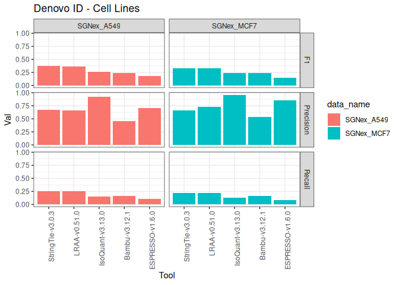
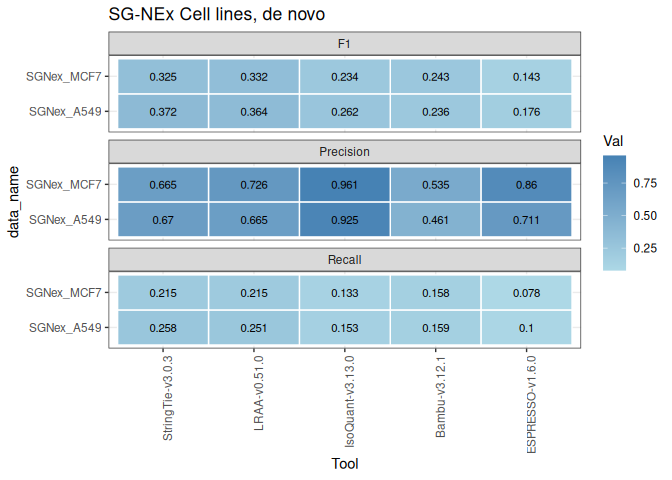
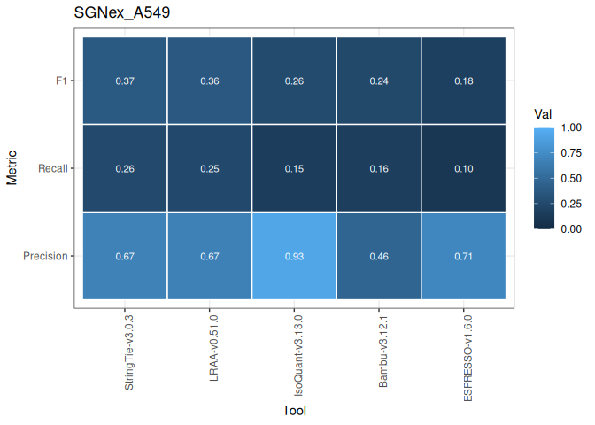
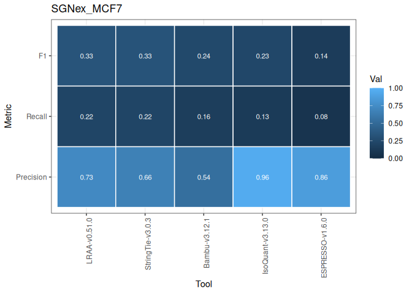
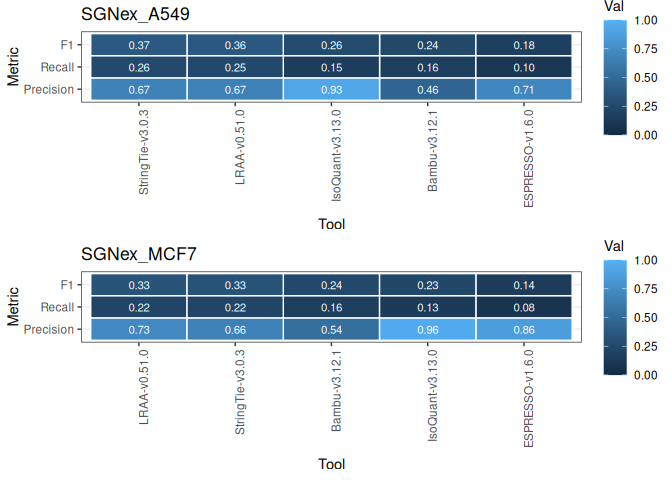

eval_cell_line_denovo_ID.Rmd
================
2025-02-17

``` r
df = read.csv("all.Denovo_ID_summary.tsv", header=T, sep="\t")

df$data_name = str_replace(df$data_name, "CL_", "")
df$data_name = str_replace(df$data_name, "_human", "")

#df = df %>%  separate_wider_delim(data_name, "_", names=c("cell_line", "replicate"))

df = df %>% rename(Tool = Program)

df = df %>% filter(Metric != 'novelTPR')

df = df %>% select(Tool, data_name, Metric, Value)

df %>% head()
```

    ##            Tool  data_name   Metric     Value
    ## 1  LRAA-v0.51.0 SGNex_A549 knownTPR 0.2506480
    ## 2  LRAA-v0.51.0 SGNex_A549 novelFDR 0.3349503
    ## 3  LRAA-v0.51.0 SGNex_A549       F1 0.3640795
    ## 4 Bambu-v3.12.1 SGNex_A549 knownTPR 0.1585671
    ## 5 Bambu-v3.12.1 SGNex_A549 novelFDR 0.5391135
    ## 6 Bambu-v3.12.1 SGNex_A549       F1 0.2359545

``` r
df = df %>% spread(key=Metric, value=Value) 

df = df %>% dplyr::rename(Recall = `knownTPR`) %>% mutate(Precision = 1-novelFDR) %>% select(-novelFDR)

df = df %>% gather(key=Metric, value=Value, F1, Recall, Precision) %>% rename(Val=Value)

df %>% head()
```

    ##               Tool  data_name Metric       Val
    ## 1    Bambu-v3.12.1 SGNex_A549     F1 0.2359545
    ## 2    Bambu-v3.12.1 SGNex_MCF7     F1 0.2434807
    ## 3  ESPRESSO-v1.6.0 SGNex_A549     F1 0.1759779
    ## 4  ESPRESSO-v1.6.0 SGNex_MCF7     F1 0.1432209
    ## 5 IsoQuant-v3.13.0 SGNex_A549     F1 0.2622202
    ## 6 IsoQuant-v3.13.0 SGNex_MCF7     F1 0.2343924

``` r
df2 = df %>% spread(key=Metric, value=Val) %>% mutate(F2 = 2 * (Precision * Recall) / (Precision + Recall) )

df2
```

    ##                Tool  data_name        F1 Precision     Recall        F2
    ## 1     Bambu-v3.12.1 SGNex_A549 0.2359545 0.4608865 0.15856706 0.2359545
    ## 2     Bambu-v3.12.1 SGNex_MCF7 0.2434807 0.5353163 0.15757592 0.2434807
    ## 3   ESPRESSO-v1.6.0 SGNex_A549 0.1759779 0.7111949 0.10041192 0.1759779
    ## 4   ESPRESSO-v1.6.0 SGNex_MCF7 0.1432209 0.8601806 0.07811343 0.1432209
    ## 5  IsoQuant-v3.13.0 SGNex_A549 0.2622202 0.9251577 0.15275849 0.2622202
    ## 6  IsoQuant-v3.13.0 SGNex_MCF7 0.2343924 0.9607768 0.13347794 0.2343924
    ## 7      LRAA-v0.51.0 SGNex_A549 0.3640795 0.6650497 0.25064797 0.3640795
    ## 8      LRAA-v0.51.0 SGNex_MCF7 0.3319729 0.7262500 0.21516242 0.3319729
    ## 9  StringTie-v3.0.3 SGNex_A549 0.3723301 0.6701360 0.25777562 0.3723301
    ## 10 StringTie-v3.0.3 SGNex_MCF7 0.3252822 0.6645172 0.21534758 0.3252822

``` r
prog_ranking = df %>% filter(Metric == "F1") %>% group_by(Tool) %>%
  summarize(mean_F1 = mean(Val)) %>% arrange(desc(mean_F1)) %>% pull(Tool)


df$Tool = factor(df$Tool, levels=prog_ranking)
```

``` r
df %>% ggplot(aes(x=Tool, y=Val, fill=data_name)) + geom_bar(stat='identity', position='dodge') +
  facet_grid(vars(Metric), vars(data_name)) +
  theme_bw() +
   theme(axis.text.x = element_text(angle = 90, hjust = 1)) +
  ggtitle("Denovo ID - Cell Lines")
```

<!-- -->

``` r
get_latest_tools = function(data_df) {

  tool_versions = data_df %>%
    distinct(Tool) %>%
    mutate(Tool = as.character(Tool),
           Tool_Base = str_remove(Tool, "-v[0-9].*$"),
           Version = str_match(Tool, "-v([0-9][0-9A-Za-z.\\-]*)$")[, 2])

  latest_versioned_tools = tool_versions %>%
    filter(! is.na(Version)) %>%
    group_by(Tool_Base) %>%
    # numeric_version() rejects letter suffixes (e.g. 0.18.2b), so rank on the
    # leading numeric run and break ties on the full string:
    #   0.18.3 > 0.18.2b > 0.18.2
    arrange(desc(numeric_version(str_extract(Version, "^[0-9]+(\\.[0-9]+)*"))),
            desc(Version), .by_group = TRUE) %>%
    slice(1) %>%
    ungroup()

  unversioned_tools = tool_versions %>%
    filter(is.na(Version))

  bind_rows(latest_versioned_tools, unversioned_tools) %>%
    pull(Tool)
}

latest_tools = get_latest_tools(df)

latest_tools
```

    ## [1] "Bambu-v3.12.1"    "ESPRESSO-v1.6.0"  "IsoQuant-v3.13.0" "LRAA-v0.51.0"    
    ## [5] "StringTie-v3.0.3"

``` r
df %>% filter(Tool %in% c("StringTie", "LRAA"))
```

    ## [1] Tool      data_name Metric    Val      
    ## <0 rows> (or 0-length row.names)

``` r
SGNEx_denovo_plot = df %>% 
  ggplot(aes(x=Tool, y=data_name, fill=Val)) + 
  geom_tile(color = "white", size = 0.5) +
  geom_text(aes(label = round(Val, 3)), 
            size = 3, 
            color = "black") +
  scale_fill_gradient(low = "lightblue", high = "steelblue") +
  facet_wrap(~Metric, ncol=1) +
  theme_bw() +
  theme(axis.text.x = element_text(angle = 90, hjust = 1)) +
  ggtitle("SG-NEx Cell lines, de novo") +
  labs(x = "Tool", y = "data_name")
```

    ## Warning: Using `size` aesthetic for lines was deprecated in ggplot2 3.4.0.
    ## ℹ Please use `linewidth` instead.
    ## This warning is displayed once per session.
    ## Call `lifecycle::last_lifecycle_warnings()` to see where this warning was
    ## generated.

``` r
ggsave(SGNEx_denovo_plot , file="SGNEx_denovo_plot.pdf", width=6, height=5)

SGNEx_denovo_plot 
```

<!-- -->

# Individual tile plots for each cell line

``` r
# Function to create ranked tile plot for a specific cell line
get_ranked_tile_plot_denovo = function(data_name_val, data_df = df) {
  
  ranked_df = data_df %>% filter(data_name == data_name_val)
  
  # Rank programs by F1 score for this cell line
  ranked_progs = ranked_df %>% 
    filter(Metric == "F1") %>% 
    arrange(desc(Val)) %>% 
    pull(Tool)
  
  ranked_df$Tool = factor(ranked_df$Tool, levels=ranked_progs)
  
  # Create tile plot
  tile_plot = ranked_df %>%
    mutate(Metric = factor(Metric, levels = c("Precision", "Recall", "F1"))) %>%
    ggplot(aes(x=Tool, y=Metric, fill=Val)) + 
    geom_tile(color = "white", size = 0.5) +
    geom_text(aes(label = sprintf("%.2f", Val)), color = "white", size = 3) +
    theme_bw() +
    theme(axis.text.x = element_text(angle = 90, hjust = 1)) +
    scale_fill_gradient(limits = c(0, 1)) +
    ggtitle(data_name_val)
  
  return(tile_plot)
}
```

``` r
# Get unique cell lines
cell_lines = unique(df$data_name)

# Create plots for each cell line
for (cl in cell_lines) {
  assign(paste0(cl, "_tile_plot"), get_ranked_tile_plot_denovo(cl))
}
```

``` r
SGNex_A549_tile_plot
```

<!-- -->

``` r
SGNex_MCF7_tile_plot
```

<!-- -->

``` r
library(cowplot)
```

    ## 
    ## Attaching package: 'cowplot'

    ## The following object is masked from 'package:lubridate':
    ## 
    ##     stamp

``` r
stacked_cell_line_denovo_plots = plot_grid(
  SGNex_A549_tile_plot,
  SGNex_MCF7_tile_plot,
  ncol=1
)

stacked_cell_line_denovo_plots
```

<!-- -->

``` r
ggsave(stacked_cell_line_denovo_plots, file="SG-NEx_cell_lines_denovo_stacked.pdf", width=9, height=5)
```

``` r
latest_df = df %>%
  filter(as.character(Tool) %in% latest_tools)

latest_cell_lines = unique(latest_df$data_name)

for (cl in latest_cell_lines) {
  assign(paste0(cl, "_latest_tile_plot"),
         get_ranked_tile_plot_denovo(cl, latest_df))
}

latest_stacked_cell_line_denovo_plots = plot_grid(
  SGNex_A549_latest_tile_plot,
  SGNex_MCF7_latest_tile_plot,
  ncol=1
)

latest_stacked_cell_line_denovo_plots
```

<!-- -->

``` r
ggsave(latest_stacked_cell_line_denovo_plots,
       file="SG-NEx_cell_lines_denovo_stacked.latest_tools.pdf",
       width=4.25,
       height=5)
```
