Mouse_denovo_eval.Rmd
================
2025-02-15

``` r
get_latest_programs = function(data_df) {

  program_versions = data_df %>%
    distinct(Program) %>%
    mutate(Program = as.character(Program),
           Tool = str_remove(Program, "-v[0-9].*$"),
           Version = str_match(Program, "-v([0-9][0-9A-Za-z.\\-]*)$")[, 2])

  latest_versioned_programs = program_versions %>%
    filter(! is.na(Version)) %>%
    group_by(Tool) %>%
    arrange(dplyr::desc(numeric_version(Version)), .by_group = TRUE) %>%
    dplyr::slice(1) %>%
    ungroup()

  unversioned_programs = program_versions %>%
    filter(is.na(Version))

  bind_rows(latest_versioned_programs, unversioned_programs) %>%
    pull(Program)
}

tpr_fdr_f1_annot_df = read.delim("mouse_isoseqsim.full_transcriptome_TPR_FDR_F1.tsv",
                                  header=T,
                                  sep="\t",
                                  check.names=FALSE,
                                  colClasses="character")

latest_programs = get_latest_programs(tpr_fdr_f1_annot_df)

tpr_fdr_f1_annot_df %>%
  mutate(is_latest_tool_version = as.character(Program) %in% latest_programs) %>%
  write.table(file = "mouse_isoseqsim.full_transcriptome_TPR_FDR_F1.w_latest_tool_version.tsv",
              sep = "\t",
              quote = FALSE,
              row.names = FALSE,
              na = "")

df = read.csv("mouse_isoseqsim.full_transcriptome_TPR_FDR_F1.tsv", header=T, sep="\t") %>%
  dplyr::select(Program, Metric, Value, data_name) %>%
  filter(Metric != 'novelTPR')

df$data_name = str_replace(df$data_name, "mouse_isoseqsim_", "")

df %>% head()
```

    ##         Program   Metric      Value data_name
    ## 1  LRAA-v0.17.5 knownTPR 0.76123565      e000
    ## 2  LRAA-v0.17.5 novelFDR 0.01782955      e000
    ## 3  LRAA-v0.17.5       F1 0.85770397      e000
    ## 4 Bambu-v3.12.1 knownTPR 0.50754407      e000
    ## 5 Bambu-v3.12.1 novelFDR 0.11521441      e000
    ## 6 Bambu-v3.12.1       F1 0.64505941      e000

``` r
df = df %>% spread(key=Metric, value=Value) 

df = df %>% dplyr::rename(Recall = `knownTPR`) %>% mutate(Precision = 1-novelFDR) %>% select(-novelFDR)

df = df %>% gather(key=Metric, value=Value, F1, Recall, Precision)
```

``` r
# define ranking

program_ranking = df %>% filter(Metric == "F1") %>% group_by(Program) %>% 
  summarize(mean_F1 = mean(Value)) %>% arrange(dplyr::desc(mean_F1)) %>% pull(Program)

df$Program = factor(df$Program, levels=program_ranking)
```

``` r
df$Metric = factor(df$Metric, levels = c("F1", "Recall", "Precision"))
```

# F1 by sample error rate

``` r
f1_error_rate_df = df %>%
  filter(Metric == "F1") %>%
  mutate(Sample_error_rate = as.numeric(str_remove(data_name, "^e")) / 1000)

f1_error_rate_plot = f1_error_rate_df %>%
  ggplot(aes(x=Sample_error_rate, y=Value, color=Program, group=Program)) +
  geom_line(linewidth = 0.6, alpha = 0.8) +
  geom_point(size = 1.8) +
  scale_x_continuous(
    breaks = sort(unique(f1_error_rate_df$Sample_error_rate)),
    labels = function(x) sprintf("%.1f%%", x * 100)
  ) +
  coord_cartesian(ylim = c(0, 1)) +
  theme_bw() +
  labs(x = "Sample error rate",
       y = "F1",
       title = "F1 across sample error rates for each method")

f1_error_rate_plot
```

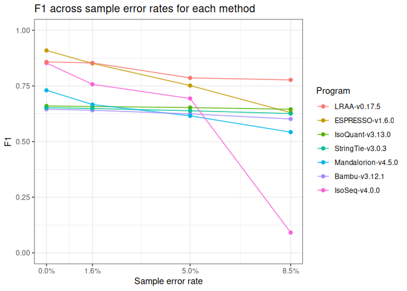<!-- -->

``` r
ggsave(f1_error_rate_plot,
       file="mouse_sim_F1_by_error_rate.pdf",
       width=8,
       height=5)
```

``` r
df %>% ggplot(aes(x=Program, y=Value, fill=Program)) + geom_col() +
  theme_bw() +
  facet_grid(vars(Metric), vars(data_name)) +
  theme(axis.text.x = element_text(angle = 90, hjust = 1)) +
  ggtitle("Ref annotation-free Isoform Discovery Accuracy - mouse-sim")
```

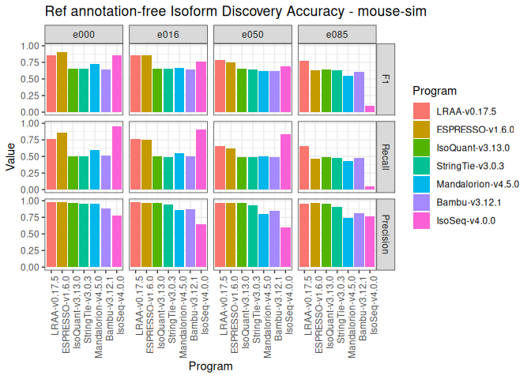<!-- -->

``` r
df %>% ggplot(aes(x=Program, y=Value)) + geom_col() +
  theme_bw() +
  facet_grid(vars(Metric), vars(data_name)) +
  theme(axis.text.x = element_text(angle = 90, hjust = 1)) +
  ggtitle("Ref annotation-free Isoform Discovery Accuracy - mouse-sim")
```

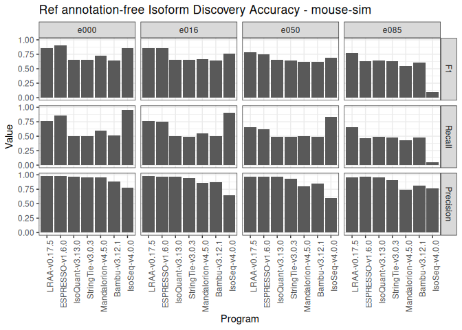<!-- -->

# rank each experiment separately.

``` r
get_ranked_df = function(data_name_val, data_df = df) {

  ranked_df = data_df %>%  filter(data_name == data_name_val) 

  ranked_progs = ranked_df %>% filter(Metric == "F1") %>% arrange(dplyr::desc(Value)) %>% pull(Program)

  ranked_df$Program = factor(ranked_df$Program, levels=ranked_progs)

  return(ranked_df)
  
}
```

``` r
e000_ranked_df = get_ranked_df("e000")

e000_ranked_plot = e000_ranked_df %>% 
  ggplot(aes(x=Program, y=Value)) + geom_col() +
  facet_wrap(~Metric, ncol=1) +
  theme_bw() +
  theme(axis.text.x = element_text(angle = 90, hjust = 1)) +
  ggtitle("e000")

e000_ranked_plot
```

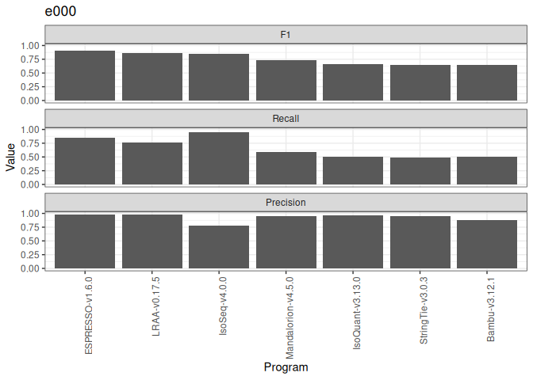<!-- -->

``` r
e016_ranked_df = get_ranked_df("e016")

e016_ranked_plot = e016_ranked_df %>% 
  ggplot(aes(x=Program, y=Value)) + geom_col() +
  facet_wrap(~Metric, ncol=1) +
  theme_bw() +
  theme(axis.text.x = element_text(angle = 90, hjust = 1)) +
  ggtitle("e016")

e016_ranked_plot
```

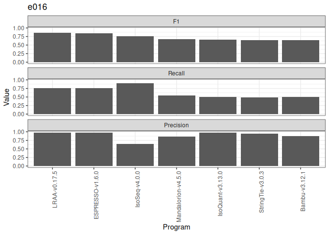<!-- -->

``` r
e050_ranked_df = get_ranked_df("e050")

e050_ranked_plot = e050_ranked_df %>% 
  ggplot(aes(x=Program, y=Value)) + geom_col() +
  facet_wrap(~Metric, ncol=1) +
  theme_bw() +
  theme(axis.text.x = element_text(angle = 90, hjust = 1)) +
  ggtitle("e050")

e050_ranked_plot
```

<!-- -->

``` r
e085_ranked_df = get_ranked_df("e085")

e085_ranked_plot = e085_ranked_df %>% 
  ggplot(aes(x=Program, y=Value)) + geom_col() +
  facet_wrap(~Metric, ncol=1) +
  theme_bw() +
  theme(axis.text.x = element_text(angle = 90, hjust = 1)) +
  ggtitle("e085")

e085_ranked_plot
```

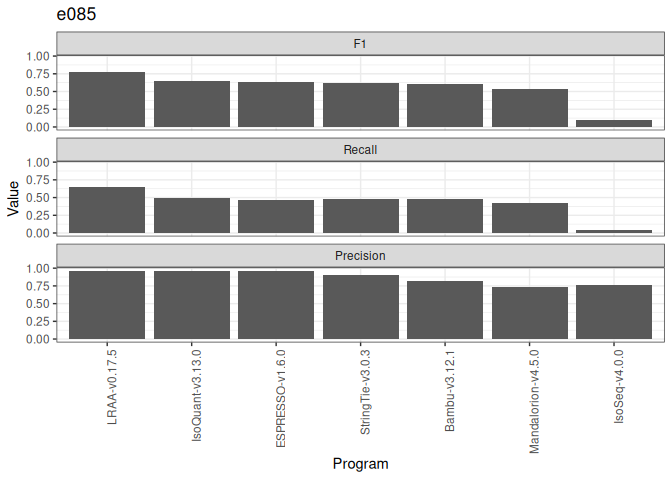<!-- -->

``` r
library(cowplot)
```

    ## 
    ## Attaching package: 'cowplot'

    ## The following object is masked from 'package:lubridate':
    ## 
    ##     stamp

``` r
plot_grid(e000_ranked_plot,
          e016_ranked_plot,
          e050_ranked_plot,
          e085_ranked_plot, 
          nrow=1)
```

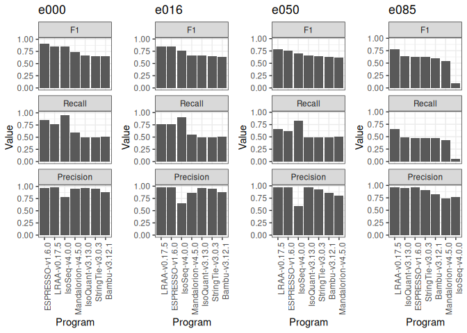<!-- -->

# use heatmap reprsentations for condensed view.

``` r
e000_ranked_tile_plot = e000_ranked_df %>%  
  mutate(Metric = factor(Metric, levels = c("Precision", "Recall", "F1"))) %>%
  ggplot(aes(x=Program, y=Metric, fill=Value)) + 
  geom_tile(color = "white", size = 0.5) +
  geom_text(aes(label = sprintf("%.2f", Value)), color = "white", size = 3) +
  theme_bw() +
  theme(axis.text.x = element_text(angle = 90, hjust = 1)) +
   scale_fill_gradient(limits = c(0, 1)) +
  ggtitle("e000")
```

    ## Warning: Using `size` aesthetic for lines was deprecated in ggplot2 3.4.0.
    ## ℹ Please use `linewidth` instead.
    ## This warning is displayed once per session.
    ## Call `lifecycle::last_lifecycle_warnings()` to see where this warning was
    ## generated.

``` r
e000_ranked_tile_plot
```

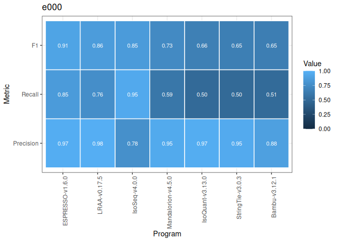<!-- -->

``` r
e016_ranked_tile_plot = e016_ranked_df %>%  
  mutate(Metric = factor(Metric, levels = c("Precision", "Recall", "F1"))) %>%
  ggplot(aes(x=Program, y=Metric, fill=Value)) + 
  geom_tile(color = "white", size = 0.5) +
  geom_text(aes(label = sprintf("%.2f", Value)), color = "white", size = 3) +
  theme_bw() +
  theme(axis.text.x = element_text(angle = 90, hjust = 1)) +
   scale_fill_gradient(limits = c(0, 1)) +
  ggtitle("e016")

e016_ranked_tile_plot
```

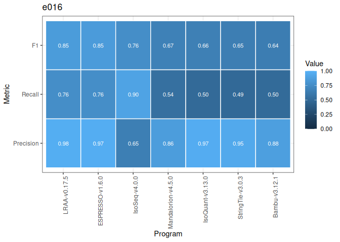<!-- -->

``` r
e050_ranked_tile_plot = e050_ranked_df %>%  
  mutate(Metric = factor(Metric, levels = c("Precision", "Recall", "F1"))) %>%
  ggplot(aes(x=Program, y=Metric, fill=Value)) + 
  geom_tile(color = "white", size = 0.5) +
  geom_text(aes(label = sprintf("%.2f", Value)), color = "white", size = 3) +
  theme_bw() +
  theme(axis.text.x = element_text(angle = 90, hjust = 1)) +
   scale_fill_gradient(limits = c(0, 1)) +
  ggtitle("e050")

e050_ranked_tile_plot
```

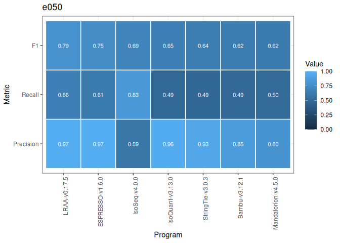<!-- -->

``` r
e085_ranked_tile_plot = e085_ranked_df %>%  
  mutate(Metric = factor(Metric, levels = c("Precision", "Recall", "F1"))) %>%
  ggplot(aes(x=Program, y=Metric, fill=Value)) + 
  geom_tile(color = "white", size = 0.5) +
  geom_text(aes(label = sprintf("%.2f", Value)), color = "white", size = 3) +
  theme_bw() +
  theme(axis.text.x = element_text(angle = 90, hjust = 1)) +
   scale_fill_gradient(limits = c(0, 1)) +
  ggtitle("e085")

e085_ranked_tile_plot
```

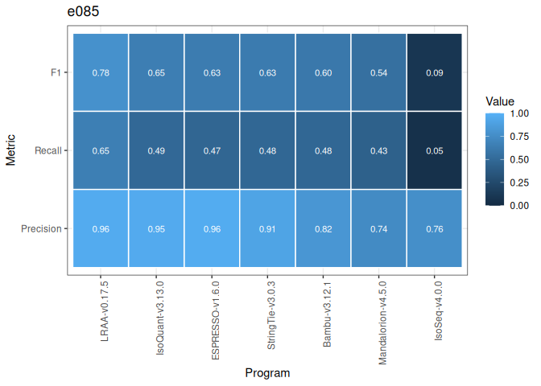<!-- -->

``` r
stacked_tile_plot = plot_grid(e000_ranked_tile_plot,
          e016_ranked_tile_plot,
          e050_ranked_tile_plot,
          e085_ranked_tile_plot, 
          ncol=1)

stacked_tile_plot 
```

<!-- -->

``` r
ggsave(stacked_tile_plot, file="mouse_sim_summary.pdf", width=8, height=10)
```

# analyses restricted to latest tool versions, retaining unversioned and single-version tools.

``` r
latest_programs = get_latest_programs(df)

latest_programs
```

    ## [1] "Bambu-v3.12.1"      "ESPRESSO-v1.6.0"    "IsoQuant-v3.13.0"  
    ## [4] "IsoSeq-v4.0.0"      "LRAA-v0.17.5"       "Mandalorion-v4.5.0"
    ## [7] "StringTie-v3.0.3"

``` r
latest_program_df = df %>%
  filter(as.character(Program) %in% latest_programs)

latest_program_ranking = latest_program_df %>%
  filter(Metric == "F1") %>%
  group_by(Program) %>%
  summarize(mean_F1 = mean(Value), .groups = "drop") %>%
  arrange(dplyr::desc(mean_F1)) %>%
  pull(Program)

latest_program_df$Program = factor(latest_program_df$Program,
                                   levels = latest_program_ranking)

latest_f1_error_rate_df = latest_program_df %>%
  filter(Metric == "F1") %>%
  mutate(Sample_error_rate = as.numeric(str_remove(data_name, "^e")) / 1000)

latest_f1_error_rate_plot = latest_f1_error_rate_df %>%
  ggplot(aes(x=Sample_error_rate, y=Value, color=Program, group=Program)) +
  geom_line(linewidth = 0.7, alpha = 0.9) +
  geom_point(size = 2) +
  scale_x_continuous(
    breaks = sort(unique(latest_f1_error_rate_df$Sample_error_rate)),
    labels = function(x) sprintf("%.1f%%", x * 100)
  ) +
  coord_cartesian(ylim = c(0, 1)) +
  theme_bw() +
  labs(x = "Sample error rate",
       y = "F1",
       title = "F1 across sample error rates for latest tool versions")

latest_f1_error_rate_plot
```

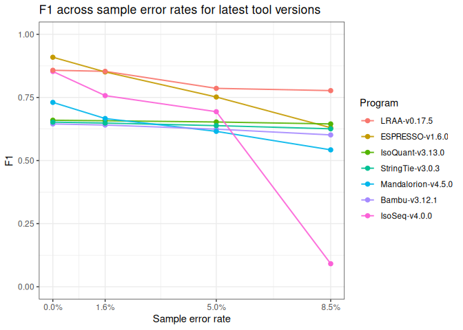<!-- -->

``` r
ggsave(latest_f1_error_rate_plot,
       file="mouse_sim_F1_by_error_rate.latest_tools.pdf",
       width=8,
       height=5)
```

``` r
make_ranked_tile_plot = function(ranked_df, plot_title) {

  ranked_df %>%
    mutate(Metric = factor(Metric, levels = c("Precision", "Recall", "F1"))) %>%
    ggplot(aes(x=Program, y=Metric, fill=Value)) +
    geom_tile(color = "white", size = 0.5) +
    geom_text(aes(label = sprintf("%.2f", Value)), color = "white", size = 3) +
    theme_bw() +
    theme(axis.text.x = element_text(angle = 90, hjust = 1)) +
    scale_fill_gradient(limits = c(0, 1)) +
    ggtitle(plot_title)
}

latest_ranked_tile_plots = c("e000", "e016", "e050", "e085") %>%
  map(function(data_name_val) {
    get_ranked_df(data_name_val, latest_program_df) %>%
      make_ranked_tile_plot(data_name_val)
  })

latest_stacked_tile_plot = plot_grid(plotlist = latest_ranked_tile_plots,
                                     ncol=1)

latest_stacked_tile_plot
```

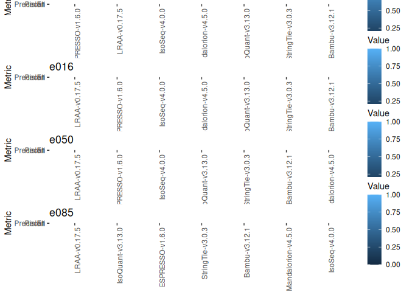<!-- -->

``` r
ggsave(latest_stacked_tile_plot,
       file="mouse_sim_summary.latest_tools.pdf",
       width=4.5,
       height=10)
```
