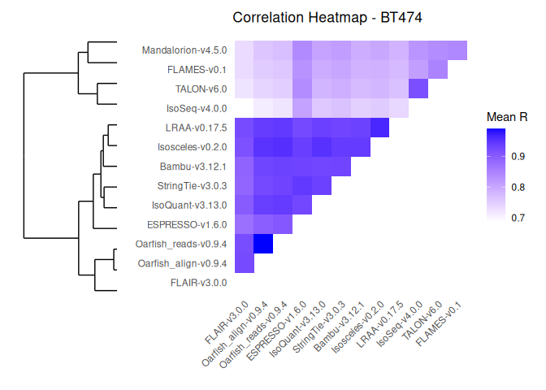
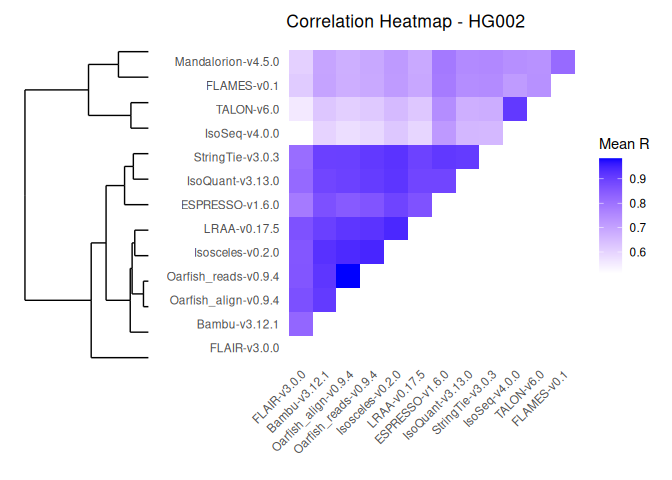
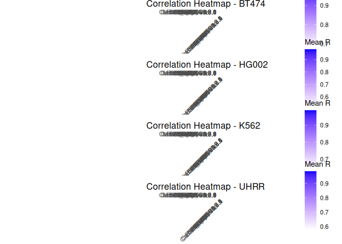

examine_expr_correlations
================
2025-08-01

``` r
expr_cors = read.csv("all_expr_correlations.tsv", header=T, sep="\t", check.names=FALSE) %>% rename(methodA = `Unnamed: 0`)

expr_cors %>% head()
```

    ##            methodA LRAA-v0.17.5 ESPRESSO-v1.6.0 FLAIR-v3.0.0 FLAMES-v0.1
    ## 1     LRAA-v0.17.5    1.0000000       0.9134285    0.9075391   0.7676347
    ## 2  ESPRESSO-v1.6.0    0.9134285       1.0000000    0.8549684   0.8239118
    ## 3     FLAIR-v3.0.0    0.9075391       0.8549684    1.0000000   0.7149560
    ## 4      FLAMES-v0.1    0.7676347       0.8239118    0.7149560   1.0000000
    ## 5 IsoQuant-v3.13.0    0.9258760       0.9205332    0.8827696   0.7925885
    ## 6 Isosceles-v0.2.0    0.9560453       0.9330772    0.8988877   0.7845103
    ##   IsoQuant-v3.13.0 Isosceles-v0.2.0 IsoSeq-v4.0.0 Mandalorion-v4.5.0
    ## 1        0.9258760        0.9560453     0.7040137          0.7724533
    ## 2        0.9205332        0.9330772     0.7823373          0.8324990
    ## 3        0.8827696        0.8988877     0.6445646          0.7094486
    ## 4        0.7925885        0.7845103     0.7849317          0.8433797
    ## 5        1.0000000        0.9468987     0.7307546          0.8023255
    ## 6        0.9468987        1.0000000     0.7253088          0.7943131
    ##   Oarfish_align-v0.9.4 Oarfish_reads-v0.9.4 Bambu-v3.12.1 StringTie-v3.0.3
    ## 1            0.9324733            0.9360480     0.9217337        0.9219448
    ## 2            0.8882734            0.8975462     0.9154531        0.9362622
    ## 3            0.9093282            0.9039575     0.8730933        0.8708460
    ## 4            0.7469785            0.7544603     0.7799729        0.7985991
    ## 5            0.9285630            0.9336526     0.9211537        0.9306266
    ## 6            0.9460687            0.9508058     0.9362070        0.9410232
    ##   TALON-v6.0        data_name
    ## 1  0.7269040 CL_K562_E0_human
    ## 2  0.8046504 CL_K562_E0_human
    ## 3  0.6738466 CL_K562_E0_human
    ## 4  0.8132968 CL_K562_E0_human
    ## 5  0.7483047 CL_K562_E0_human
    ## 6  0.7462631 CL_K562_E0_human

``` r
expr_cors = expr_cors %>% separate_wider_delim(data_name, delim = "_", 
                      names = c("prefix", "cell_line", "replicate", "suffix"),
                      too_few = "align_start") %>%
  select(-prefix, -suffix)

expr_cors %>% head()
```

    ## # A tibble: 6 × 16
    ##   methodA          `LRAA-v0.17.5` `ESPRESSO-v1.6.0` `FLAIR-v3.0.0` `FLAMES-v0.1`
    ##   <chr>                     <dbl>             <dbl>          <dbl>         <dbl>
    ## 1 LRAA-v0.17.5              1                 0.913          0.908         0.768
    ## 2 ESPRESSO-v1.6.0           0.913             1              0.855         0.824
    ## 3 FLAIR-v3.0.0              0.908             0.855          1             0.715
    ## 4 FLAMES-v0.1               0.768             0.824          0.715         1    
    ## 5 IsoQuant-v3.13.0          0.926             0.921          0.883         0.793
    ## 6 Isosceles-v0.2.0          0.956             0.933          0.899         0.785
    ## # ℹ 11 more variables: `IsoQuant-v3.13.0` <dbl>, `Isosceles-v0.2.0` <dbl>,
    ## #   `IsoSeq-v4.0.0` <dbl>, `Mandalorion-v4.5.0` <dbl>,
    ## #   `Oarfish_align-v0.9.4` <dbl>, `Oarfish_reads-v0.9.4` <dbl>,
    ## #   `Bambu-v3.12.1` <dbl>, `StringTie-v3.0.3` <dbl>, `TALON-v6.0` <dbl>,
    ## #   cell_line <chr>, replicate <chr>

``` r
expr_cors = expr_cors %>% gather(key='methodB', value='cor_val', -methodA, -cell_line, -replicate)


expr_cors %>% head()
```

    ## # A tibble: 6 × 5
    ##   methodA          cell_line replicate methodB      cor_val
    ##   <chr>            <chr>     <chr>     <chr>          <dbl>
    ## 1 LRAA-v0.17.5     K562      E0        LRAA-v0.17.5   1    
    ## 2 ESPRESSO-v1.6.0  K562      E0        LRAA-v0.17.5   0.913
    ## 3 FLAIR-v3.0.0     K562      E0        LRAA-v0.17.5   0.908
    ## 4 FLAMES-v0.1      K562      E0        LRAA-v0.17.5   0.768
    ## 5 IsoQuant-v3.13.0 K562      E0        LRAA-v0.17.5   0.926
    ## 6 Isosceles-v0.2.0 K562      E0        LRAA-v0.17.5   0.956

``` r
# determine mean cor_val across replicates

expr_cors_mean = expr_cors %>% group_by(cell_line, methodA, methodB) %>% summarize(mean_R = mean(cor_val))
```

    ## `summarise()` has regrouped the output.
    ## ℹ Summaries were computed grouped by cell_line, methodA, and methodB.
    ## ℹ Output is grouped by cell_line and methodA.
    ## ℹ Use `summarise(.groups = "drop_last")` to silence this message.
    ## ℹ Use `summarise(.by = c(cell_line, methodA, methodB))` for per-operation
    ##   grouping (`?dplyr::dplyr_by`) instead.

``` r
expr_cors_mean %>% head()
```

    ## # A tibble: 6 × 4
    ## # Groups:   cell_line, methodA [1]
    ##   cell_line methodA       methodB          mean_R
    ##   <chr>     <chr>         <chr>             <dbl>
    ## 1 BT474     Bambu-v3.12.1 Bambu-v3.12.1     1    
    ## 2 BT474     Bambu-v3.12.1 ESPRESSO-v1.6.0   0.931
    ## 3 BT474     Bambu-v3.12.1 FLAIR-v3.0.0      0.891
    ## 4 BT474     Bambu-v3.12.1 FLAMES-v0.1       0.786
    ## 5 BT474     Bambu-v3.12.1 IsoQuant-v3.13.0  0.928
    ## 6 BT474     Bambu-v3.12.1 IsoSeq-v4.0.0     0.747

``` r
get_latest_methods = function(methods) {

  method_versions = tibble(method = methods) %>%
    distinct(method) %>%
    mutate(method = as.character(method),
           Tool = str_remove(method, "-v[0-9].*$"),
           Version = str_match(method, "-v([0-9][0-9A-Za-z.\\-]*)$")[, 2])

  latest_versioned = method_versions %>%
    filter(! is.na(Version)) %>%
    group_by(Tool) %>%
    arrange(dplyr::desc(numeric_version(Version)), .by_group = TRUE) %>%
    dplyr::slice(1) %>%
    ungroup()

  unversioned = method_versions %>%
    filter(is.na(Version))

  bind_rows(latest_versioned, unversioned) %>%
    pull(method)
}

latest_methods = get_latest_methods(c(expr_cors$methodA, expr_cors$methodB))

latest_methods
```

    ##  [1] "Bambu-v3.12.1"        "ESPRESSO-v1.6.0"      "FLAIR-v3.0.0"        
    ##  [4] "FLAMES-v0.1"          "IsoQuant-v3.13.0"     "IsoSeq-v4.0.0"       
    ##  [7] "Isosceles-v0.2.0"     "LRAA-v0.17.5"         "Mandalorion-v4.5.0"  
    ## [10] "Oarfish_align-v0.9.4" "Oarfish_reads-v0.9.4" "StringTie-v3.0.3"    
    ## [13] "TALON-v6.0"

``` r
library(ggplot2)
library(dplyr)
library(cluster)
library(ggdendro)
library(patchwork)

heatmap_cor_plot_with_dendrogram = function(cell_line_selected, methods_filter = NULL) {
  # Filter data for selected cell line
  data_filtered <- expr_cors_mean %>% 
    filter(cell_line == cell_line_selected)

  if (! is.null(methods_filter)) {
    data_filtered <- data_filtered %>%
      filter(as.character(methodA) %in% methods_filter,
             as.character(methodB) %in% methods_filter)
  }
  
  # Create a wide-format correlation matrix for clustering
  cor_matrix <- data_filtered %>%
    select(methodA, methodB, mean_R) %>%
    tidyr::pivot_wider(names_from = methodB, values_from = mean_R) %>%
    column_to_rownames("methodA") %>%
    as.matrix()
  
  # Perform hierarchical clustering
  dist_matrix <- dist(cor_matrix)
  hclust_result <- hclust(dist_matrix, method = "complete")
  
  # Get the dendrogram order
  method_order <- rownames(cor_matrix)[hclust_result$order]
  n_methods <- length(method_order)
  
  # Create upper triangle mask and reorder data
  plot_data <- data_filtered %>%
    # Convert to factors with dendrogram order
    mutate(
      methodA = factor(methodA, levels = method_order),
      methodB = factor(methodB, levels = method_order)
    ) %>%
    # Keep only the strict upper triangle, excluding self-correlations
    filter(as.numeric(methodA) < as.numeric(methodB))
  
  # Create the heatmap plot
  heatmap_plot <- ggplot(plot_data, aes(x = methodA, y = methodB, fill = mean_R)) +
    geom_tile() +
    scale_fill_gradient(
      low = "white", 
      high = "blue",
      name = "Mean R"
    ) +
    scale_y_discrete(limits = method_order) +
    theme_minimal() +
    theme(
      axis.text.x = element_text(angle = 45, hjust = 1),
      axis.text.y = element_text(),
      axis.title = element_blank(),
      panel.grid = element_blank()
    ) +
    coord_fixed() +
    labs(title = paste("Correlation Heatmap -", cell_line_selected))
  
  # Create dendrogram plot
  dend_data <- dendro_data(hclust_result)
  
  dend_plot <- ggplot(segment(dend_data)) +
    geom_segment(aes(x = x, y = y, xend = xend, yend = yend)) +
    scale_x_continuous(limits = c(0.5, n_methods + 0.5), expand = c(0, 0)) +
    coord_flip() +
    scale_y_reverse(expand = c(0, 0.1)) +
    theme_void() +
    theme(plot.margin = margin(t = 5, r = 0, b = 5, l = 5))
  
  # Use patchwork to combine - it should preserve alignment
  combined <- dend_plot + heatmap_plot + 
    plot_layout(widths = c(1.5, 3))
  
  return(combined)
}
```

``` r
BT474_plot = heatmap_cor_plot_with_dendrogram("BT474")
```

    ## Adding missing grouping variables: `cell_line`

    ## Warning in dist(cor_matrix): NAs introduced by coercion

``` r
ggsave(BT474_plot, file="BT474_expr_cor_plot.pdf", 
       width = 6, height = 4, units = "in")
BT474_plot
```

<!-- -->

``` r
HG002_plot = heatmap_cor_plot_with_dendrogram("HG002")
```

    ## Adding missing grouping variables: `cell_line`

    ## Warning in dist(cor_matrix): NAs introduced by coercion

``` r
ggsave(HG002_plot, file="HG002_expr_cor_plot.pdf", 
       width = 6, height = 4, units = "in")

HG002_plot
```

<!-- -->

``` r
K562_plot = heatmap_cor_plot_with_dendrogram("K562")
```

    ## Adding missing grouping variables: `cell_line`

    ## Warning in dist(cor_matrix): NAs introduced by coercion

``` r
ggsave(K562_plot, file="K562_expr_cor_plot.pdf", 
       width = 6, height = 4, units = "in")

K562_plot
```

<!-- -->

``` r
UHRR_plot = heatmap_cor_plot_with_dendrogram("UHRR")
```

    ## Adding missing grouping variables: `cell_line`

    ## Warning in dist(cor_matrix): NAs introduced by coercion

``` r
ggsave(UHRR_plot, file="UHRR_expr_cor_plot.pdf", 
       width = 6, height = 4, units = "in")

UHRR_plot
```

<!-- -->

``` r
library(cowplot)
```

    ## 
    ## Attaching package: 'cowplot'

    ## The following object is masked from 'package:patchwork':
    ## 
    ##     align_plots

    ## The following object is masked from 'package:lubridate':
    ## 
    ##     stamp

``` r
# Use patchwork for the entire combination
combo_plot = plot_grid(BT474_plot, HG002_plot, 
                        K562_plot, UHRR_plot,
                        ncol=1)

# Save using pdf() device instead of ggsave
pdf("summary_CellLines_corr_plots.pdf", width=7, height=20)
print(combo_plot)
dev.off()
```

    ## png 
    ##   2

``` r
# For display
combo_plot
```

<!-- -->

``` r
BT474_latest_plot = heatmap_cor_plot_with_dendrogram("BT474", latest_methods)
```

    ## Adding missing grouping variables: `cell_line`

    ## Warning in dist(cor_matrix): NAs introduced by coercion

``` r
ggsave(BT474_latest_plot, file="BT474_expr_cor_plot.latest_tools.pdf",
       width = 6, height = 4, units = "in")

HG002_latest_plot = heatmap_cor_plot_with_dendrogram("HG002", latest_methods)
```

    ## Adding missing grouping variables: `cell_line`

    ## Warning in dist(cor_matrix): NAs introduced by coercion

``` r
ggsave(HG002_latest_plot, file="HG002_expr_cor_plot.latest_tools.pdf",
       width = 6, height = 4, units = "in")

K562_latest_plot = heatmap_cor_plot_with_dendrogram("K562", latest_methods)
```

    ## Adding missing grouping variables: `cell_line`

    ## Warning in dist(cor_matrix): NAs introduced by coercion

``` r
ggsave(K562_latest_plot, file="K562_expr_cor_plot.latest_tools.pdf",
       width = 6, height = 4, units = "in")

UHRR_latest_plot = heatmap_cor_plot_with_dendrogram("UHRR", latest_methods)
```

    ## Adding missing grouping variables: `cell_line`

    ## Warning in dist(cor_matrix): NAs introduced by coercion

``` r
ggsave(UHRR_latest_plot, file="UHRR_expr_cor_plot.latest_tools.pdf",
       width = 6, height = 4, units = "in")

latest_combo_plot = plot_grid(BT474_latest_plot, HG002_latest_plot,
                              K562_latest_plot, UHRR_latest_plot,
                              ncol=1)

pdf("summary_CellLines_corr_plots.latest_tools.pdf", width=7, height=20)
print(latest_combo_plot)
dev.off()
```

    ## png 
    ##   2

``` r
latest_combo_plot
```

<!-- -->
