MORFs QUANT_only_summary
================
2025-02-14

# MORFs

## Pearson Cor

``` r
morf2_pearson_cor_df = read.csv("morf2.pearson_cor.tsv", header=T, sep="\t")  %>% dplyr::select(name, cor_value, data_name)

morf2_pearson_cor_df$data_name = str_replace(morf2_pearson_cor_df$data_name, "morf2_", "")

morf2_pearson_cor_df %>% head()
```

    ##                   name cor_value                        data_name
    ## 1         LRAA-v0.17.5 0.9609754 ont_merged_annot_compat_1isoform
    ## 2         FLAIR-v3.0.0 0.9457191 ont_merged_annot_compat_1isoform
    ## 3     Isosceles-v0.2.0 0.7924134 ont_merged_annot_compat_1isoform
    ## 4          FLAMES-v0.1 0.7454203 ont_merged_annot_compat_1isoform
    ## 5        Bambu-v3.12.1 0.7318048 ont_merged_annot_compat_1isoform
    ## 6 Oarfish_align-v0.9.4 0.6931725 ont_merged_annot_compat_1isoform

``` r
# rank according to mean cor val
pearson_cor_df_ranking = morf2_pearson_cor_df %>% group_by(name) %>% summarize(mcor = mean(cor_value)) %>% arrange(dplyr::desc(mcor)) %>% pull(name)


morf2_pearson_cor_df$name = factor(morf2_pearson_cor_df$name, levels=pearson_cor_df_ranking)
```

``` r
morf2_pearson_cor_df %>% ggplot(aes(x=name, y=cor_value)) + geom_col() +
  theme_bw() +
  theme(axis.text.x = element_text(angle = 90, hjust = 1)) +
  facet_wrap(~data_name, nrow=1) +
  ggtitle("MORFs - Pearson cor")
```

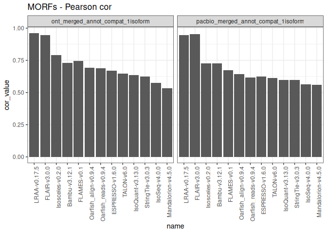<!-- -->

## Spearman Cor

``` r
morf2_spearman_cor_df = read.csv("morf2.spearman_cor.tsv", header=T, sep="\t")  %>% dplyr::select(name, cor_value, data_name)

morf2_spearman_cor_df$data_name = str_replace(morf2_spearman_cor_df$data_name, "morf2_", "")

morf2_spearman_cor_df %>% head()
```

    ##                   name cor_value                        data_name
    ## 1         LRAA-v0.17.5 0.9691281 ont_merged_annot_compat_1isoform
    ## 2         FLAIR-v3.0.0 0.9547624 ont_merged_annot_compat_1isoform
    ## 3        Bambu-v3.12.1 0.8587150 ont_merged_annot_compat_1isoform
    ## 4          FLAMES-v0.1 0.8244441 ont_merged_annot_compat_1isoform
    ## 5     Isosceles-v0.2.0 0.8232688 ont_merged_annot_compat_1isoform
    ## 6 Oarfish_align-v0.9.4 0.8231573 ont_merged_annot_compat_1isoform

``` r
# rank according to mean cor val
spearman_cor_df_ranking = morf2_spearman_cor_df %>% group_by(name) %>% summarize(mcor = mean(cor_value)) %>% arrange(dplyr::desc(mcor)) %>% pull(name)


morf2_spearman_cor_df$name = factor(morf2_spearman_cor_df$name, levels=pearson_cor_df_ranking)
```

``` r
morf2_spearman_cor_df %>% ggplot(aes(x=name, y=cor_value)) + geom_col() +
   theme_bw() +
   theme(axis.text.x = element_text(angle = 90, hjust = 1)) +
   facet_wrap(~data_name, nrow=1) +
  ggtitle("MORFs - Spearman cor")
```

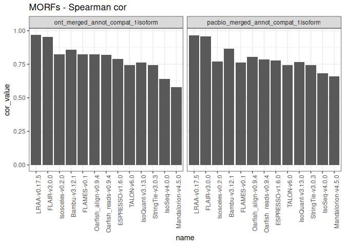<!-- -->

## Median relative difference

``` r
morf2_median_rel_diff = read.csv("morf2.median_rel_diff.tsv", sep="\t", header=T) %>%
  dplyr::select(name, rel_diff, data_name)

morf2_median_rel_diff$data_name  = str_replace(morf2_median_rel_diff$data_name, "morf2_", "")

morf2_median_rel_diff %>% head()
```

    ##                   name   rel_diff                        data_name
    ## 1         LRAA-v0.17.5 0.01561300 ont_merged_annot_compat_1isoform
    ## 2 Oarfish_reads-v0.9.4 0.02367004 ont_merged_annot_compat_1isoform
    ## 3 Oarfish_align-v0.9.4 0.02389556 ont_merged_annot_compat_1isoform
    ## 4        Bambu-v3.12.1 0.03052011 ont_merged_annot_compat_1isoform
    ## 5         FLAIR-v3.0.0 0.08428712 ont_merged_annot_compat_1isoform
    ## 6     Isosceles-v0.2.0 0.11986438 ont_merged_annot_compat_1isoform

``` r
# rank according to median relative difference
mrel_median_diff_ranking = morf2_median_rel_diff %>% group_by(name) %>% summarize(mrel_diff = mean(rel_diff)) %>% arrange(mrel_diff) %>% pull(name)


morf2_median_rel_diff$name = factor(morf2_median_rel_diff$name, levels=mrel_median_diff_ranking)
```

``` r
morf2_median_rel_diff %>% ggplot(aes(x=name, y=rel_diff)) + geom_col() +
    theme_bw() +
   theme(axis.text.x = element_text(angle = 90, hjust = 1)) +
  facet_wrap(~data_name, nrow=1) +
  ggtitle("median relative difference - morf2") 
```

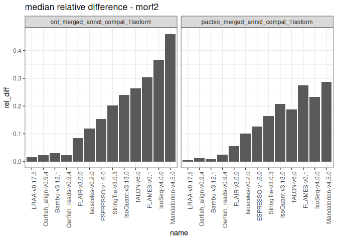<!-- -->

``` r
pbio_morf2_median_rel_diff = morf2_median_rel_diff %>% filter(grepl("pacbio_", data_name))

pbio_morf2_median_rel_rankings = pbio_morf2_median_rel_diff %>% arrange(rel_diff) %>% pull(name)


pbio_morf2_median_rel_diff$name = factor(pbio_morf2_median_rel_diff$name, levels=pbio_morf2_median_rel_rankings)
```

``` r
pbio_morf2_median_rel_diff_plot = pbio_morf2_median_rel_diff %>% 
  ggplot(aes(x=name, y=rel_diff)) + geom_col() +
    theme_bw() +
   theme(axis.text.x = element_text(angle = 90, hjust = 1))  +
  ggtitle("pacbio morf2 median rel diff")

pbio_morf2_median_rel_diff_plot 
```

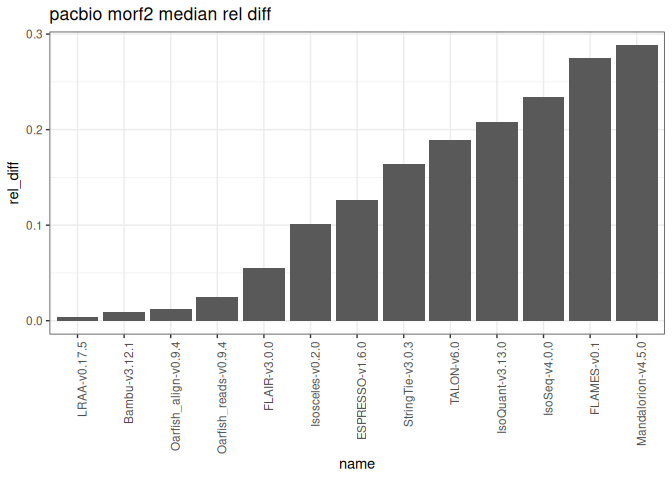<!-- -->

``` r
ont_morf2_median_rel_diff = morf2_median_rel_diff %>% filter(grepl("ont_", data_name))

ont_morf2_median_rel_rankings = ont_morf2_median_rel_diff %>% arrange(rel_diff) %>% pull(name)


ont_morf2_median_rel_diff$name = factor(ont_morf2_median_rel_diff$name, levels=ont_morf2_median_rel_rankings)
```

``` r
ont_morf2_median_rel_diff_plot = ont_morf2_median_rel_diff %>% 
  ggplot(aes(x=name, y=rel_diff)) + geom_col() +
    theme_bw() +
   theme(axis.text.x = element_text(angle = 90, hjust = 1))  +
  ggtitle("ONT morf2 median rel diff")

ont_morf2_median_rel_diff_plot 
```

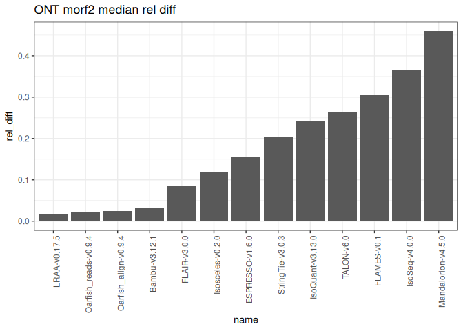<!-- -->

## Mean relative difference

``` r
morf2_mean_rel_diff = read.csv("morf2.mean_rel_diff.tsv", sep="\t", header=T) %>%
  dplyr::select(name, rel_diff, data_name)

morf2_mean_rel_diff$data_name  = str_replace(morf2_mean_rel_diff$data_name, "morf2_", "")

morf2_mean_rel_diff %>% head()
```

    ##                   name  rel_diff                        data_name
    ## 1         LRAA-v0.17.5 0.1125271 ont_merged_annot_compat_1isoform
    ## 2        Bambu-v3.12.1 0.2555935 ont_merged_annot_compat_1isoform
    ## 3         FLAIR-v3.0.0 0.2565504 ont_merged_annot_compat_1isoform
    ## 4 Oarfish_align-v0.9.4 0.3208770 ont_merged_annot_compat_1isoform
    ## 5 Oarfish_reads-v0.9.4 0.3224266 ont_merged_annot_compat_1isoform
    ## 6     Isosceles-v0.2.0 0.4076830 ont_merged_annot_compat_1isoform

``` r
# rank according to median relative difference
mrel_mean_diff_ranking = morf2_mean_rel_diff %>% group_by(name) %>% summarize(mrel_diff = mean(rel_diff)) %>% arrange(mrel_diff) %>% pull(name)


morf2_mean_rel_diff$name = factor(morf2_mean_rel_diff$name, levels=mrel_mean_diff_ranking)
```

``` r
morf2_mean_rel_diff %>% ggplot(aes(x=name, y=rel_diff)) + geom_col() +
  theme_bw() +
   theme(axis.text.x = element_text(angle = 90, hjust = 1)) +
  facet_wrap(~data_name, nrow=1) +
  ggtitle("mean relative diffference - morf2")
```

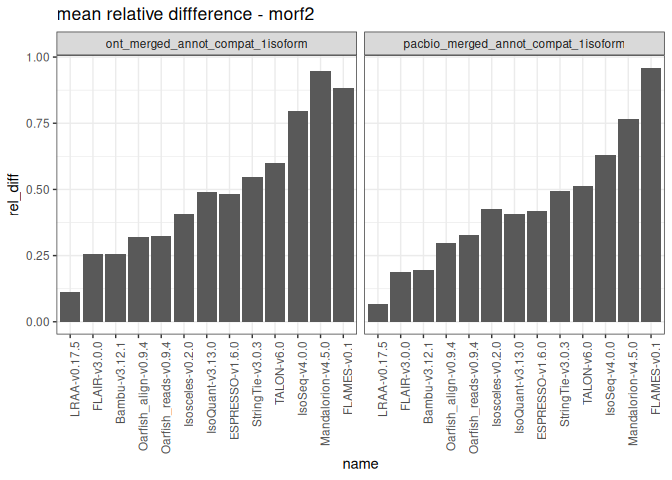<!-- -->

``` r
get_latest_programs = function(data_df) {

  program_versions = data_df %>%
    distinct(name) %>%
    mutate(name = as.character(name),
           Tool = str_remove(name, "-v[0-9].*$"),
           Version = str_match(name, "-v([0-9][0-9A-Za-z.\\-]*)$")[, 2])

  latest_versioned_programs = program_versions %>%
    filter(! is.na(Version)) %>%
    group_by(Tool) %>%
    arrange(dplyr::desc(numeric_version(Version)), .by_group = TRUE) %>%
    dplyr::slice(1) %>%
    ungroup()

  unversioned_programs = program_versions %>%
    filter(is.na(Version))

  bind_rows(latest_versioned_programs, unversioned_programs) %>%
    pull(name)
}

latest_programs = get_latest_programs(morf2_mean_rel_diff)

latest_programs
```

    ##  [1] "Bambu-v3.12.1"        "ESPRESSO-v1.6.0"      "FLAIR-v3.0.0"        
    ##  [4] "FLAMES-v0.1"          "IsoQuant-v3.13.0"     "IsoSeq-v4.0.0"       
    ##  [7] "Isosceles-v0.2.0"     "LRAA-v0.17.5"         "Mandalorion-v4.5.0"  
    ## [10] "Oarfish_align-v0.9.4" "Oarfish_reads-v0.9.4" "StringTie-v3.0.3"    
    ## [13] "TALON-v6.0"

``` r
pbio_only_plot = morf2_mean_rel_diff %>% 
  filter(grepl("pacbio", data_name)) %>%
  
  
  ggplot(aes(x=name, y=rel_diff, fill=rel_diff)) + geom_col() +
  theme_bw() +
   theme(axis.text.x = element_text(angle = 90, hjust = 1)) +
   scale_fill_gradient(low='lightgreen', high='darkgreen') +
  ggtitle("mean relative diffference - morf2")

pbio_only_plot
```

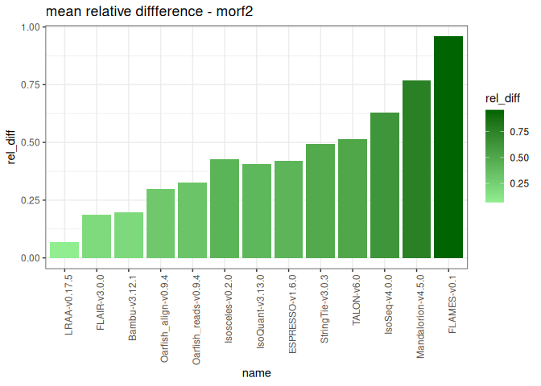<!-- -->

``` r
ggsave(pbio_only_plot, file="pbio_only_plot.quant_summary.pdf", width=5, height=5)
```

``` r
pbio_morf2_mean_rel_diff = morf2_mean_rel_diff %>% filter(grepl("pacbio_", data_name))

pbio_morf2_mean_rel_rankings = pbio_morf2_mean_rel_diff %>% arrange(rel_diff) %>% pull(name)


pbio_morf2_mean_rel_diff$name = factor(pbio_morf2_mean_rel_diff$name, levels=pbio_morf2_mean_rel_rankings)
```

``` r
pbio_morf2_mean_rel_diff_plot = pbio_morf2_mean_rel_diff %>% 
  ggplot(aes(x=name, y=rel_diff, fill=rel_diff)) + 
  geom_col() +
  geom_text(aes(label = round(rel_diff, 2)), vjust=-0.5, size = 3, color = "black") +
  scale_fill_gradient(low = "lightgreen", high = "darkgreen") +
  scale_y_continuous(expand = expansion(mult = c(0, 0.15))) +
  theme_bw() +
  theme(axis.text.x = element_text(angle = 90, hjust = 1)) +
  ggtitle("pacbio morf2 mean rel diff") +
  ylab("Mean Relative Difference")

pbio_morf2_mean_rel_diff_plot 
```

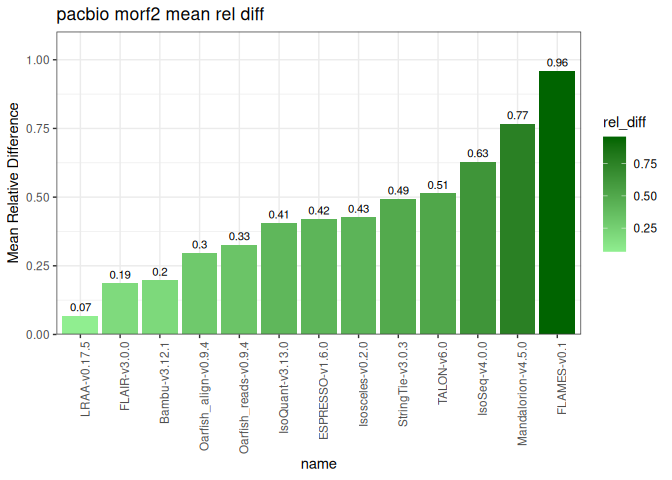<!-- -->

``` r
ont_morf2_mean_rel_diff = morf2_mean_rel_diff %>% filter(grepl("ont_", data_name))

ont_morf2_mean_rel_rankings = ont_morf2_mean_rel_diff %>% arrange(rel_diff) %>% pull(name)


ont_morf2_mean_rel_diff$name = factor(ont_morf2_mean_rel_diff$name, levels=ont_morf2_mean_rel_rankings)
```

``` r
ont_morf2_mean_rel_diff_plot = ont_morf2_mean_rel_diff %>%  ggplot(aes(x=name, y=rel_diff, fill=rel_diff)) + 
  geom_col() +
  geom_text(aes(label = round(rel_diff, 2)), vjust=-0.5, size = 3, color = "black") +
  scale_fill_gradient(low = "lightgreen", high = "darkgreen") +
  scale_y_continuous(expand = expansion(mult = c(0, 0.15))) +
  theme_bw() +
  theme(axis.text.x = element_text(angle = 90, hjust = 1)) +
  ggtitle("ONT morf2 mean rel diff") +
  ylab("Mean Relative Difference")

ont_morf2_mean_rel_diff_plot 
```

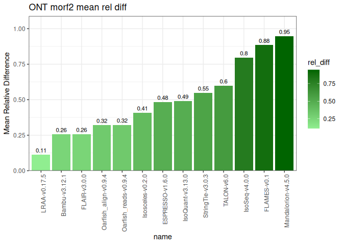<!-- -->

``` r
combined_morf_quant_plot = plot_grid(pbio_morf2_mean_rel_diff_plot,
                                     ont_morf2_mean_rel_diff_plot,
                                     ncol=1)

ggsave(combined_morf_quant_plot, file="combined_morf_quant_plot.pdf", height=6, width=8)


combined_morf_quant_plot
```

<!-- -->

``` r
latest_pbio_morf2_mean_rel_diff = morf2_mean_rel_diff %>%
  filter(grepl("pacbio_", data_name),
         as.character(name) %in% latest_programs)

latest_pbio_morf2_mean_rel_rankings = latest_pbio_morf2_mean_rel_diff %>%
  arrange(rel_diff) %>%
  pull(name)

latest_pbio_morf2_mean_rel_diff$name = factor(latest_pbio_morf2_mean_rel_diff$name,
                                              levels=latest_pbio_morf2_mean_rel_rankings)

latest_pbio_morf2_mean_rel_diff_plot = latest_pbio_morf2_mean_rel_diff %>%
  ggplot(aes(x=name, y=rel_diff, fill=rel_diff)) +
  geom_col() +
  geom_text(aes(label = round(rel_diff, 2)), vjust=-0.5, size = 3, color = "black") +
  scale_fill_gradient(low = "lightgreen", high = "darkgreen") +
  scale_y_continuous(expand = expansion(mult = c(0, 0.15))) +
  theme_bw() +
  theme(axis.text.x = element_text(angle = 90, hjust = 1)) +
  ggtitle("pacbio morf2 mean rel diff") +
  ylab("Mean Relative Difference")

latest_ont_morf2_mean_rel_diff = morf2_mean_rel_diff %>%
  filter(grepl("ont_", data_name),
         as.character(name) %in% latest_programs)

latest_ont_morf2_mean_rel_rankings = latest_ont_morf2_mean_rel_diff %>%
  arrange(rel_diff) %>%
  pull(name)

latest_ont_morf2_mean_rel_diff$name = factor(latest_ont_morf2_mean_rel_diff$name,
                                             levels=latest_ont_morf2_mean_rel_rankings)

latest_ont_morf2_mean_rel_diff_plot = latest_ont_morf2_mean_rel_diff %>%
  ggplot(aes(x=name, y=rel_diff, fill=rel_diff)) +
  geom_col() +
  geom_text(aes(label = round(rel_diff, 2)), vjust=-0.5, size = 3, color = "black") +
  scale_fill_gradient(low = "lightgreen", high = "darkgreen") +
  scale_y_continuous(expand = expansion(mult = c(0, 0.15))) +
  theme_bw() +
  theme(axis.text.x = element_text(angle = 90, hjust = 1)) +
  ggtitle("ONT morf2 mean rel diff") +
  ylab("Mean Relative Difference")

latest_combined_morf_quant_plot = plot_grid(latest_pbio_morf2_mean_rel_diff_plot,
                                            latest_ont_morf2_mean_rel_diff_plot,
                                            ncol=1)

ggsave(latest_combined_morf_quant_plot,
       file="combined_morf_quant_plot.latest_tools.pdf",
       height=6,
       width=8)

latest_combined_morf_quant_plot
```

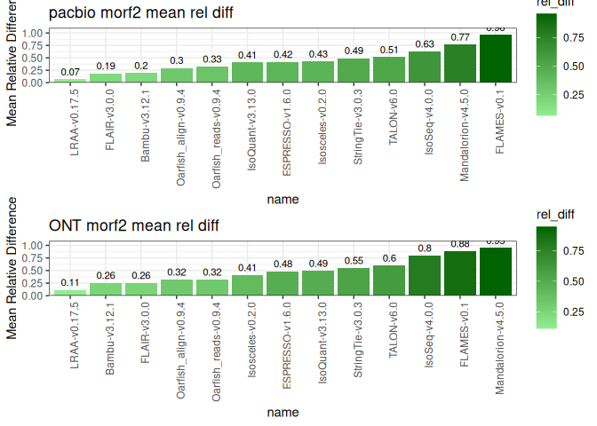<!-- -->

## Oarfish-style quantification metrics

``` r
morf2_oarfish_metrics_file = "morf2.oarfish_style_metrics.tsv"

if (file.exists(morf2_oarfish_metrics_file)) {
  morf2_oarfish_metrics_df = read.csv(morf2_oarfish_metrics_file, sep="\t", header=T)
  morf2_oarfish_metrics_df$data_name = str_replace(morf2_oarfish_metrics_df$data_name, "morf2_", "")
} else {
  message(morf2_oarfish_metrics_file, " not found; run make summarize after regenerating per-sample oarfish_style_metrics.tsv files.")
  morf2_oarfish_metrics_df = tibble()
}

morf2_oarfish_metrics_df %>% head()
```

    ##                   name       color  spearman pearson_log1p ccc_log1p   kendall
    ## 1         LRAA-v0.17.5        teal 0.9691281     0.9609754 0.9598633 0.9266762
    ## 2         FLAIR-v3.0.0        pink 0.9547624     0.9457191 0.9421868 0.8513079
    ## 3     Isosceles-v0.2.0         red 0.8232688     0.7924134 0.7782030 0.7236100
    ## 4          FLAMES-v0.1   gainsboro 0.8244441     0.7454203 0.5079816 0.7265222
    ## 5        Bambu-v3.12.1 forestgreen 0.8587150     0.7318048 0.7045403 0.8056995
    ## 6 Oarfish_align-v0.9.4       khaki 0.8231573     0.6931725 0.6537424 0.7568922
    ##       rmse nrmse_mean_truth       mard pr_auc average_precision n_scored
    ## 1 172.2762        0.4661795 0.05626356     NA                NA     2706
    ## 2 206.4185        0.5585686 0.12827522     NA                NA     2706
    ## 3 402.7855        1.0899376 0.20384150     NA                NA     2706
    ## 4 382.0814        1.0339123 0.44212717     NA                NA     2706
    ## 5 310.2520        0.8395420 0.12779673     NA                NA     2706
    ## 6 340.0573        0.9201949 0.16043851     NA                NA     2706
    ##   n_truth_expressed n_truth_unexpressed                        data_name
    ## 1              2706                   0 ont_merged_annot_compat_1isoform
    ## 2              2706                   0 ont_merged_annot_compat_1isoform
    ## 3              2706                   0 ont_merged_annot_compat_1isoform
    ## 4              2706                   0 ont_merged_annot_compat_1isoform
    ## 5              2706                   0 ont_merged_annot_compat_1isoform
    ## 6              2706                   0 ont_merged_annot_compat_1isoform

``` r
higher_is_better_metrics = c(
  "spearman",
  "pearson_log1p",
  "ccc_log1p",
  "kendall",
  "pr_auc",
  "average_precision"
)

lower_is_better_metrics = c(
  "rmse",
  "nrmse_mean_truth",
  "mard"
)

oarfish_metric_labels = tribble(
  ~metric, ~metric_label,
  "spearman", "Spearman",
  "pearson_log1p", "Pearson log1p",
  "ccc_log1p", "CCC log1p",
  "kendall", "Kendall",
  "rmse", "RMSE",
  "nrmse_mean_truth", "NRMSE",
  "mard", "MARD",
  "pr_auc", "PR-AUC",
  "average_precision", "Average precision"
)

if (nrow(morf2_oarfish_metrics_df) > 0) {
  morf2_oarfish_metrics_long = morf2_oarfish_metrics_df %>%
    dplyr::select(name, data_name, all_of(c(higher_is_better_metrics, lower_is_better_metrics))) %>%
    pivot_longer(
      cols = all_of(c(higher_is_better_metrics, lower_is_better_metrics)),
      names_to = "metric",
      values_to = "metric_value"
    ) %>%
    left_join(oarfish_metric_labels, by="metric") %>%
    mutate(
      direction = if_else(metric %in% higher_is_better_metrics, "higher is better", "lower is better"),
      metric_label = factor(metric_label, levels=oarfish_metric_labels$metric_label)
    )
} else {
  morf2_oarfish_metrics_long = tibble()
}
```

``` r
if (nrow(morf2_oarfish_metrics_long) > 0) {
  morf2_oarfish_metric_rankings = morf2_oarfish_metrics_long %>%
    group_by(data_name, metric, metric_label, direction) %>%
    mutate(
      metric_rank = if_else(
        direction == "higher is better",
        min_rank(dplyr::desc(metric_value)),
        min_rank(metric_value)
      )
    ) %>%
    ungroup()

  morf2_oarfish_mean_rankings = morf2_oarfish_metric_rankings %>%
    group_by(name, metric, metric_label, direction) %>%
    summarize(
      mean_metric_value = mean(metric_value, na.rm=TRUE),
      mean_rank = mean(metric_rank, na.rm=TRUE),
      .groups = "drop"
    )
} else {
  morf2_oarfish_metric_rankings = tibble()
  morf2_oarfish_mean_rankings = tibble()
}
```

``` r
reorder_within = function(x, by, within, fun=mean, sep="___", ...) {
  new_x = paste(x, within, sep=sep)
  stats::reorder(new_x, by, FUN=fun)
}

scale_y_reordered = function(..., sep="___") {
  scale_y_discrete(labels=function(x) gsub(paste0(sep, ".+$"), "", x), ...)
}
```

Note: PR-AUC and average precision require both expressed and
unexpressed truth isoforms in the scored reference set. In the current
MORF truth sets, all scored multi-exon MORF isoforms are truth-expressed
(`n_truth_unexpressed = 0`), so those two metrics are reported as `NA`
and their plot facets are not interpretable for MORFs.

``` r
if (nrow(morf2_oarfish_mean_rankings) > 0) {
  oarfish_metric_mean_rank_plot = morf2_oarfish_mean_rankings %>%
    ggplot(aes(x=mean_rank, y=reorder_within(name, -mean_rank, metric_label), fill=mean_rank)) +
    geom_col() +
    geom_text(aes(label=round(mean_rank, 1)), hjust=-0.1, size=2.5) +
    facet_wrap(~metric_label, scales="free_y") +
    scale_y_reordered() +
    scale_x_continuous(expand = expansion(mult = c(0, 0.15))) +
    scale_fill_gradient(low="darkgreen", high="lightgreen") +
    theme_bw() +
    theme(axis.text.y = element_text(size=6),
          legend.position="none") +
    xlab("Mean rank across MORF samples") +
    ylab("") +
    ggtitle("MORFs - Oarfish-style metric rankings")

  oarfish_metric_mean_rank_plot
}
```

    ## Warning: Removed 26 rows containing missing values or values outside the scale range
    ## (`geom_col()`).

    ## Warning: Removed 26 rows containing missing values or values outside the scale range
    ## (`geom_text()`).

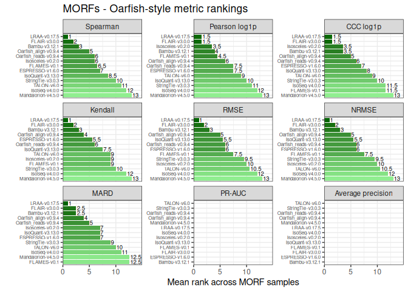<!-- -->

``` r
if (nrow(morf2_oarfish_mean_rankings) > 0) {
  oarfish_metric_value_plot = morf2_oarfish_mean_rankings %>%
    ggplot(aes(x=mean_metric_value, y=reorder_within(name, mean_metric_value, metric_label), fill=mean_metric_value)) +
    geom_col() +
    facet_wrap(~metric_label, scales="free") +
    scale_y_reordered() +
    theme_bw() +
    theme(axis.text.y = element_text(size=6),
          legend.position="none") +
    xlab("Mean metric value across MORF samples") +
    ylab("") +
    ggtitle("MORFs - Oarfish-style mean metric values")

  oarfish_metric_value_plot
}
```

    ## Warning: Position guide is perpendicular to the intended axis.
    ## ℹ Did you mean to specify a different guide `position`?
    ## Position guide is perpendicular to the intended axis.
    ## ℹ Did you mean to specify a different guide `position`?

    ## Warning: Removed 26 rows containing missing values or values outside the scale range
    ## (`geom_col()`).

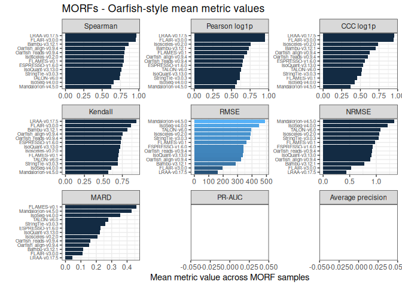<!-- -->

``` r
if (exists("oarfish_metric_mean_rank_plot")) {
  ggsave(oarfish_metric_mean_rank_plot,
         file="morf2_oarfish_style_metric_rankings.pdf",
         width=11,
         height=8.5)
}
```

    ## Warning: Removed 26 rows containing missing values or values outside the scale range
    ## (`geom_col()`).

    ## Warning: Removed 26 rows containing missing values or values outside the scale range
    ## (`geom_text()`).

``` r
if (exists("oarfish_metric_value_plot")) {
  ggsave(oarfish_metric_value_plot,
         file="morf2_oarfish_style_metric_values.pdf",
         width=11,
         height=8.5)
}
```

    ## Warning: Position guide is perpendicular to the intended axis.
    ## ℹ Did you mean to specify a different guide `position`?

    ## Warning: Position guide is perpendicular to the intended axis.
    ## ℹ Did you mean to specify a different guide `position`?

    ## Warning: Removed 26 rows containing missing values or values outside the scale range
    ## (`geom_col()`).

``` r
if (nrow(morf2_oarfish_mean_rankings) > 0) {
  morf2_oarfish_latest_mean_rankings = morf2_oarfish_mean_rankings %>%
    filter(as.character(name) %in% latest_programs)

  oarfish_latest_metric_mean_rank_plot = morf2_oarfish_latest_mean_rankings %>%
    ggplot(aes(x=mean_rank, y=reorder_within(name, -mean_rank, metric_label), fill=mean_rank)) +
    geom_col() +
    geom_text(aes(label=round(mean_rank, 1)), hjust=-0.1, size=2.5) +
    facet_wrap(~metric_label, scales="free_y") +
    scale_y_reordered() +
    scale_x_continuous(expand = expansion(mult = c(0, 0.15))) +
    scale_fill_gradient(low="darkgreen", high="lightgreen") +
    theme_bw() +
    theme(axis.text.y = element_text(size=6),
          legend.position="none") +
    xlab("Mean rank across MORF samples") +
    ylab("") +
    ggtitle("MORFs - Oarfish-style metric rankings, latest tools")

  oarfish_latest_metric_mean_rank_plot
}
```

    ## Warning: Removed 26 rows containing missing values or values outside the scale range
    ## (`geom_col()`).

    ## Warning: Removed 26 rows containing missing values or values outside the scale range
    ## (`geom_text()`).

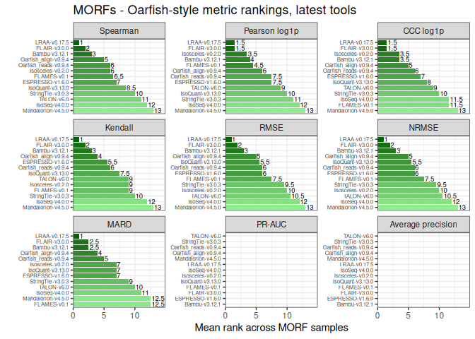<!-- -->

``` r
if (exists("oarfish_latest_metric_mean_rank_plot")) {
  ggsave(oarfish_latest_metric_mean_rank_plot,
         file="morf2_oarfish_style_metric_rankings.latest_tools.pdf",
         width=11,
         height=8.5)
}
```

    ## Warning: Removed 26 rows containing missing values or values outside the scale range
    ## (`geom_col()`).

    ## Warning: Removed 26 rows containing missing values or values outside the scale range
    ## (`geom_text()`).
