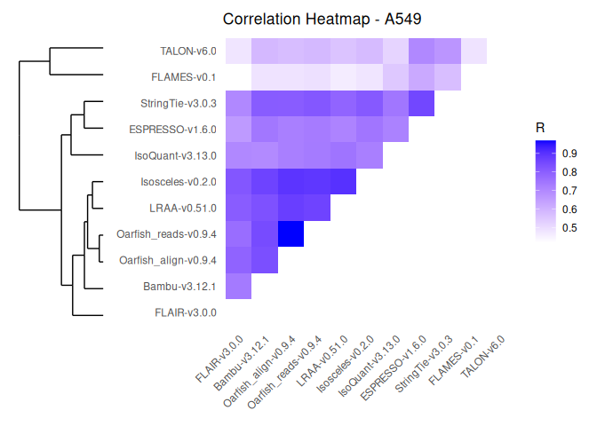
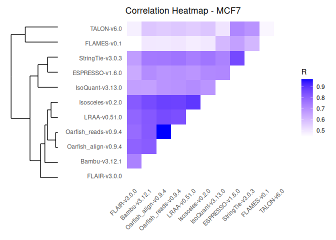
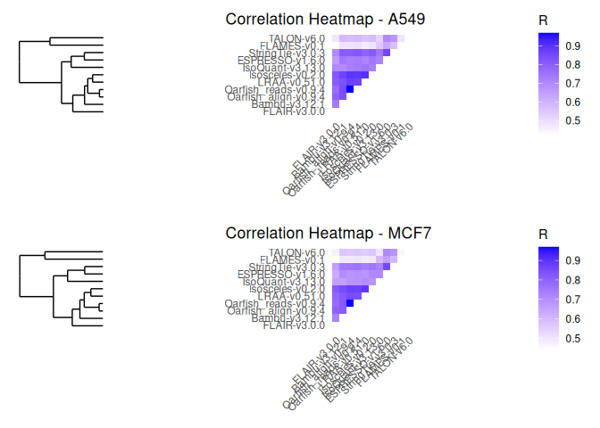
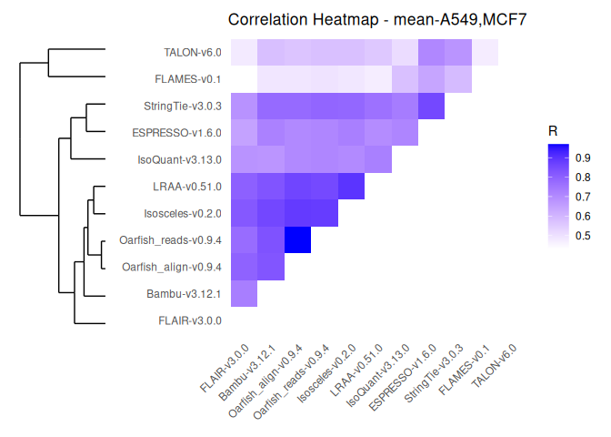

examine_expr_correlations
================
2025-08-01

``` r
expr_cors = read.csv("all_expr_correlations.tsv", header=T, sep="\t", check.names=FALSE) %>% rename(methodA = `Unnamed: 0`)

expr_cors %>% head()
```

    ##            methodA LRAA-v0.51.0 ESPRESSO-v1.6.0 FLAIR-v3.0.0 FLAMES-v0.1
    ## 1     LRAA-v0.51.0    1.0000000       0.7133214    0.8078488   0.4639223
    ## 2  ESPRESSO-v1.6.0    0.7133214       1.0000000    0.6593648   0.6221687
    ## 3     FLAIR-v3.0.0    0.8078488       0.6593648    1.0000000   0.4203000
    ## 4      FLAMES-v0.1    0.4639223       0.6221687    0.4203000   1.0000000
    ## 5 IsoQuant-v3.13.0    0.7502730       0.7169427    0.7023915   0.5487129
    ## 6 Isosceles-v0.2.0    0.9032725       0.7469162    0.8206420   0.4796530
    ##   IsoQuant-v3.13.0 Isosceles-v0.2.0 Oarfish_align-v0.9.4 Oarfish_reads-v0.9.4
    ## 1        0.7502730        0.9032725            0.8745283            0.8635328
    ## 2        0.7169427        0.7469162            0.7234548            0.7328866
    ## 3        0.7023915        0.8206420            0.7908332            0.7677964
    ## 4        0.5487129        0.4796530            0.4846047            0.4935253
    ## 5        1.0000000        0.7233110            0.7245836            0.7347346
    ## 6        0.7233110        1.0000000            0.8955489            0.8907140
    ##   Bambu-v3.12.1 StringTie-v3.0.3 TALON-v6.0  data_name
    ## 1     0.8324966        0.7878957  0.5601633 SGNex_A549
    ## 2     0.7440078        0.8565599  0.7033502 SGNex_A549
    ## 3     0.7366573        0.7022891  0.4810033 SGNex_A549
    ## 4     0.4844954        0.5723086  0.4849076 SGNex_A549
    ## 5     0.6963065        0.7451936  0.5213059 SGNex_A549
    ## 6     0.8645601        0.8137105  0.5803971 SGNex_A549

``` r
expr_cors = expr_cors %>% separate_wider_delim(data_name, delim = "_", 
                      names = c("prefix", "cell_line") ) %>%
  select(-prefix)

expr_cors %>% head()
```

    ## # A tibble: 6 × 13
    ##   methodA          `LRAA-v0.51.0` `ESPRESSO-v1.6.0` `FLAIR-v3.0.0` `FLAMES-v0.1`
    ##   <chr>                     <dbl>             <dbl>          <dbl>         <dbl>
    ## 1 LRAA-v0.51.0              1                 0.713          0.808         0.464
    ## 2 ESPRESSO-v1.6.0           0.713             1              0.659         0.622
    ## 3 FLAIR-v3.0.0              0.808             0.659          1             0.420
    ## 4 FLAMES-v0.1               0.464             0.622          0.420         1    
    ## 5 IsoQuant-v3.13.0          0.750             0.717          0.702         0.549
    ## 6 Isosceles-v0.2.0          0.903             0.747          0.821         0.480
    ## # ℹ 8 more variables: `IsoQuant-v3.13.0` <dbl>, `Isosceles-v0.2.0` <dbl>,
    ## #   `Oarfish_align-v0.9.4` <dbl>, `Oarfish_reads-v0.9.4` <dbl>,
    ## #   `Bambu-v3.12.1` <dbl>, `StringTie-v3.0.3` <dbl>, `TALON-v6.0` <dbl>,
    ## #   cell_line <chr>

``` r
expr_cors = expr_cors %>% gather(key='methodB', value='R', -methodA, -cell_line)


expr_cors %>% head()
```

    ## # A tibble: 6 × 4
    ##   methodA          cell_line methodB          R
    ##   <chr>            <chr>     <chr>        <dbl>
    ## 1 LRAA-v0.51.0     A549      LRAA-v0.51.0 1    
    ## 2 ESPRESSO-v1.6.0  A549      LRAA-v0.51.0 0.713
    ## 3 FLAIR-v3.0.0     A549      LRAA-v0.51.0 0.808
    ## 4 FLAMES-v0.1      A549      LRAA-v0.51.0 0.464
    ## 5 IsoQuant-v3.13.0 A549      LRAA-v0.51.0 0.750
    ## 6 Isosceles-v0.2.0 A549      LRAA-v0.51.0 0.903

``` r
# determine mean cor_val across replicates

expr_cors_mean = expr_cors %>% group_by(methodA, methodB) %>% summarize(R = mean(R))
```

    ## `summarise()` has regrouped the output.
    ## ℹ Summaries were computed grouped by methodA and methodB.
    ## ℹ Output is grouped by methodA.
    ## ℹ Use `summarise(.groups = "drop_last")` to silence this message.
    ## ℹ Use `summarise(.by = c(methodA, methodB))` for per-operation grouping
    ##   (`?dplyr::dplyr_by`) instead.

``` r
expr_cors_mean %>% head()
```

    ## # A tibble: 6 × 3
    ## # Groups:   methodA [1]
    ##   methodA       methodB              R
    ##   <chr>         <chr>            <dbl>
    ## 1 Bambu-v3.12.1 Bambu-v3.12.1    1    
    ## 2 Bambu-v3.12.1 ESPRESSO-v1.6.0  0.725
    ## 3 Bambu-v3.12.1 FLAIR-v3.0.0     0.733
    ## 4 Bambu-v3.12.1 FLAMES-v0.1      0.490
    ## 5 Bambu-v3.12.1 IsoQuant-v3.13.0 0.677
    ## 6 Bambu-v3.12.1 Isosceles-v0.2.0 0.858

``` r
get_latest_methods = function(methods) {

  method_versions = tibble(method = methods) %>%
    distinct(method) %>%
    mutate(method = as.character(method),
           Tool = str_remove(method, "-v[0-9].*$"),
           Version = str_match(method, "-v([0-9][0-9A-Za-z.\\-]*)$")[, 2])

  latest_versioned = method_versions %>%
    filter(! is.na(Version)) %>%
    group_by(Tool) %>%
    # numeric_version() rejects letter suffixes (e.g. 0.18.2b), so rank on the
    # leading numeric run and break ties on the full string:
    #   0.18.3 > 0.18.2b > 0.18.2
    arrange(desc(numeric_version(str_extract(Version, "^[0-9]+(\\.[0-9]+)*"))),
            desc(Version), .by_group = TRUE) %>%
    slice(1) %>%
    ungroup()

  unversioned = method_versions %>%
    filter(is.na(Version))

  bind_rows(latest_versioned, unversioned) %>%
    pull(method)
}

latest_methods = get_latest_methods(c(expr_cors$methodA, expr_cors$methodB))

latest_methods
```

    ##  [1] "Bambu-v3.12.1"        "ESPRESSO-v1.6.0"      "FLAIR-v3.0.0"        
    ##  [4] "FLAMES-v0.1"          "IsoQuant-v3.13.0"     "Isosceles-v0.2.0"    
    ##  [7] "LRAA-v0.51.0"         "Oarfish_align-v0.9.4" "Oarfish_reads-v0.9.4"
    ## [10] "StringTie-v3.0.3"     "TALON-v6.0"

``` r
library(ggplot2)
library(dplyr)
library(cluster)
library(ggdendro)
library(patchwork)
```

    ## 
    ## Attaching package: 'patchwork'

    ## The following object is masked from 'package:cowplot':
    ## 
    ##     align_plots

``` r
heatmap_cor_plot_with_dendrogram = function(df, title_token, methods_filter = NULL) {

  if (! is.null(methods_filter)) {
    df = df %>%
      filter(as.character(methodA) %in% methods_filter,
             as.character(methodB) %in% methods_filter)
  }
  
  # Create a wide-format correlation matrix for clustering
  cor_matrix <- df %>%
    select(methodA, methodB, R) %>%
    tidyr::pivot_wider(names_from = methodB, values_from = R) %>%
    column_to_rownames("methodA") %>%
    as.matrix()
  
  # Perform hierarchical clustering
  dist_matrix <- dist(cor_matrix)
  hclust_result <- hclust(dist_matrix, method = "complete")
  
  # Get the dendrogram order
  method_order <- rownames(cor_matrix)[hclust_result$order]
  n_methods <- length(method_order)
  
  # Create upper triangle mask and reorder data
  plot_data <- df%>%
    # Convert to factors with dendrogram order
    mutate(
      methodA = factor(methodA, levels = method_order),
      methodB = factor(methodB, levels = method_order)
    ) %>%
    # Keep only the strict upper triangle, excluding self-correlations
    filter(as.numeric(methodA) < as.numeric(methodB))
  
  # Create the plot
  heatmap_plot <- ggplot(plot_data, aes(x = methodA, y = methodB, fill = R)) +
    geom_tile() +
    scale_fill_gradient(
      low = "white", 
      high = "blue",
      name = "R"
    ) +
    scale_x_discrete(limits = method_order, drop = FALSE) +
    scale_y_discrete(limits = method_order, drop = FALSE) +
    theme_minimal() +
    theme(
      axis.text.x = element_text(angle = 45, hjust = 1),
      axis.text.y = element_text(),
      axis.title = element_blank(),
      panel.grid = element_blank()
    ) +
    coord_fixed() +  # Keep square tiles
    labs(title = paste("Correlation Heatmap -", title_token))
  
  # Create dendrogram plot (rotated to orient leaves toward heatmap)
  dend_data <- dendro_data(hclust_result)
  dend_plot <- ggplot(segment(dend_data)) +
    geom_segment(aes(x = x, y = y, xend = xend, yend = yend)) +
    scale_x_continuous(limits = c(0.5, n_methods + 0.5), expand = c(0, 0)) +
    coord_flip() +
    scale_y_reverse(expand = c(0, 0.1)) +
    theme_void() +
    theme(plot.margin = margin(t = 5, r = 0, b = 5, l = 5))
  
  # Display both plots side by side using:
  dend_heatmap_plot = dend_plot + heatmap_plot + plot_layout(widths = c(1, 3))
  
  return(dend_heatmap_plot)
  
}
```

``` r
cor_heatmap_A549_plot = heatmap_cor_plot_with_dendrogram(expr_cors %>% filter(cell_line=="A549"), "A549")

cor_heatmap_A549_plot
```

<!-- -->

``` r
cor_heatmap_MCF7_plot = heatmap_cor_plot_with_dendrogram(expr_cors %>% filter(cell_line=="MCF7"), "MCF7")

cor_heatmap_MCF7_plot
```

<!-- -->

``` r
SGNex_expr_cor_plot = plot_grid(cor_heatmap_A549_plot,
                                cor_heatmap_MCF7_plot,
                                ncol=1)


ggsave(SGNex_expr_cor_plot, file="SGNex_expr_cor_plot.pdf", width=6, height=10)

SGNex_expr_cor_plot
```

<!-- -->

``` r
cor_heatmap_A549_latest_plot = heatmap_cor_plot_with_dendrogram(
  expr_cors %>% filter(cell_line=="A549"),
  "A549",
  latest_methods
)

cor_heatmap_MCF7_latest_plot = heatmap_cor_plot_with_dendrogram(
  expr_cors %>% filter(cell_line=="MCF7"),
  "MCF7",
  latest_methods
)

SGNex_expr_cor_latest_plot = plot_grid(cor_heatmap_A549_latest_plot,
                                       cor_heatmap_MCF7_latest_plot,
                                       ncol=1)

ggsave(SGNex_expr_cor_latest_plot,
       file="SGNex_expr_cor_plot.latest_tools.pdf",
       width=6,
       height=10)

SGNex_expr_cor_latest_plot
```

<!-- -->

``` r
heatmap_cor_plot_with_dendrogram(expr_cors_mean, "mean-A549,MCF7")
```

<!-- -->
