Mouse sim QUANT_only_summary
================
2025-02-14

# mouse

## Pearson Cor

``` r
mouse_pearson_cor_df = read.csv("mouse_isoseqsim.pearson_cor.tsv", header=T, sep="\t")  %>% dplyr::select(name, cor_value, data_name)

mouse_pearson_cor_df$data_name = str_replace(mouse_pearson_cor_df$data_name, "mouse_isoseqsim_", "")

mouse_pearson_cor_df %>% head()
```

    ##                   name cor_value data_name
    ## 1         FLAIR-v3.0.0 0.9988180      e000
    ## 2         LRAA-v0.17.5 0.9956509      e000
    ## 3 Oarfish_align-v0.9.4 0.9933449      e000
    ## 4 Oarfish_reads-v0.9.4 0.9920026      e000
    ## 5        Bambu-v3.12.1 0.9903698      e000
    ## 6     IsoQuant-v3.13.0 0.9895058      e000

``` r
# rank according to mean cor val
pearson_cor_df_ranking = mouse_pearson_cor_df %>% group_by(name) %>% summarize(mcor = mean(cor_value)) %>% arrange(dplyr::desc(mcor)) %>% pull(name)


mouse_pearson_cor_df$name = factor(mouse_pearson_cor_df$name, levels=pearson_cor_df_ranking)
```

``` r
mouse_pearson_cor_df %>% ggplot(aes(x=name, y=cor_value)) + geom_col() +
  theme_bw() +
  theme(axis.text.x = element_text(angle = 90, hjust = 1)) +
  facet_wrap(~data_name, nrow=1) +
  ggtitle("Mouse sim -  Pearson cor")
```

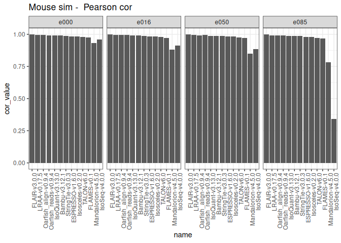<!-- -->

## Spearman Cor

``` r
mouse_spearman_cor_df = read.csv("mouse_isoseqsim.spearman_cor.tsv", header=T, sep="\t")  %>% dplyr::select(name, cor_value, data_name)

mouse_spearman_cor_df$data_name = str_replace(mouse_spearman_cor_df$data_name, "mouse_isoseqsim_", "")

mouse_spearman_cor_df %>% head()
```

    ##                   name cor_value data_name
    ## 1         FLAIR-v3.0.0 0.9971622      e000
    ## 2         LRAA-v0.17.5 0.9931668      e000
    ## 3 Oarfish_align-v0.9.4 0.9893334      e000
    ## 4        Bambu-v3.12.1 0.9891421      e000
    ## 5     IsoQuant-v3.13.0 0.9873505      e000
    ## 6 Oarfish_reads-v0.9.4 0.9870225      e000

``` r
# rank according to mean cor val
spearman_cor_df_ranking = mouse_spearman_cor_df %>% group_by(name) %>% summarize(mcor = mean(cor_value)) %>% arrange(dplyr::desc(mcor)) %>% pull(name)


mouse_spearman_cor_df$name = factor(mouse_spearman_cor_df$name, levels=pearson_cor_df_ranking)
```

``` r
mouse_spearman_cor_df %>% ggplot(aes(x=name, y=cor_value)) + geom_col() +
   theme_bw() +
   theme(axis.text.x = element_text(angle = 90, hjust = 1)) +
   facet_wrap(~data_name, nrow=1) +
  ggtitle("Mouse sim - Spearman cor")
```

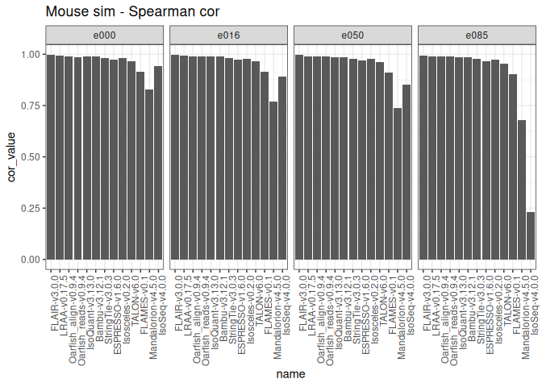<!-- -->

## Median relative difference

``` r
mouse_median_rel_diff = read.csv("mouse_isoseqsim.median_rel_diff.tsv", sep="\t", header=T) %>%
  dplyr::select(name, rel_diff, data_name)

mouse_median_rel_diff$data_name  = str_replace(mouse_median_rel_diff$data_name, "mouse_isoseqsim_", "")

mouse_median_rel_diff %>% head()
```

    ##                   name     rel_diff data_name
    ## 1         FLAIR-v3.0.0 3.282881e-05      e000
    ## 2         LRAA-v0.17.5 2.173388e-03      e000
    ## 3        Bambu-v3.12.1 2.664383e-03      e000
    ## 4 Oarfish_reads-v0.9.4 4.094611e-03      e000
    ## 5 Oarfish_align-v0.9.4 5.385316e-03      e000
    ## 6      ESPRESSO-v1.6.0 1.535951e-02      e000

``` r
# rank according to median relative difference
mrel_median_diff_ranking = mouse_median_rel_diff %>% group_by(name) %>% summarize(mrel_diff = mean(rel_diff)) %>% arrange(mrel_diff) %>% pull(name)


mouse_median_rel_diff$name = factor(mouse_median_rel_diff$name, levels=mrel_median_diff_ranking)
```

``` r
mouse_median_rel_diff %>% ggplot(aes(x=name, y=rel_diff)) + geom_col() +
    theme_bw() +
   theme(axis.text.x = element_text(angle = 90, hjust = 1)) +
  facet_wrap(~data_name, nrow=1) +
  ggtitle("Quant median relative difference for Mouse simulated long isoform reads")
```

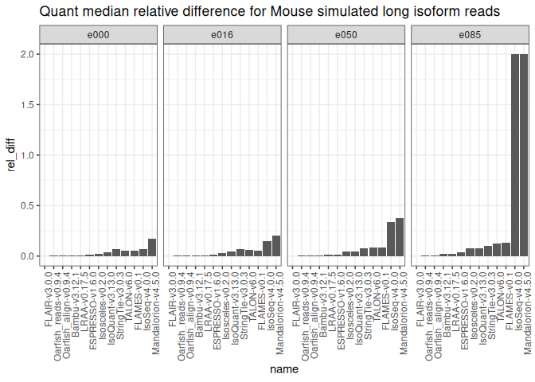<!-- -->

``` r
mouse_median_rel_diff %>% ggplot(aes(x=name, y=factor(data_name, levels=c("e085", "e050", "e016", "e000")), fill=-1*log(rel_diff))) +
  geom_tile() +
  theme(axis.text.x = element_text(angle = 90, hjust = 1))  +
   ggtitle("Quant median relative difference for Mouse simulated long isoform reads")
```

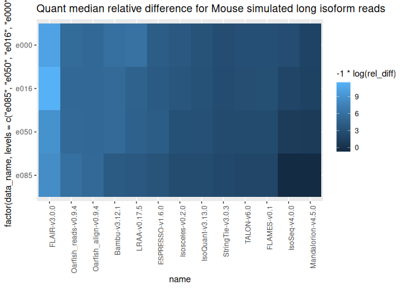<!-- -->

## Mean relative difference

``` r
mouse_mean_rel_diff = read.csv("mouse_isoseqsim.mean_rel_diff.tsv", sep="\t", header=T) %>%
  dplyr::select(name, rel_diff, data_name)

mouse_mean_rel_diff$data_name  = str_replace(mouse_mean_rel_diff$data_name, "mouse_isoseqsim_", "")

mouse_mean_rel_diff %>% head()
```

    ##                   name   rel_diff data_name
    ## 1         FLAIR-v3.0.0 0.01378006      e000
    ## 2         LRAA-v0.17.5 0.04062281      e000
    ## 3 Oarfish_align-v0.9.4 0.05123714      e000
    ## 4 Oarfish_reads-v0.9.4 0.05749356      e000
    ## 5        Bambu-v3.12.1 0.05924361      e000
    ## 6     IsoQuant-v3.13.0 0.08062055      e000

``` r
# rank according to median relative difference
mrel_mean_diff_ranking = mouse_mean_rel_diff %>% group_by(name) %>% summarize(mrel_diff = mean(rel_diff)) %>% arrange(mrel_diff) %>% pull(name)


mouse_mean_rel_diff$name = factor(mouse_mean_rel_diff$name, levels=mrel_mean_diff_ranking)
```

``` r
mouse_mean_rel_diff %>% ggplot(aes(x=name, y=rel_diff)) + geom_col() +
  theme_bw() +
   theme(axis.text.x = element_text(angle = 90, hjust = 1)) +
  facet_wrap(~data_name, nrow=1) +
   ggtitle("Quant mean relative difference for Mouse simulated long isoform reads")
```

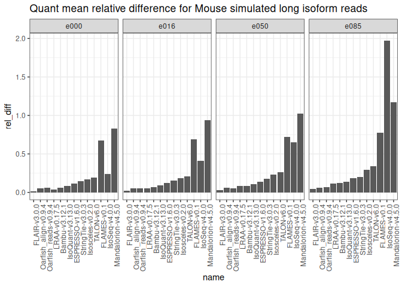<!-- -->

``` r
mouse_mean_rel_diff %>% ggplot(aes(x=name, y=factor(data_name, levels=c("e085", "e050", "e016", "e000")), fill=-1*log(rel_diff))) +
  geom_tile() +
  theme(axis.text.x = element_text(angle = 90, hjust = 1))  +
   ggtitle("Quant mean relative difference for Mouse simulated long isoform reads")
```

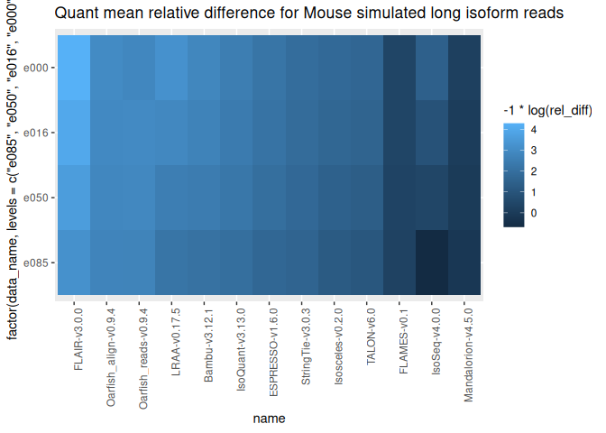<!-- -->

``` r
get_latest_programs = function(data_df) {

  program_versions = data_df %>%
    distinct(name) %>%
    mutate(name = as.character(name),
           Tool = str_remove(name, "-v[0-9].*$"),
           Version = str_match(name, "-v([0-9][0-9A-Za-z.\\-]*)$")[, 2])

  latest_versioned_programs = program_versions %>%
    filter(! is.na(Version)) %>%
    group_by(Tool) %>%
    arrange(dplyr::desc(numeric_version(Version)), .by_group = TRUE) %>%
    dplyr::slice(1) %>%
    ungroup()

  unversioned_programs = program_versions %>%
    filter(is.na(Version))

  bind_rows(latest_versioned_programs, unversioned_programs) %>%
    pull(name)
}

latest_programs = get_latest_programs(mouse_mean_rel_diff)

latest_programs
```

    ##  [1] "Bambu-v3.12.1"        "ESPRESSO-v1.6.0"      "FLAIR-v3.0.0"        
    ##  [4] "FLAMES-v0.1"          "IsoQuant-v3.13.0"     "IsoSeq-v4.0.0"       
    ##  [7] "Isosceles-v0.2.0"     "LRAA-v0.17.5"         "Mandalorion-v4.5.0"  
    ## [10] "Oarfish_align-v0.9.4" "Oarfish_reads-v0.9.4" "StringTie-v3.0.3"    
    ## [13] "TALON-v6.0"

# plot in heatmap form with individual rankings

``` r
get_ranked_df = function(data_name_val) {
  
  ranked_df =   mouse_mean_rel_diff %>% filter(data_name == data_name_val)
  
  ranked_progs = ranked_df %>% arrange(rel_diff) %>% pull(name)
  
  ranked_df$name = factor(ranked_df$name, levels=ranked_progs)
  
  return(ranked_df)
 
}
```

``` r
color_scale_limit_range = c(0,2)
```

``` r
e000_mean_expr_df = get_ranked_df("e000")

e000_mean_expr_tile_plot = e000_mean_expr_df %>% ggplot(aes(x=name, y=data_name, fill=rel_diff)) + 
  geom_tile()  +
  scale_fill_gradient(low = "lightgreen", high = "darkgreen", limits=color_scale_limit_range) +
  theme(axis.text.x = element_text(angle = 90, hjust = 1))  +
  ggtitle("e000")

e000_mean_expr_tile_plot
```

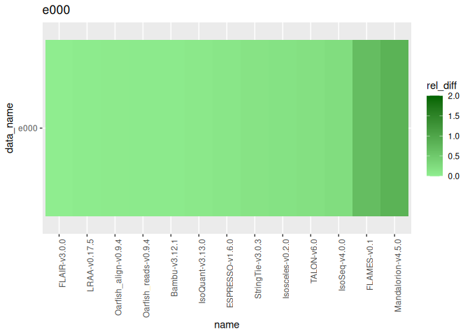<!-- -->

``` r
e000_mean_expr_bar_plot = e000_mean_expr_df %>% ggplot(aes(x=name, y=rel_diff, fill=rel_diff)) + 
  geom_col()  +
  geom_text(aes(label=round(rel_diff, 2)), vjust=-0.5, color="black", size=3) +
  scale_fill_gradient(low = "lightgreen", high = "darkgreen", limits=color_scale_limit_range) +
  scale_y_continuous(expand = expansion(mult = c(0, 0.15))) +
  theme_bw() +
  theme(axis.text.x = element_text(angle = 90, hjust = 1))  +
  ggtitle("e000") +
  ylab("Mean Relative Difference")

e000_mean_expr_bar_plot
```

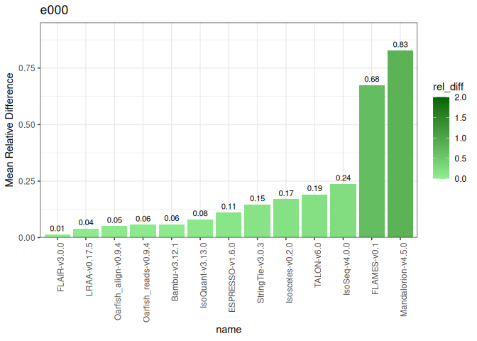<!-- -->

``` r
e016_mean_expr_df = get_ranked_df("e016")

e016_mean_expr_tile_plot = e016_mean_expr_df %>% ggplot(aes(x=name, y=data_name, fill=rel_diff)) + 
  geom_tile()  +
  scale_fill_gradient(low = "lightgreen", high = "darkgreen", limits=color_scale_limit_range) +
  theme(axis.text.x = element_text(angle = 90, hjust = 1))  +
  ggtitle("e016")

e016_mean_expr_tile_plot
```

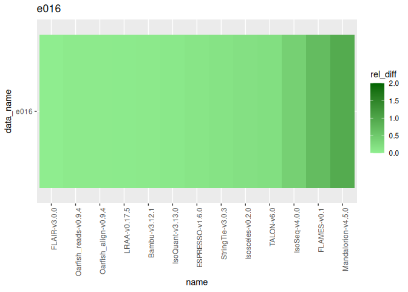<!-- -->

``` r
e016_mean_expr_bar_plot = e016_mean_expr_df %>% ggplot(aes(x=name, y=rel_diff, fill=rel_diff)) + 
  geom_col()  +
  geom_text(aes(label=round(rel_diff, 2)), vjust=-0.5, color="black", size=3) +
  scale_fill_gradient(low = "lightgreen", high = "darkgreen", limits=color_scale_limit_range) +
  scale_y_continuous(expand = expansion(mult = c(0, 0.15))) +
  theme_bw() +
  theme(axis.text.x = element_text(angle = 90, hjust = 1))  +
  ggtitle("e016") +
  ylab("Mean Relative Difference")

e016_mean_expr_bar_plot
```

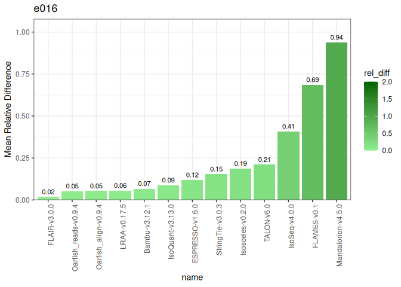<!-- -->

``` r
e050_mean_expr_df = get_ranked_df("e050")

e050_mean_expr_tile_plot = e050_mean_expr_df %>% ggplot(aes(x=name, y=data_name, fill=rel_diff)) + 
  geom_tile()  +
  scale_fill_gradient(low = "lightgreen", high = "darkgreen", limits=color_scale_limit_range) +
  theme(axis.text.x = element_text(angle = 90, hjust = 1))  +
  ggtitle("e050")

e050_mean_expr_tile_plot
```

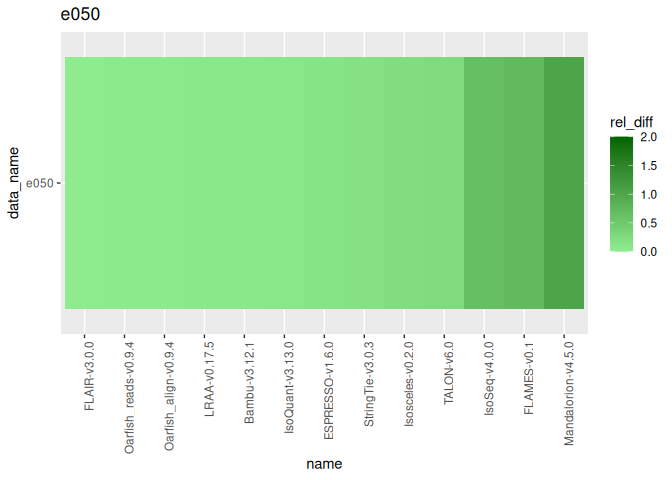<!-- -->

``` r
e050_mean_expr_bar_plot = e050_mean_expr_df %>% ggplot(aes(x=name, y=rel_diff, fill=rel_diff)) + 
  geom_col()  +
  geom_text(aes(label=round(rel_diff, 2)), vjust=-0.5, color="black", size=3) +
  scale_fill_gradient(low = "lightgreen", high = "darkgreen", limits=color_scale_limit_range) +
  scale_y_continuous(expand = expansion(mult = c(0, 0.15))) +
  theme_bw() +
  theme(axis.text.x = element_text(angle = 90, hjust = 1))  +
  ggtitle("e050") +
  ylab("Mean Relative Difference")

e050_mean_expr_bar_plot
```

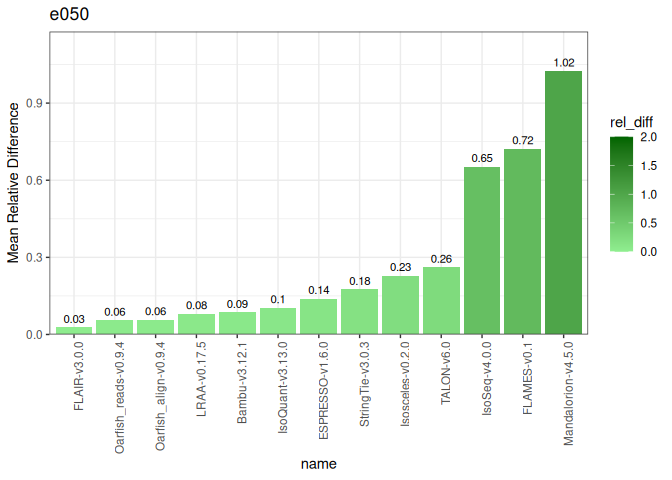<!-- -->

``` r
e085_mean_expr_df = get_ranked_df("e085")

e085_mean_expr_tile_plot = e085_mean_expr_df %>% ggplot(aes(x=name, y=data_name, fill=rel_diff)) + 
  geom_tile()  +
  scale_fill_gradient(low = "lightgreen", high = "darkgreen", limits=color_scale_limit_range) +
  theme(axis.text.x = element_text(angle = 90, hjust = 1))  +
  ggtitle("e085")

e085_mean_expr_tile_plot
```

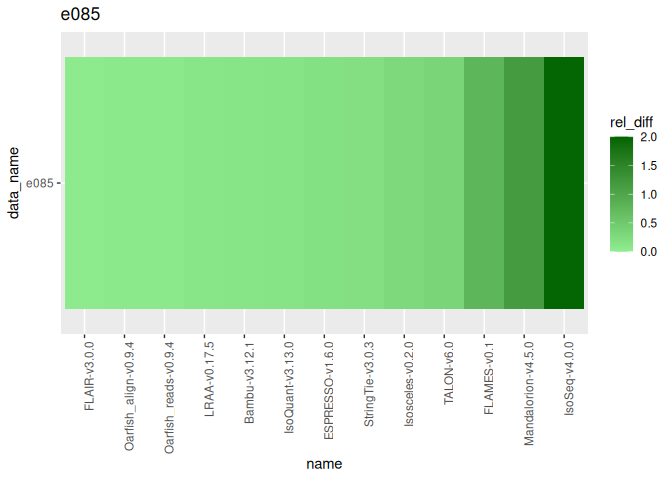<!-- -->

``` r
e085_mean_expr_bar_plot = e085_mean_expr_df %>% ggplot(aes(x=name, y=rel_diff, fill=rel_diff)) + 
  geom_col()  +
  geom_text(aes(label=round(rel_diff, 2)), vjust=-0.5, color="black", size=3) +
  scale_fill_gradient(low = "lightgreen", high = "darkgreen", limits=color_scale_limit_range) +
  scale_y_continuous(expand = expansion(mult = c(0, 0.15))) +
  theme_bw() +
  theme(axis.text.x = element_text(angle = 90, hjust = 1))  +
  ggtitle("e085") +
  ylab("Mean Relative Difference")

e085_mean_expr_bar_plot
```

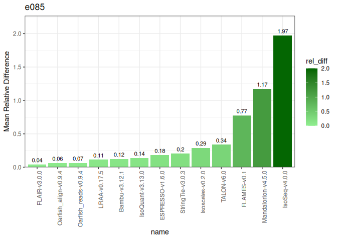<!-- -->

``` r
library(cowplot)
```

    ## 
    ## Attaching package: 'cowplot'

    ## The following object is masked from 'package:lubridate':
    ## 
    ##     stamp

``` r
summary_tile_plot = plot_grid(e000_mean_expr_tile_plot,
                              e016_mean_expr_tile_plot,
                              e050_mean_expr_tile_plot,
                              e085_mean_expr_tile_plot,
                              ncol=1) 

summary_tile_plot
```

<!-- -->

``` r
summary_bar_plot = plot_grid(e000_mean_expr_bar_plot,
                             e016_mean_expr_bar_plot,
                             e050_mean_expr_bar_plot,
                             e085_mean_expr_bar_plot,
                             ncol=1) 

summary_bar_plot
```

<!-- -->

``` r
ggsave(summary_bar_plot, file="mouse_sim_quant_summary_barplot.pdf", width=8, height=10)
```

``` r
get_ranked_latest_df = function(data_name_val) {

  ranked_df = mouse_mean_rel_diff %>%
    filter(data_name == data_name_val,
           as.character(name) %in% latest_programs)

  ranked_progs = ranked_df %>%
    arrange(rel_diff) %>%
    pull(name)

  ranked_df$name = factor(ranked_df$name, levels=ranked_progs)

  return(ranked_df)
}

e000_latest_mean_expr_df = get_ranked_latest_df("e000")

e000_latest_mean_expr_tile_plot = e000_latest_mean_expr_df %>%
  ggplot(aes(x=name, y=data_name, fill=rel_diff)) +
  geom_tile() +
  scale_fill_gradient(low = "lightgreen", high = "darkgreen", limits=color_scale_limit_range) +
  theme(axis.text.x = element_text(angle = 90, hjust = 1)) +
  ggtitle("e000")

e000_latest_mean_expr_bar_plot = e000_latest_mean_expr_df %>%
  ggplot(aes(x=name, y=rel_diff, fill=rel_diff)) +
  geom_col() +
  geom_text(aes(label=round(rel_diff, 2)), vjust=-0.5, color="black", size=3) +
  scale_fill_gradient(low = "lightgreen", high = "darkgreen", limits=color_scale_limit_range) +
  scale_y_continuous(expand = expansion(mult = c(0, 0.15))) +
  theme_bw() +
  theme(axis.text.x = element_text(angle = 90, hjust = 1)) +
  ggtitle("e000") +
  ylab("Mean Relative Difference")

e016_latest_mean_expr_df = get_ranked_latest_df("e016")

e016_latest_mean_expr_tile_plot = e016_latest_mean_expr_df %>%
  ggplot(aes(x=name, y=data_name, fill=rel_diff)) +
  geom_tile() +
  scale_fill_gradient(low = "lightgreen", high = "darkgreen", limits=color_scale_limit_range) +
  theme(axis.text.x = element_text(angle = 90, hjust = 1)) +
  ggtitle("e016")

e016_latest_mean_expr_bar_plot = e016_latest_mean_expr_df %>%
  ggplot(aes(x=name, y=rel_diff, fill=rel_diff)) +
  geom_col() +
  geom_text(aes(label=round(rel_diff, 2)), vjust=-0.5, color="black", size=3) +
  scale_fill_gradient(low = "lightgreen", high = "darkgreen", limits=color_scale_limit_range) +
  scale_y_continuous(expand = expansion(mult = c(0, 0.15))) +
  theme_bw() +
  theme(axis.text.x = element_text(angle = 90, hjust = 1)) +
  ggtitle("e016") +
  ylab("Mean Relative Difference")

e050_latest_mean_expr_df = get_ranked_latest_df("e050")

e050_latest_mean_expr_tile_plot = e050_latest_mean_expr_df %>%
  ggplot(aes(x=name, y=data_name, fill=rel_diff)) +
  geom_tile() +
  scale_fill_gradient(low = "lightgreen", high = "darkgreen", limits=color_scale_limit_range) +
  theme(axis.text.x = element_text(angle = 90, hjust = 1)) +
  ggtitle("e050")

e050_latest_mean_expr_bar_plot = e050_latest_mean_expr_df %>%
  ggplot(aes(x=name, y=rel_diff, fill=rel_diff)) +
  geom_col() +
  geom_text(aes(label=round(rel_diff, 2)), vjust=-0.5, color="black", size=3) +
  scale_fill_gradient(low = "lightgreen", high = "darkgreen", limits=color_scale_limit_range) +
  scale_y_continuous(expand = expansion(mult = c(0, 0.15))) +
  theme_bw() +
  theme(axis.text.x = element_text(angle = 90, hjust = 1)) +
  ggtitle("e050") +
  ylab("Mean Relative Difference")

e085_latest_mean_expr_df = get_ranked_latest_df("e085")

e085_latest_mean_expr_tile_plot = e085_latest_mean_expr_df %>%
  ggplot(aes(x=name, y=data_name, fill=rel_diff)) +
  geom_tile() +
  scale_fill_gradient(low = "lightgreen", high = "darkgreen", limits=color_scale_limit_range) +
  theme(axis.text.x = element_text(angle = 90, hjust = 1)) +
  ggtitle("e085")

e085_latest_mean_expr_bar_plot = e085_latest_mean_expr_df %>%
  ggplot(aes(x=name, y=rel_diff, fill=rel_diff)) +
  geom_col() +
  geom_text(aes(label=round(rel_diff, 2)), vjust=-0.5, color="black", size=3) +
  scale_fill_gradient(low = "lightgreen", high = "darkgreen", limits=color_scale_limit_range) +
  scale_y_continuous(expand = expansion(mult = c(0, 0.15))) +
  theme_bw() +
  theme(axis.text.x = element_text(angle = 90, hjust = 1)) +
  ggtitle("e085") +
  ylab("Mean Relative Difference")

latest_summary_tile_plot = plot_grid(e000_latest_mean_expr_tile_plot,
                                     e016_latest_mean_expr_tile_plot,
                                     e050_latest_mean_expr_tile_plot,
                                     e085_latest_mean_expr_tile_plot,
                                     ncol=1)

latest_summary_tile_plot
```

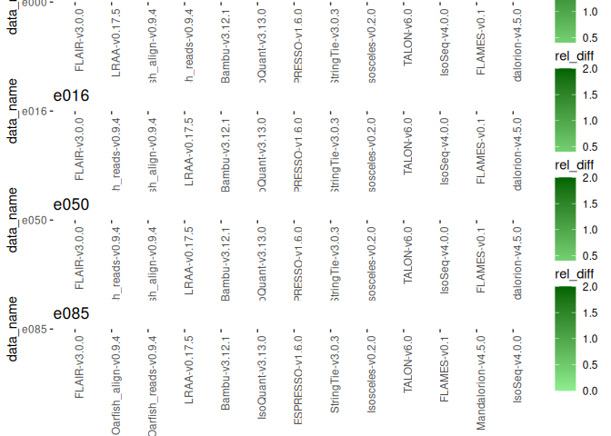<!-- -->

``` r
latest_summary_bar_plot = plot_grid(e000_latest_mean_expr_bar_plot,
                                    e016_latest_mean_expr_bar_plot,
                                    e050_latest_mean_expr_bar_plot,
                                    e085_latest_mean_expr_bar_plot,
                                    ncol=1)

latest_summary_bar_plot
```

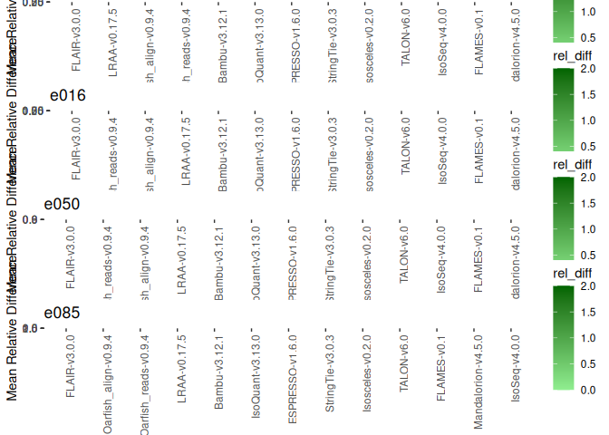<!-- -->

``` r
ggsave(latest_summary_bar_plot,
       file="mouse_sim_quant_summary_barplot.latest_tools.pdf",
       width=8,
       height=10)
```

## Oarfish-style quantification metrics

``` r
mouse_oarfish_metrics_df = read.csv("mouse_isoseqsim.oarfish_style_metrics.tsv", sep="\t", header=T)

mouse_oarfish_metrics_df$data_name = str_replace(mouse_oarfish_metrics_df$data_name, "mouse_isoseqsim_", "")

mouse_oarfish_metrics_df %>% head()
```

    ##                   name       color  spearman pearson_log1p ccc_log1p   kendall
    ## 1         FLAIR-v3.0.0        pink 0.9971622     0.9988180 0.9988171 0.9954567
    ## 2         LRAA-v0.17.5        teal 0.9931668     0.9956509 0.9956507 0.9879219
    ## 3 Oarfish_align-v0.9.4       khaki 0.9893334     0.9933449 0.9933165 0.9808146
    ## 4 Oarfish_reads-v0.9.4   peachpuff 0.9870225     0.9920026 0.9919562 0.9777275
    ## 5        Bambu-v3.12.1 forestgreen 0.9891421     0.9903698 0.9903675 0.9801519
    ## 6     IsoQuant-v3.13.0        blue 0.9873505     0.9895058 0.9895016 0.9815201
    ##        rmse nrmse_mean_truth        mard    pr_auc average_precision n_scored
    ## 1  2.708981        0.2354971 0.004454203 0.9984479         0.9982846    86932
    ## 2 10.111970        0.8790538 0.013165310 0.9975317         0.9969038    86932
    ## 3  7.293536        0.6340416 0.016504481 0.9981875         0.9967518    86932
    ## 4  7.471337        0.6494983 0.018516824 0.9979374         0.9961798    86932
    ## 5 16.212440        1.4093798 0.019158107 0.9967556         0.9956321    86932
    ## 6 16.714345        1.4530114 0.025970848 0.9973363         0.9953606    86932
    ##   n_truth_expressed n_truth_unexpressed data_name
    ## 1             55938               30994      e000
    ## 2             55938               30994      e000
    ## 3             55938               30994      e000
    ## 4             55938               30994      e000
    ## 5             55938               30994      e000
    ## 6             55938               30994      e000

``` r
higher_is_better_metrics = c(
  "spearman",
  "pearson_log1p",
  "ccc_log1p",
  "kendall",
  "pr_auc",
  "average_precision"
)

lower_is_better_metrics = c(
  "rmse",
  "nrmse_mean_truth",
  "mard"
)

oarfish_metric_labels = tribble(
  ~metric, ~metric_label,
  "spearman", "Spearman",
  "pearson_log1p", "Pearson log1p",
  "ccc_log1p", "CCC log1p",
  "kendall", "Kendall",
  "rmse", "RMSE",
  "nrmse_mean_truth", "NRMSE",
  "mard", "MARD",
  "pr_auc", "PR-AUC",
  "average_precision", "Average precision"
)

mouse_oarfish_metrics_long = mouse_oarfish_metrics_df %>%
  dplyr::select(name, data_name, all_of(c(higher_is_better_metrics, lower_is_better_metrics))) %>%
  pivot_longer(
    cols = all_of(c(higher_is_better_metrics, lower_is_better_metrics)),
    names_to = "metric",
    values_to = "metric_value"
  ) %>%
  left_join(oarfish_metric_labels, by="metric") %>%
  mutate(
    direction = if_else(metric %in% higher_is_better_metrics, "higher is better", "lower is better"),
    metric_label = factor(metric_label, levels=oarfish_metric_labels$metric_label)
  )
```

``` r
mouse_oarfish_metric_rankings = mouse_oarfish_metrics_long %>%
  group_by(data_name, metric, metric_label, direction) %>%
  mutate(
    metric_rank = if_else(
      direction == "higher is better",
      min_rank(dplyr::desc(metric_value)),
      min_rank(metric_value)
    )
  ) %>%
  ungroup()

mouse_oarfish_mean_rankings = mouse_oarfish_metric_rankings %>%
  group_by(name, metric, metric_label, direction) %>%
  summarize(
    mean_metric_value = mean(metric_value, na.rm=TRUE),
    mean_rank = mean(metric_rank, na.rm=TRUE),
    .groups = "drop"
  )
```

``` r
reorder_within = function(x, by, within, fun=mean, sep="___", ...) {
  new_x = paste(x, within, sep=sep)
  stats::reorder(new_x, by, FUN=fun)
}

scale_y_reordered = function(..., sep="___") {
  scale_y_discrete(labels=function(x) gsub(paste0(sep, ".+$"), "", x), ...)
}
```

``` r
oarfish_metric_mean_rank_plot = mouse_oarfish_mean_rankings %>%
  ggplot(aes(x=mean_rank, y=reorder_within(name, -mean_rank, metric_label), fill=mean_rank)) +
  geom_col() +
  geom_text(aes(label=round(mean_rank, 1)), hjust=-0.1, size=2.5) +
  facet_wrap(~metric_label, scales="free_y") +
  scale_y_reordered() +
  scale_x_continuous(expand = expansion(mult = c(0, 0.15))) +
  scale_fill_gradient(low="darkgreen", high="lightgreen") +
  theme_bw() +
  theme(axis.text.y = element_text(size=6),
        legend.position="none") +
  xlab("Mean rank across mouse simulations") +
  ylab("") +
  ggtitle("Mouse sim - Oarfish-style metric rankings")

oarfish_metric_mean_rank_plot
```

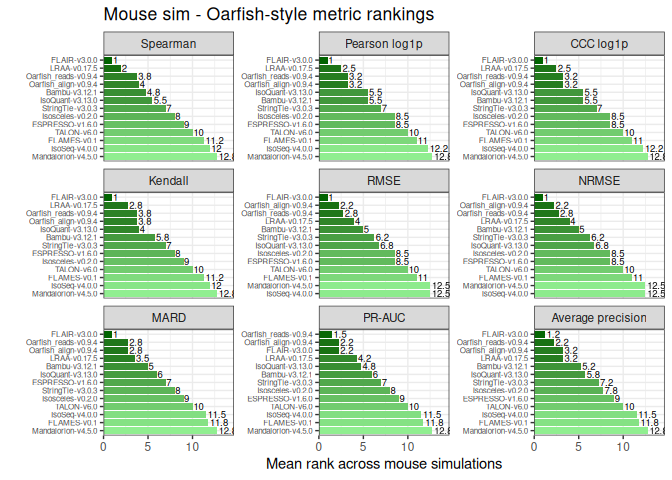<!-- -->

``` r
oarfish_metric_value_plot = mouse_oarfish_mean_rankings %>%
  ggplot(aes(x=mean_metric_value, y=reorder_within(name, mean_metric_value, metric_label), fill=mean_metric_value)) +
  geom_col() +
  facet_wrap(~metric_label, scales="free") +
  scale_y_reordered() +
  theme_bw() +
  theme(axis.text.y = element_text(size=6),
        legend.position="none") +
  xlab("Mean metric value across mouse simulations") +
  ylab("") +
  ggtitle("Mouse sim - Oarfish-style mean metric values")

oarfish_metric_value_plot
```

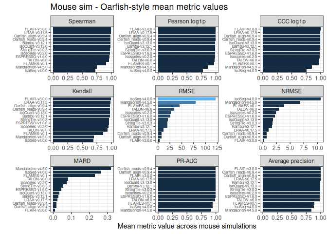<!-- -->

``` r
ggsave(oarfish_metric_mean_rank_plot,
       file="mouse_sim_oarfish_style_metric_rankings.pdf",
       width=11,
       height=8.5)

ggsave(oarfish_metric_value_plot,
       file="mouse_sim_oarfish_style_metric_values.pdf",
       width=11,
       height=8.5)
```

``` r
mouse_oarfish_latest_mean_rankings = mouse_oarfish_mean_rankings %>%
  filter(as.character(name) %in% latest_programs)

oarfish_latest_metric_mean_rank_plot = mouse_oarfish_latest_mean_rankings %>%
  ggplot(aes(x=mean_rank, y=reorder_within(name, -mean_rank, metric_label), fill=mean_rank)) +
  geom_col() +
  geom_text(aes(label=round(mean_rank, 1)), hjust=-0.1, size=2.5) +
  facet_wrap(~metric_label, scales="free_y") +
  scale_y_reordered() +
  scale_x_continuous(expand = expansion(mult = c(0, 0.15))) +
  scale_fill_gradient(low="darkgreen", high="lightgreen") +
  theme_bw() +
  theme(axis.text.y = element_text(size=6),
        legend.position="none") +
  xlab("Mean rank across mouse simulations") +
  ylab("") +
  ggtitle("Mouse sim - Oarfish-style metric rankings, latest tools")

oarfish_latest_metric_mean_rank_plot
```

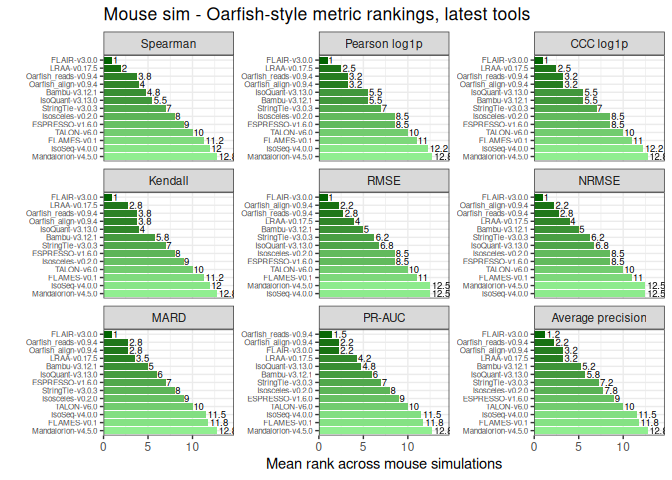<!-- -->

``` r
ggsave(oarfish_latest_metric_mean_rank_plot,
       file="mouse_sim_oarfish_style_metric_rankings.latest_tools.pdf",
       width=11,
       height=8.5)
```
