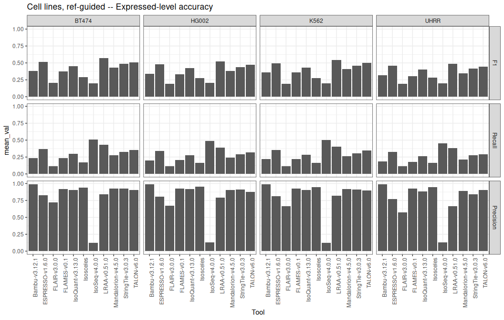
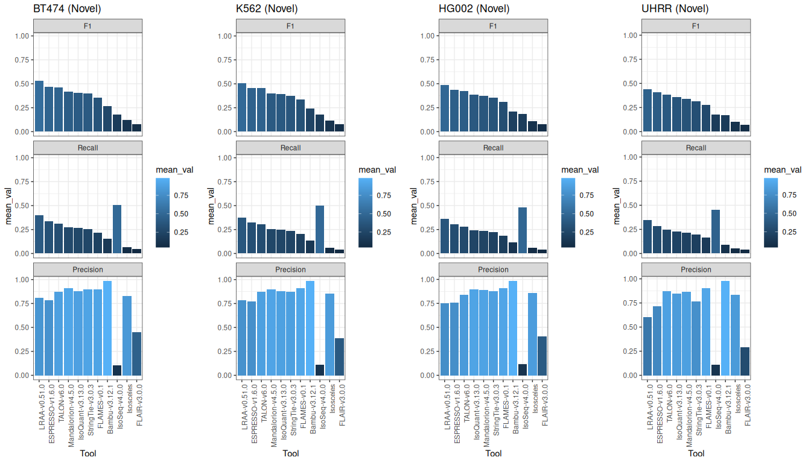
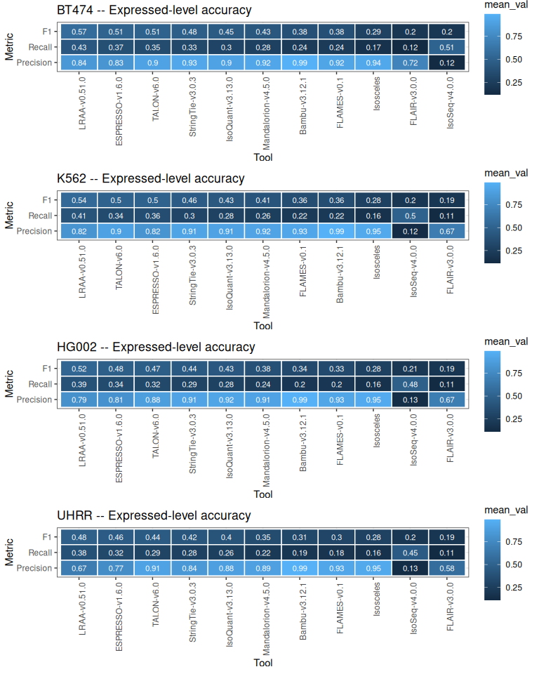
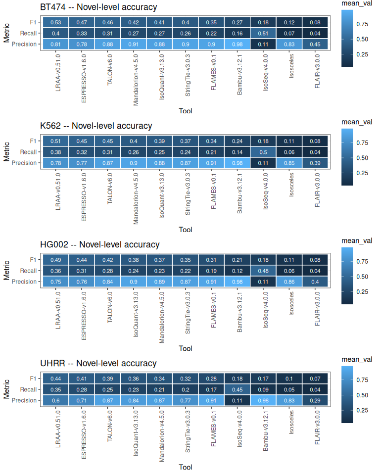
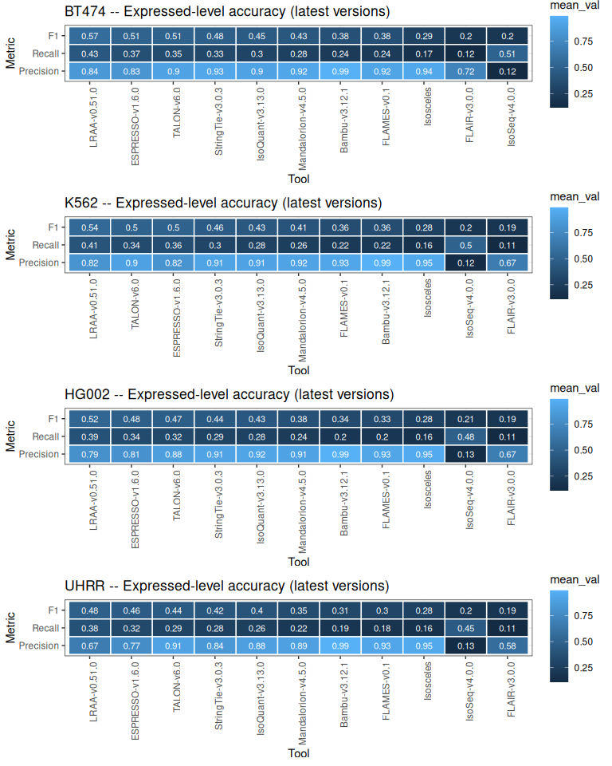
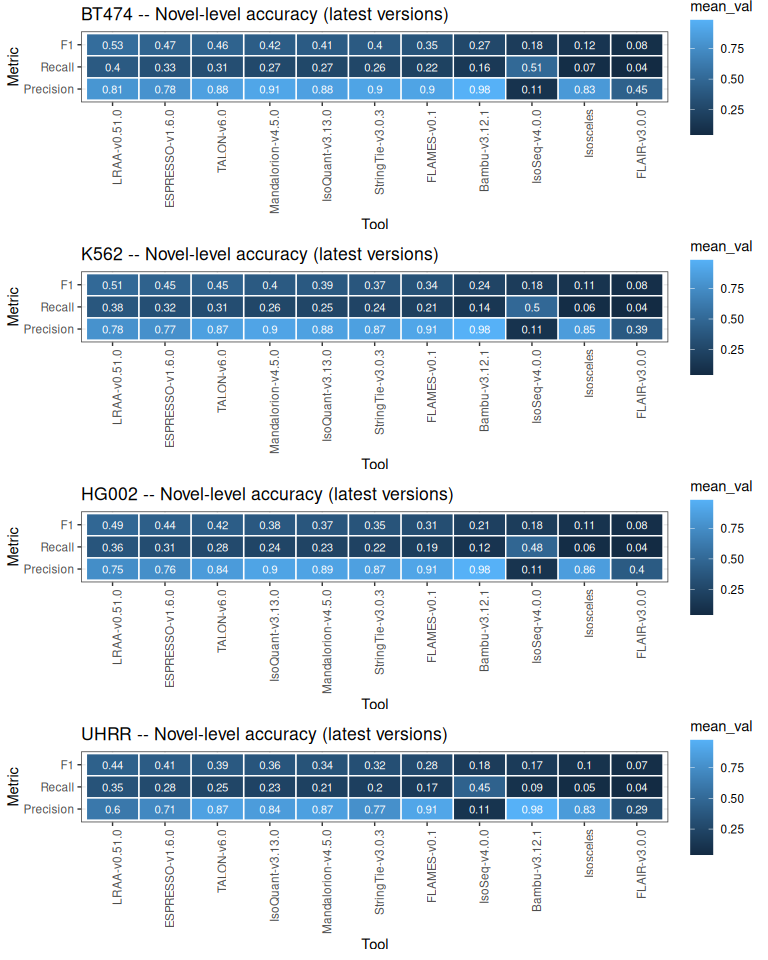

eval_cell_line_RefGuided_ID.Rmd
================
2025-02-17

Reference-guided isoform identification accuracy on the PacBio cell
lines (BT474, K562, HG002, UHRR), reported at two accuracy levels.

| Level | Source table | Universe scored |
|----|----|----|
| **Expressed** | `refguided_expressed_accuracy_summary.tsv` | every proxy-expressed reference chain: provided + held-out. Shares its universe with the de novo regime, so it is the cross-regime comparable number. |
| **Novel** | `refguided_accuracy_summary.tsv` | the held-out subset only. This is the primary result for reference-guided isoform discovery. |

The two source tables reuse the same `Metric` names for different
quantities, so the mapping below is deliberate rather than incidental:

| `Metric` column | in the expressed table | in the novel table |
|----|----|----|
| `knownTPR` | **recall** over the expressed universe | provided-model recall, an unscored diagnostic |
| `novelTPR` | `NA` for every entry | **recall** over the held-out universe |
| `novelFDR` | 1 - precision | 1 - precision |

Reading recall from the wrong column yields an all-`NA` row that renders
as a blank band in the heatmaps, so the setup chunk re-derives F1 from
the mapped precision and recall and stops the render if they disagree.

Figures are written to `Cell_lines_summary.<level>.pdf` and
`Cell_lines_summary.latest_tools.<level>.pdf`.

``` r
# The two source tables put recall in DIFFERENT columns, and each carries a
# column that means something else entirely in the other table:
#
#   expressed table: recall = knownTPR ; novelTPR is NA for every entry
#   novel table:     recall = novelTPR ; knownTPR is the provided-model recall,
#                    an unscored diagnostic, NOT a recall over this universe
#
# So the recall column is a parameter, and F1 is re-derived below as a guard.
read_level = function(path, level, recall_metric) {
  d = read.csv(path, header=T, sep="\t")
  d$data_name = str_replace(d$data_name, "CL_", "")
  d$data_name = str_replace(d$data_name, "_human", "")
  d %>%
    separate_wider_delim(data_name, "_", names=c("cell_line", "replicate")) %>%
    select(cell_line, replicate, Program, Metric, Value) %>%
    rename(Tool = Program) %>%
    spread(key=Metric, value=Value) %>%
    mutate(Recall = .data[[recall_metric]], Precision = 1-novelFDR) %>%
    select(Tool, F1, Recall, Precision, cell_line, replicate) %>%
    gather(key="Metric", value='Val', F1, Recall, Precision) %>%
    mutate(Level = level)
}

expressed_df = read_level("refguided_expressed_accuracy_summary.tsv", "Expressed", "knownTPR")
novel_df     = read_level("refguided_accuracy_summary.tsv", "Novel", "novelTPR")

df = bind_rows(expressed_df, novel_df) %>%
  mutate(Level  = factor(Level,  levels = c("Expressed", "Novel")),
         Metric = factor(Metric, levels = c("F1", "Recall", "Precision")))

# Guard: the reported F1 must be the harmonic mean of the Precision and Recall
# we just mapped. If a future column rename breaks the mapping, this fails loudly
# instead of silently greying out a heatmap row.
f1_check = df %>%
  spread(key=Metric, value=Val) %>%
  filter(!is.na(F1)) %>%
  mutate(F1_recomputed = 2*Precision*Recall/(Precision+Recall),
         delta = abs(F1 - F1_recomputed))
stopifnot(!any(is.na(f1_check$Recall)))
stopifnot(max(f1_check$delta, na.rm=TRUE) < 1e-6)
cat("F1 consistency check passed for", nrow(f1_check), "tool x sample x level rows;",
    "max |delta| =", signif(max(f1_check$delta, na.rm=TRUE), 3), "\n")
```

    ## F1 consistency check passed for 88 tool x sample x level rows; max |delta| = 1.67e-16

``` r
df %>% count(Level, cell_line) %>% spread(Level, n)
```

    ## # A tibble: 4 × 3
    ##   cell_line Expressed Novel
    ##   <chr>         <int> <int>
    ## 1 BT474            33    33
    ## 2 HG002            33    33
    ## 3 K562             33    33
    ## 4 UHRR             33    33

``` r
df %>% head()
```

    ## # A tibble: 6 × 6
    ##   Tool             cell_line replicate Metric   Val Level    
    ##   <chr>            <chr>     <chr>     <fct>  <dbl> <fct>    
    ## 1 Bambu-v3.12.1    BT474     E0        F1     0.383 Expressed
    ## 2 ESPRESSO-v1.6.0  BT474     E0        F1     0.512 Expressed
    ## 3 FLAIR-v3.0.0     BT474     E0        F1     0.203 Expressed
    ## 4 FLAMES-v0.1      BT474     E0        F1     0.376 Expressed
    ## 5 IsoQuant-v3.13.0 BT474     E0        F1     0.450 Expressed
    ## 6 Isosceles        BT474     E0        F1     0.287 Expressed

# Tool selection

``` r
get_latest_tools = function(data_df) {

  tool_versions = data_df %>%
    distinct(Tool) %>%
    mutate(Tool = as.character(Tool),
           Tool_Base = str_remove(Tool, "-v[0-9].*$"),
           Version = str_match(Tool, "-v([0-9][0-9A-Za-z.\\-]*)$")[, 2])

  latest_versioned_tools = tool_versions %>%
    filter(! is.na(Version)) %>%
    group_by(Tool_Base) %>%
    # numeric_version() rejects letter suffixes (e.g. 0.18.2b), so rank on the
    # leading numeric run and break ties on the full string:
    #   0.18.3 > 0.18.2b > 0.18.2
    arrange(desc(numeric_version(str_extract(Version, "^[0-9]+(\\.[0-9]+)*"))),
            desc(Version), .by_group = TRUE) %>%
    slice(1) %>%
    ungroup()

  unversioned_tools = tool_versions %>%
    filter(is.na(Version))

  bind_rows(latest_versioned_tools, unversioned_tools) %>%
    pull(Tool)
}

latest_tools = get_latest_tools(df)

latest_tools
```

    ##  [1] "Bambu-v3.12.1"      "ESPRESSO-v1.6.0"    "FLAIR-v3.0.0"      
    ##  [4] "FLAMES-v0.1"        "IsoQuant-v3.13.0"   "IsoSeq-v4.0.0"     
    ##  [7] "LRAA-v0.51.0"       "Mandalorion-v4.5.0" "StringTie-v3.0.3"  
    ## [10] "TALON-v6.0"         "Isosceles"

Tools are ordered within each figure by descending F1 *at the level that
figure shows*, so the ordering of a novel-level panel need not match its
expressed-level counterpart.

``` r
rank_by_F1 = function(d) {
  d %>% mutate(Tool = factor(Tool, levels = d %>%
    filter(Metric == "F1") %>% arrange(desc(mean_val)) %>% pull(Tool)))
}

mean_df = df %>%
  group_by(Tool, cell_line, Level, Metric) %>%
  summarize(mean_val = mean(Val), .groups="drop")

cell_lines = c("BT474", "K562", "HG002", "UHRR")
```

# All tools, per accuracy level

``` r
mean_vals_for_plot = df %>%
  group_by(Tool, Metric, Level, cell_line) %>%
  summarize(mean_val = mean(Val), stderr = sd(Val)/sqrt(n()), .groups="drop")

for (lvl in levels(df$Level)) {
  p = mean_vals_for_plot %>% filter(Level == lvl) %>%
    ggplot(aes(x=Tool, y=mean_val)) + geom_col() +
    geom_errorbar(aes(x=Tool, ymin=mean_val-stderr, ymax=pmin(1, mean_val+stderr))) +
    facet_grid(vars(Metric), vars(cell_line)) +
    theme_bw() +
    theme(axis.text.x = element_text(angle = 90, hjust = 1)) +
    ggtitle(paste0("Cell lines, ref-guided -- ", lvl, "-level accuracy"))
  print(p)
}
```

<!-- --><!-- -->

# Ranked bar plots per cell line

``` r
make_ranked_plot = function(d, plot_title) {
  rank_by_F1(d) %>%
    ggplot(aes(x=Tool, y=mean_val, fill=mean_val)) + geom_col() +
    facet_wrap(~Metric, ncol=1) +
    theme_bw() +
    theme(axis.text.x = element_text(angle = 90, hjust = 1)) +
    ggtitle(plot_title)
}

ranked_grids = list()
for (lvl in levels(df$Level)) {
  plots = lapply(cell_lines, function(cl) {
    make_ranked_plot(mean_df %>% filter(cell_line == cl, Level == lvl),
                     paste0(cl, " (", lvl, ")"))
  })
  g = plot_grid(plotlist = plots, nrow = 1)
  ranked_grids[[lvl]] = g
  print(g)
}
```

<!-- --><!-- -->

# Heatmap representations, condensed view

``` r
make_tile_plot = function(d, plot_title) {
  rank_by_F1(d) %>%
    mutate(Metric = factor(Metric, levels = c("Precision", "Recall", "F1"))) %>%
    ggplot(aes(x=Tool, y=Metric, fill=mean_val)) +
    geom_tile(color = "white", size = 0.5) +
    geom_text(aes(label = round(mean_val, 2)), size = 3, color = "white") +
    theme_bw() +
    theme(axis.text.x = element_text(angle = 90, hjust = 1)) +
    ggtitle(plot_title)
}

stacked_tile_plots = list()
for (lvl in levels(df$Level)) {
  plots = lapply(cell_lines, function(cl) {
    make_tile_plot(mean_df %>% filter(cell_line == cl, Level == lvl),
                   paste0(cl, " -- ", lvl, "-level accuracy"))
  })
  g = plot_grid(plotlist = plots, ncol = 1)
  stacked_tile_plots[[lvl]] = g
  print(g)
}
```

    ## Warning: Using `size` aesthetic for lines was deprecated in ggplot2 3.4.0.
    ## ℹ Please use `linewidth` instead.
    ## This warning is displayed once per session.
    ## Call `lifecycle::last_lifecycle_warnings()` to see where this warning was
    ## generated.

<!-- --><!-- -->

``` r
for (lvl in names(stacked_tile_plots)) {
  fname = paste0("Cell_lines_summary.", tolower(lvl), ".pdf")
  ggsave(stacked_tile_plots[[lvl]], file=fname, width=8, height=10)
  message("wrote ", fname)
}
```

    ## wrote Cell_lines_summary.expressed.pdf

    ## wrote Cell_lines_summary.novel.pdf

# Latest tool versions only

``` r
latest_mean_df = df %>%
  filter(as.character(Tool) %in% latest_tools) %>%
  group_by(Tool, cell_line, Level, Metric) %>%
  summarize(mean_val = mean(Val), .groups="drop")

latest_stacked_tile_plots = list()
for (lvl in levels(df$Level)) {
  plots = lapply(cell_lines, function(cl) {
    make_tile_plot(latest_mean_df %>% filter(cell_line == cl, Level == lvl),
                   paste0(cl, " -- ", lvl, "-level accuracy (latest versions)"))
  })
  g = plot_grid(plotlist = plots, ncol = 1)
  latest_stacked_tile_plots[[lvl]] = g
  print(g)
}
```

<!-- --><!-- -->

``` r
for (lvl in names(latest_stacked_tile_plots)) {
  fname = paste0("Cell_lines_summary.latest_tools.", tolower(lvl), ".pdf")
  ggsave(latest_stacked_tile_plots[[lvl]], file=fname, width=8, height=10)
  message("wrote ", fname)
}
```

    ## wrote Cell_lines_summary.latest_tools.expressed.pdf

    ## wrote Cell_lines_summary.latest_tools.novel.pdf

# Expressed versus novel, side by side

Same tools, same samples, the two universes side by side. The expressed
universe is dominated by held-out chains, so the two levels track each
other closely; where they diverge, a tool is being rewarded or penalised
for how it handles the *provided* models it was given rather than for
discovery.

``` r
latest_F1 = latest_mean_df %>% filter(Metric == "F1")

both_levels_plot = latest_F1 %>%
  mutate(Tool = fct_reorder(Tool, mean_val, .fun=mean, .desc=FALSE)) %>%
  ggplot(aes(x=Tool, y=mean_val, fill=Level)) +
  geom_col(position="dodge") +
  coord_flip() +
  facet_wrap(~cell_line, nrow=1) +
  theme_bw() +
  labs(y="F1", title="Ref-guided F1: expressed-level vs novel-level (latest versions)")

both_levels_plot
```

<!-- -->

``` r
ggsave(both_levels_plot, file="Cell_lines_summary.latest_tools.both_levels.pdf",
       width=10, height=8)
```

``` r
latest_F1 %>%
  select(Tool, cell_line, Level, mean_val) %>%
  spread(Level, mean_val) %>%
  mutate(`Expressed - Novel` = round(Expressed - Novel, 4)) %>%
  arrange(cell_line, desc(Expressed))
```

    ## # A tibble: 44 × 5
    ##    Tool               cell_line Expressed  Novel `Expressed - Novel`
    ##    <chr>              <chr>         <dbl>  <dbl>               <dbl>
    ##  1 LRAA-v0.51.0       BT474         0.569 0.534               0.0354
    ##  2 ESPRESSO-v1.6.0    BT474         0.512 0.468               0.0439
    ##  3 TALON-v6.0         BT474         0.508 0.461               0.047 
    ##  4 StringTie-v3.0.3   BT474         0.483 0.400               0.0831
    ##  5 IsoQuant-v3.13.0   BT474         0.450 0.407               0.0434
    ##  6 Mandalorion-v4.5.0 BT474         0.428 0.420               0.0085
    ##  7 Bambu-v3.12.1      BT474         0.383 0.269               0.114 
    ##  8 FLAMES-v0.1        BT474         0.376 0.353               0.023 
    ##  9 Isosceles          BT474         0.287 0.124               0.164 
    ## 10 FLAIR-v3.0.0       BT474         0.203 0.0802              0.122 
    ## # ℹ 34 more rows
