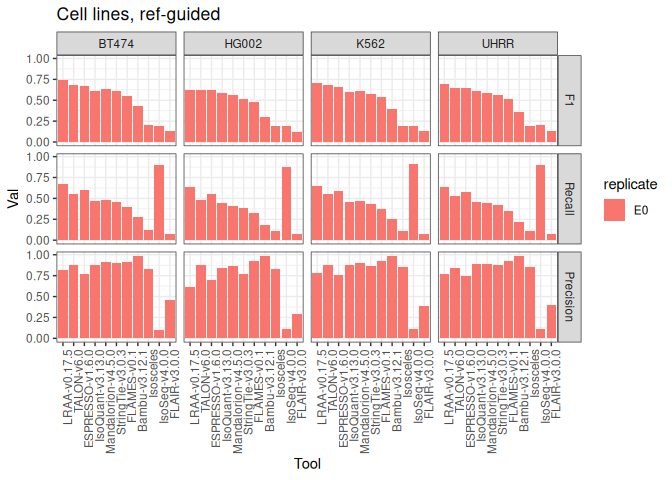
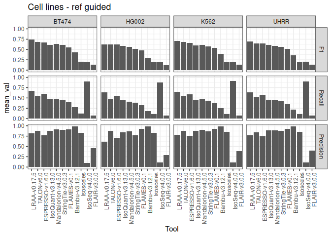
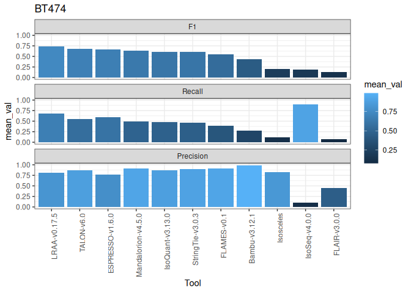
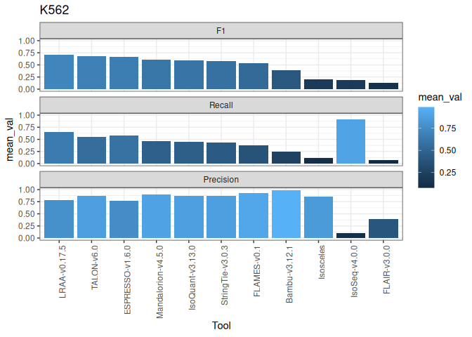
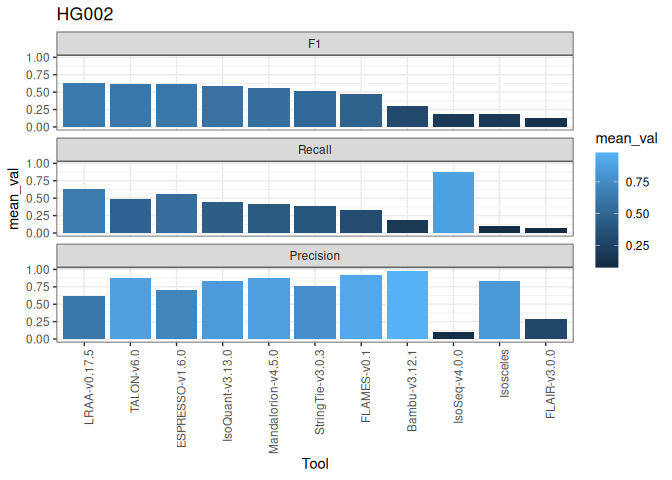
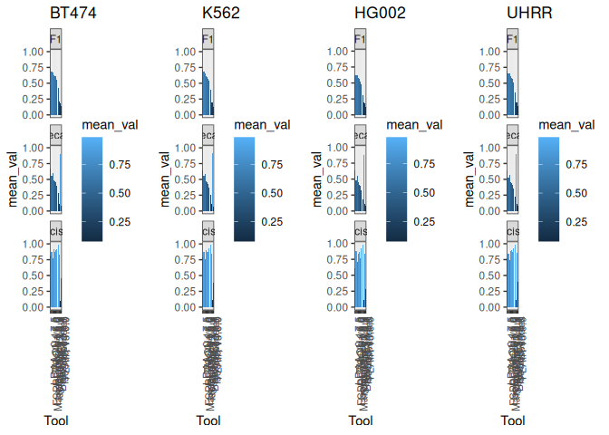
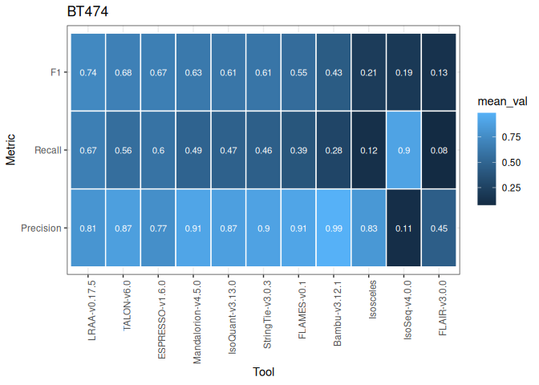
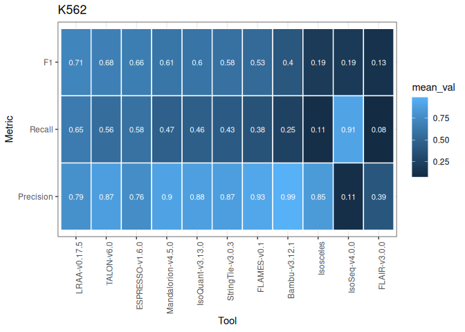
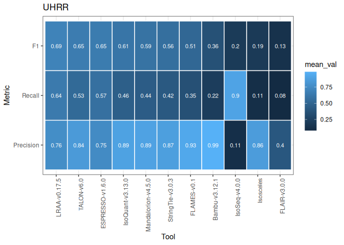
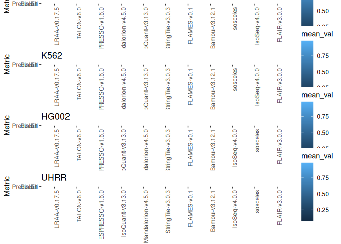

eval_cell_line_RefGuided_ID.Rmd
================
2025-02-17

``` r
df = read.csv("refguided_accuracy_summary.tsv", header=T, sep="\t")

df$data_name = str_replace(df$data_name, "CL_", "")
df$data_name = str_replace(df$data_name, "_human", "")

df = df %>%  separate_wider_delim(data_name, "_", names=c("cell_line", "replicate"))

df = df %>% select(cell_line, replicate, Program, Metric, Value) %>% rename(Tool = Program)


df %>% head()
```

    ## # A tibble: 6 × 5
    ##   cell_line replicate Tool          Metric   Value
    ##   <chr>     <chr>     <chr>         <chr>    <dbl>
    ## 1 K562      E0        LRAA-v0.17.5  knownTPR 0.567
    ## 2 K562      E0        LRAA-v0.17.5  novelTPR 0.646
    ## 3 K562      E0        LRAA-v0.17.5  novelFDR 0.214
    ## 4 K562      E0        LRAA-v0.17.5  F1       0.709
    ## 5 K562      E0        Bambu-v3.12.1 knownTPR 0.694
    ## 6 K562      E0        Bambu-v3.12.1 novelTPR 0.249

``` r
df = df %>% filter(Metric != "knownTPR")

df = df %>% spread(key=Metric, value=Value) 

df = df %>% dplyr::rename(Recall = `novelTPR`) %>% mutate(Precision = 1-novelFDR) %>% select(-novelFDR)


df %>% head()
```

    ## # A tibble: 6 × 6
    ##   cell_line replicate Tool                F1 Recall Precision
    ##   <chr>     <chr>     <chr>            <dbl>  <dbl>     <dbl>
    ## 1 BT474     E0        Bambu-v3.12.1    0.433 0.278      0.988
    ## 2 BT474     E0        ESPRESSO-v1.6.0  0.672 0.595      0.772
    ## 3 BT474     E0        FLAIR-v3.0.0     0.134 0.0785     0.453
    ## 4 BT474     E0        FLAMES-v0.1      0.549 0.392      0.915
    ## 5 BT474     E0        IsoQuant-v3.13.0 0.613 0.472      0.875
    ## 6 BT474     E0        Isosceles        0.208 0.119      0.830

``` r
df = df %>% dplyr::select(Tool, F1, Recall, Precision, cell_line, replicate) %>%
  gather(key="Metric", value='Val', F1, Recall, Precision)

df %>% head()
```

    ## # A tibble: 6 × 5
    ##   Tool             cell_line replicate Metric   Val
    ##   <chr>            <chr>     <chr>     <chr>  <dbl>
    ## 1 Bambu-v3.12.1    BT474     E0        F1     0.433
    ## 2 ESPRESSO-v1.6.0  BT474     E0        F1     0.672
    ## 3 FLAIR-v3.0.0     BT474     E0        F1     0.134
    ## 4 FLAMES-v0.1      BT474     E0        F1     0.549
    ## 5 IsoQuant-v3.13.0 BT474     E0        F1     0.613
    ## 6 Isosceles        BT474     E0        F1     0.208

``` r
prog_ranking = df %>% filter(Metric == "F1") %>% group_by(Tool) %>%
  summarize(mean_F1 = mean(Val)) %>% arrange(dplyr::desc(mean_F1)) %>% pull(Tool)


df$Tool = factor(df$Tool, levels=prog_ranking)
```

``` r
df$Metric = factor(df$Metric, levels = c("F1", "Recall", "Precision"))
```

``` r
df %>% ggplot(aes(x=Tool, y=Val, fill=replicate)) + geom_bar(stat='identity', position='dodge') +
  facet_grid(vars(Metric), vars(cell_line)) +
  theme_bw() +
   theme(axis.text.x = element_text(angle = 90, hjust = 1)) +
  ggtitle("Cell lines, ref-guided")
```

<!-- -->

``` r
get_latest_tools = function(data_df) {

  tool_versions = data_df %>%
    distinct(Tool) %>%
    mutate(Tool = as.character(Tool),
           Tool_Base = str_remove(Tool, "-v[0-9].*$"),
           Version = str_match(Tool, "-v([0-9][0-9A-Za-z.\\-]*)$")[, 2])

  latest_versioned_tools = tool_versions %>%
    filter(! is.na(Version)) %>%
    group_by(Tool_Base) %>%
    arrange(dplyr::desc(numeric_version(Version)), .by_group = TRUE) %>%
    dplyr::slice(1) %>%
    ungroup()

  unversioned_tools = tool_versions %>%
    filter(is.na(Version))

  bind_rows(latest_versioned_tools, unversioned_tools) %>%
    pull(Tool)
}

latest_tools = get_latest_tools(df)

latest_tools
```

    ##  [1] "Bambu-v3.12.1"      "ESPRESSO-v1.6.0"    "FLAIR-v3.0.0"      
    ##  [4] "FLAMES-v0.1"        "IsoQuant-v3.13.0"   "IsoSeq-v4.0.0"     
    ##  [7] "LRAA-v0.17.5"       "Mandalorion-v4.5.0" "StringTie-v3.0.3"  
    ## [10] "TALON-v6.0"         "Isosceles"

``` r
mean_vals_for_plot = df %>%
  group_by(Tool, Metric, cell_line) %>%
  summarize(mean_val = mean(Val), stderr = sd(Val)/sqrt(n())) 
```

    ## `summarise()` has regrouped the output.
    ## ℹ Summaries were computed grouped by Tool, Metric, and cell_line.
    ## ℹ Output is grouped by Tool and Metric.
    ## ℹ Use `summarise(.groups = "drop_last")` to silence this message.
    ## ℹ Use `summarise(.by = c(Tool, Metric, cell_line))` for per-operation grouping
    ##   (`?dplyr::dplyr_by`) instead.

``` r
mean_vals_for_plot$Metric = factor(mean_vals_for_plot$Metric, levels=c("F1", "Recall", "Precision") ) 


mean_vals_for_plot %>%  ggplot(aes(x=Tool, y=mean_val)) + geom_col() +
  geom_errorbar(aes(x=Tool, ymin=mean_val-stderr, ymax=pmin(1, mean_val+stderr))) +
  facet_grid(vars(Metric),vars(cell_line) ) +
  theme_bw() +
   theme(axis.text.x = element_text(angle = 90, hjust = 1)) +
  ggtitle("Cell lines - ref guided")
```

<!-- -->

``` r
mean_df = df %>% group_by(Tool, cell_line, Metric) %>%
  summarize(mean_val = mean(Val))
```

    ## `summarise()` has regrouped the output.
    ## ℹ Summaries were computed grouped by Tool, cell_line, and Metric.
    ## ℹ Output is grouped by Tool and cell_line.
    ## ℹ Use `summarise(.groups = "drop_last")` to silence this message.
    ## ℹ Use `summarise(.by = c(Tool, cell_line, Metric))` for per-operation grouping
    ##   (`?dplyr::dplyr_by`) instead.

``` r
mean_df %>% head()
```

    ## # A tibble: 6 × 4
    ## # Groups:   Tool, cell_line [2]
    ##   Tool         cell_line Metric    mean_val
    ##   <fct>        <chr>     <fct>        <dbl>
    ## 1 LRAA-v0.17.5 BT474     F1           0.736
    ## 2 LRAA-v0.17.5 BT474     Recall       0.674
    ## 3 LRAA-v0.17.5 BT474     Precision    0.812
    ## 4 LRAA-v0.17.5 HG002     F1           0.626
    ## 5 LRAA-v0.17.5 HG002     Recall       0.639
    ## 6 LRAA-v0.17.5 HG002     Precision    0.613

``` r
 df %>% select(cell_line) %>% unique()
```

    ## # A tibble: 4 × 1
    ##   cell_line
    ##   <chr>    
    ## 1 BT474    
    ## 2 HG002    
    ## 3 K562     
    ## 4 UHRR

``` r
BT474_df = mean_df %>% filter(cell_line == "BT474")

BT474_rankings = BT474_df %>% filter(Metric == "F1") %>% arrange(dplyr::desc(mean_val)) %>% pull(Tool)

BT474_df$Tool = factor(BT474_df$Tool, levels=BT474_rankings)

BT474_df_ranked_plot = BT474_df %>% ggplot(aes(x=Tool, y=mean_val, fill=mean_val)) + geom_col() +
  facet_wrap(~Metric, ncol=1) +
  theme_bw() +
  theme(axis.text.x = element_text(angle = 90, hjust = 1)) +
  ggtitle("BT474")
            
BT474_df_ranked_plot
```

<!-- -->

``` r
K562_df = mean_df %>% filter(cell_line == "K562")

K562_rankings = K562_df %>% filter(Metric == "F1") %>% arrange(dplyr::desc(mean_val)) %>% pull(Tool)

K562_df$Tool = factor(K562_df$Tool, levels=K562_rankings)

K562_df_ranked_plot =   K562_df %>% ggplot(aes(x=Tool, y=mean_val, fill=mean_val)) + geom_col() +
  facet_wrap(~Metric, ncol=1) +
  theme_bw() +
  theme(axis.text.x = element_text(angle = 90, hjust = 1)) +
  ggtitle("K562")


K562_df_ranked_plot
```

<!-- -->

``` r
  HG002_df = mean_df %>% filter(cell_line == "HG002")
  
  HG002_rankings = HG002_df %>% filter(Metric == "F1") %>% arrange(dplyr::desc(mean_val)) %>% pull(Tool)
  
  HG002_df$Tool = factor(HG002_df$Tool, levels=HG002_rankings)
  
  HG002_df_ranked_plot = HG002_df %>% ggplot(aes(x=Tool, y=mean_val, fill=mean_val)) + geom_col() +
    facet_wrap(~Metric, ncol=1) +
    theme_bw() +
    theme(axis.text.x = element_text(angle = 90, hjust = 1)) +
    ggtitle("HG002")
  
  
  HG002_df_ranked_plot
```

<!-- -->

``` r
UHRR_df = mean_df %>% filter(cell_line == "UHRR")

UHRR_rankings = UHRR_df %>% filter(Metric == "F1") %>% arrange(dplyr::desc(mean_val)) %>% pull(Tool)

UHRR_df$Tool = factor(UHRR_df$Tool, levels=UHRR_rankings)

UHRR_df_ranked_plot = UHRR_df %>% ggplot(aes(x=Tool, y=mean_val, fill=mean_val)) + geom_col() +
  facet_wrap(~Metric, ncol=1) +
  theme_bw() +
  theme(axis.text.x = element_text(angle = 90, hjust = 1)) +
  ggtitle("UHRR")

UHRR_df_ranked_plot
```

<!-- -->

``` r
library(cowplot)
```

    ## 
    ## Attaching package: 'cowplot'

    ## The following object is masked from 'package:lubridate':
    ## 
    ##     stamp

``` r
plot_grid(BT474_df_ranked_plot,
          K562_df_ranked_plot,
          HG002_df_ranked_plot,
          UHRR_df_ranked_plot,
          nrow=1)
```

<!-- -->

# use heatmap reprsentations for condensed view.

``` r
BT474_tile_plot = BT474_df %>%  
  mutate(Metric = factor(Metric, levels = c("Precision", "Recall", "F1"))) %>%
  ggplot(aes(x=Tool, y=Metric, fill=mean_val))  +
  geom_tile(color = "white", size = 0.5) +
  geom_text(aes(label = round(mean_val, 2)), 
            size = 3, 
            color = "white") +
  #scale_fill_gradient(low = "lightblue", high = "steelblue", limits = c(0, 1)) +
  theme_bw() +
  theme(axis.text.x = element_text(angle = 90, hjust = 1)) +
  ggtitle("BT474")
```

    ## Warning: Using `size` aesthetic for lines was deprecated in ggplot2 3.4.0.
    ## ℹ Please use `linewidth` instead.
    ## This warning is displayed once per session.
    ## Call `lifecycle::last_lifecycle_warnings()` to see where this warning was
    ## generated.

``` r
BT474_tile_plot
```

<!-- -->

``` r
K562_tile_plot = K562_df %>%  
  mutate(Metric = factor(Metric, levels = c("Precision", "Recall", "F1"))) %>%
  ggplot(aes(x=Tool, y=Metric, fill=mean_val))  +
  geom_tile(color = "white", size = 0.5) +
  geom_text(aes(label = round(mean_val, 2)), 
            size = 3, 
            color = "white") +
  #scale_fill_gradient(low = "lightblue", high = "steelblue", limits = c(0, 1)) +
  theme_bw() +
  theme(axis.text.x = element_text(angle = 90, hjust = 1)) +
  ggtitle("K562")

K562_tile_plot
```

<!-- -->

``` r
  HG002_tile_plot = HG002_df %>%  
  mutate(Metric = factor(Metric, levels = c("Precision", "Recall", "F1"))) %>%
  ggplot(aes(x=Tool, y=Metric, fill=mean_val))  +
  geom_tile(color = "white", size = 0.5) +
  geom_text(aes(label = round(mean_val, 2)), 
            size = 3, 
            color = "white") +
  #scale_fill_gradient(low = "lightblue", high = "steelblue", limits = c(0, 1)) +
  theme_bw() +
  theme(axis.text.x = element_text(angle = 90, hjust = 1)) +
    ggtitle("HG002")
  
  HG002_tile_plot
```

<!-- -->

``` r
UHRR_tile_plot = UHRR_df %>%  
  mutate(Metric = factor(Metric, levels = c("Precision", "Recall", "F1"))) %>%
  ggplot(aes(x=Tool, y=Metric, fill=mean_val))  +
  geom_tile(color = "white", size = 0.5) +
  geom_text(aes(label = round(mean_val, 2)), 
            size = 3, 
            color = "white") +
  #scale_fill_gradient(low = "lightblue", high = "steelblue", limits = c(0, 1)) +
  theme_bw() +
  theme(axis.text.x = element_text(angle = 90, hjust = 1)) +
  ggtitle("UHRR")

UHRR_tile_plot
```

<!-- -->

``` r
stacked_tile_plot = plot_grid(BT474_tile_plot,
                              K562_tile_plot,
                              HG002_tile_plot,
                              UHRR_tile_plot,
          ncol=1)

stacked_tile_plot 
```

<!-- -->

``` r
ggsave(stacked_tile_plot, file="Cell_lines_summary.pdf", width=8, height=10)
```

``` r
latest_mean_df = df %>%
  filter(as.character(Tool) %in% latest_tools) %>%
  group_by(Tool, cell_line, Metric) %>%
  summarize(mean_val = mean(Val))
```

    ## `summarise()` has regrouped the output.
    ## ℹ Summaries were computed grouped by Tool, cell_line, and Metric.
    ## ℹ Output is grouped by Tool and cell_line.
    ## ℹ Use `summarise(.groups = "drop_last")` to silence this message.
    ## ℹ Use `summarise(.by = c(Tool, cell_line, Metric))` for per-operation grouping
    ##   (`?dplyr::dplyr_by`) instead.

``` r
latest_BT474_df = latest_mean_df %>% filter(cell_line == "BT474")

latest_BT474_rankings = latest_BT474_df %>%
  filter(Metric == "F1") %>%
  arrange(dplyr::desc(mean_val)) %>%
  pull(Tool)

latest_BT474_df$Tool = factor(latest_BT474_df$Tool, levels=latest_BT474_rankings)

latest_K562_df = latest_mean_df %>% filter(cell_line == "K562")

latest_K562_rankings = latest_K562_df %>%
  filter(Metric == "F1") %>%
  arrange(dplyr::desc(mean_val)) %>%
  pull(Tool)

latest_K562_df$Tool = factor(latest_K562_df$Tool, levels=latest_K562_rankings)

latest_HG002_df = latest_mean_df %>% filter(cell_line == "HG002")

latest_HG002_rankings = latest_HG002_df %>%
  filter(Metric == "F1") %>%
  arrange(dplyr::desc(mean_val)) %>%
  pull(Tool)

latest_HG002_df$Tool = factor(latest_HG002_df$Tool, levels=latest_HG002_rankings)

latest_UHRR_df = latest_mean_df %>% filter(cell_line == "UHRR")

latest_UHRR_rankings = latest_UHRR_df %>%
  filter(Metric == "F1") %>%
  arrange(dplyr::desc(mean_val)) %>%
  pull(Tool)

latest_UHRR_df$Tool = factor(latest_UHRR_df$Tool, levels=latest_UHRR_rankings)

make_tile_plot = function(plot_df, plot_title) {

  plot_df %>%
    mutate(Metric = factor(Metric, levels = c("Precision", "Recall", "F1"))) %>%
    ggplot(aes(x=Tool, y=Metric, fill=mean_val)) +
    geom_tile(color = "white", size = 0.5) +
    geom_text(aes(label = round(mean_val, 2)),
              size = 3,
              color = "white") +
    theme_bw() +
    theme(axis.text.x = element_text(angle = 90, hjust = 1)) +
    ggtitle(plot_title)
}

latest_stacked_tile_plot = plot_grid(make_tile_plot(latest_BT474_df, "BT474"),
                                     make_tile_plot(latest_K562_df, "K562"),
                                     make_tile_plot(latest_HG002_df, "HG002"),
                                     make_tile_plot(latest_UHRR_df, "UHRR"),
                                     ncol=1)

latest_stacked_tile_plot
```

<!-- -->

``` r
ggsave(latest_stacked_tile_plot,
       file="Cell_lines_summary.latest_tools.pdf",
       width=8,
       height=10)
```
