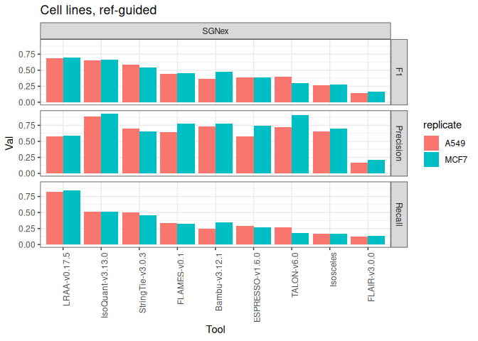
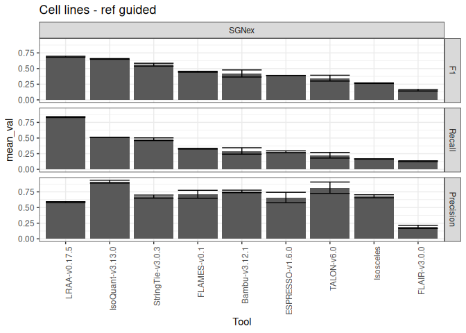
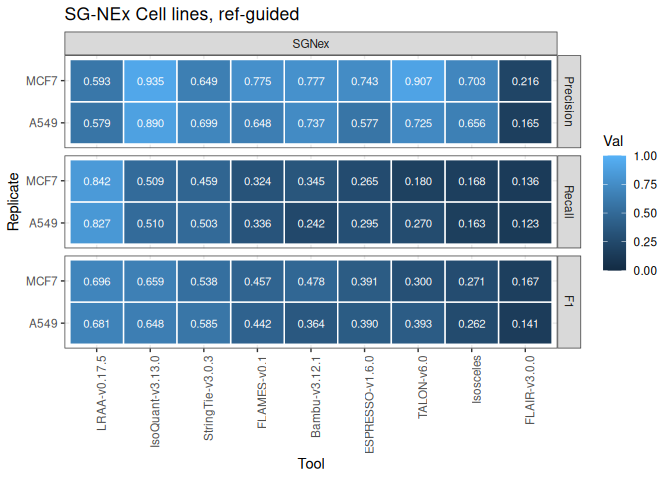
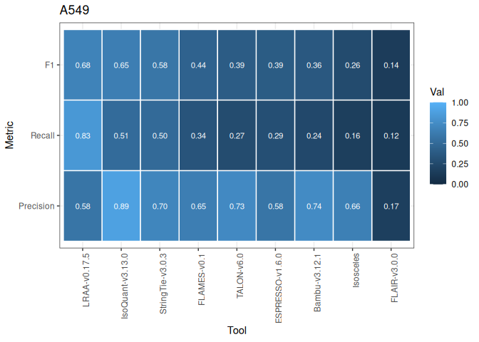
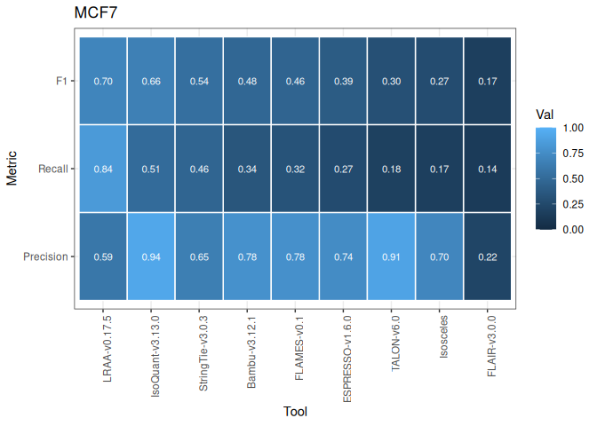
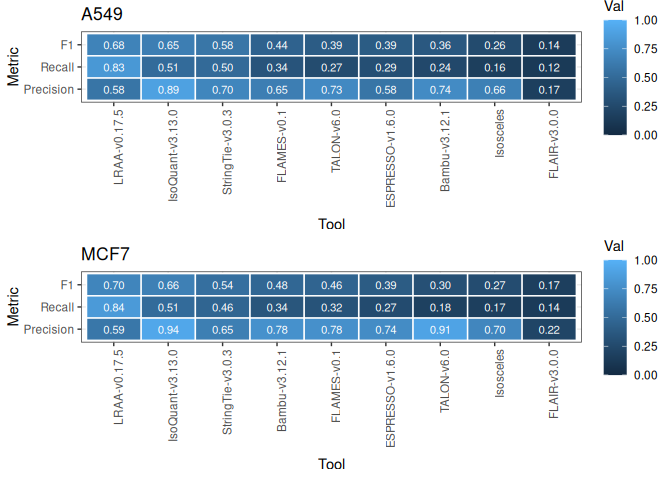

eval_cell_line_RefGuided_ID.Rmd
================
2025-02-17

``` r
df = read.csv("refguided_accuracy_summary.tsv", header=T, sep="\t")

df$data_name = str_replace(df$data_name, "CL_", "")
df$data_name = str_replace(df$data_name, "_human", "")

df = df %>%  separate_wider_delim(data_name, "_", names=c("cell_line", "replicate")) %>%
  rename(Tool = Program) %>%
  select(cell_line, replicate, Tool, Metric, Value) %>%
  filter(Metric != 'knownTPR')

df %>% head()
```

    ## # A tibble: 6 × 5
    ##   cell_line replicate Tool          Metric   Value
    ##   <chr>     <chr>     <chr>         <chr>    <dbl>
    ## 1 SGNex     A549      LRAA-v0.17.5  novelTPR 0.827
    ## 2 SGNex     A549      LRAA-v0.17.5  novelFDR 0.421
    ## 3 SGNex     A549      LRAA-v0.17.5  F1       0.681
    ## 4 SGNex     A549      Bambu-v3.12.1 novelTPR 0.242
    ## 5 SGNex     A549      Bambu-v3.12.1 novelFDR 0.263
    ## 6 SGNex     A549      Bambu-v3.12.1 F1       0.364

``` r
df = df %>% spread(key=Metric, value=`Value`) 

df = df %>% dplyr::rename(Recall = `novelTPR`) %>% mutate(Precision = 1-novelFDR) %>% select(-novelFDR)


df %>% head()
```

    ## # A tibble: 6 × 6
    ##   cell_line replicate Tool                F1 Recall Precision
    ##   <chr>     <chr>     <chr>            <dbl>  <dbl>     <dbl>
    ## 1 SGNex     A549      Bambu-v3.12.1    0.364  0.242     0.737
    ## 2 SGNex     A549      ESPRESSO-v1.6.0  0.390  0.295     0.577
    ## 3 SGNex     A549      FLAIR-v3.0.0     0.141  0.123     0.165
    ## 4 SGNex     A549      FLAMES-v0.1      0.442  0.336     0.648
    ## 5 SGNex     A549      IsoQuant-v3.13.0 0.648  0.510     0.890
    ## 6 SGNex     A549      Isosceles        0.262  0.163     0.656

``` r
df = df %>% dplyr::select(Tool, F1, Recall, Precision, cell_line, replicate) %>%
  gather(key="Metric", value='Val', F1, Recall, Precision)

df %>% head()
```

    ## # A tibble: 6 × 5
    ##   Tool             cell_line replicate Metric   Val
    ##   <chr>            <chr>     <chr>     <chr>  <dbl>
    ## 1 Bambu-v3.12.1    SGNex     A549      F1     0.364
    ## 2 ESPRESSO-v1.6.0  SGNex     A549      F1     0.390
    ## 3 FLAIR-v3.0.0     SGNex     A549      F1     0.141
    ## 4 FLAMES-v0.1      SGNex     A549      F1     0.442
    ## 5 IsoQuant-v3.13.0 SGNex     A549      F1     0.648
    ## 6 Isosceles        SGNex     A549      F1     0.262

``` r
prog_ranking = df %>% filter(Metric == "F1") %>% group_by(Tool) %>%
  summarize(mean_F1 = mean(Val)) %>% arrange(dplyr::desc(mean_F1)) %>% pull(Tool)


df$Tool = factor(df$Tool, levels=prog_ranking)
```

``` r
df %>% ggplot(aes(x=Tool, y=Val, fill=replicate)) + geom_bar(stat='identity', position='dodge') +
  facet_grid(vars(Metric), vars(cell_line)) +
  theme_bw() +
   theme(axis.text.x = element_text(angle = 90, hjust = 1)) +
  ggtitle("Cell lines, ref-guided")
```

<!-- -->

``` r
get_latest_tools = function(data_df) {

  tool_versions = data_df %>%
    distinct(Tool) %>%
    mutate(Tool = as.character(Tool),
           Tool_Base = str_remove(Tool, "-v[0-9].*$"),
           Version = str_match(Tool, "-v([0-9][0-9A-Za-z.\\-]*)$")[, 2])

  latest_versioned_tools = tool_versions %>%
    filter(! is.na(Version)) %>%
    group_by(Tool_Base) %>%
    arrange(dplyr::desc(numeric_version(Version)), .by_group = TRUE) %>%
    dplyr::slice(1) %>%
    ungroup()

  unversioned_tools = tool_versions %>%
    filter(is.na(Version))

  bind_rows(latest_versioned_tools, unversioned_tools) %>%
    pull(Tool)
}

latest_tools = get_latest_tools(df)

latest_tools
```

    ## [1] "Bambu-v3.12.1"    "ESPRESSO-v1.6.0"  "FLAIR-v3.0.0"     "FLAMES-v0.1"     
    ## [5] "IsoQuant-v3.13.0" "LRAA-v0.17.5"     "StringTie-v3.0.3" "TALON-v6.0"      
    ## [9] "Isosceles"

``` r
mean_vals_for_plot = df %>%
  group_by(Tool, Metric, cell_line) %>%
  summarize(mean_val = mean(Val), stderr = sd(Val)/sqrt(n())) 
```

    ## `summarise()` has regrouped the output.
    ## ℹ Summaries were computed grouped by Tool, Metric, and cell_line.
    ## ℹ Output is grouped by Tool and Metric.
    ## ℹ Use `summarise(.groups = "drop_last")` to silence this message.
    ## ℹ Use `summarise(.by = c(Tool, Metric, cell_line))` for per-operation grouping
    ##   (`?dplyr::dplyr_by`) instead.

``` r
mean_vals_for_plot$Metric = factor(mean_vals_for_plot$Metric, levels=c("F1", "Recall", "Precision") ) 


mean_vals_for_plot %>%  ggplot(aes(x=Tool, y=mean_val)) + geom_col() +
  geom_errorbar(aes(x=Tool, ymin=mean_val-stderr, ymax=pmin(1, mean_val+stderr))) +
  facet_grid(vars(Metric),vars(cell_line) ) +
  theme_bw() +
   theme(axis.text.x = element_text(angle = 90, hjust = 1)) +
  ggtitle("Cell lines - ref guided")
```

<!-- -->

``` r
# Reorder metrics to match other plots
df$Metric = factor(df$Metric, levels = c("Precision", "Recall", "F1"))

SGNEx_refGuided_plot = df %>% 
  ggplot(aes(x=Tool, y=replicate, fill=Val)) + 
  geom_tile(color = "white", size = 0.5) +
  geom_text(aes(label = sprintf("%.3f", Val)), 
            size = 3, 
            color = "white") +
  scale_fill_gradient(limits = c(0, 1)) +
  facet_grid(vars(Metric), vars(cell_line)) +
  theme_bw() +
  theme(axis.text.x = element_text(angle = 90, hjust = 1)) +
  ggtitle("SG-NEx Cell lines, ref-guided") +
  labs(x = "Tool", y = "Replicate")
```

    ## Warning: Using `size` aesthetic for lines was deprecated in ggplot2 3.4.0.
    ## ℹ Please use `linewidth` instead.
    ## This warning is displayed once per session.
    ## Call `lifecycle::last_lifecycle_warnings()` to see where this warning was
    ## generated.

``` r
ggsave(SGNEx_refGuided_plot, file="SGNEx_refGuided_plot.pdf", width=9, height=5)


SGNEx_refGuided_plot
```

<!-- -->

# Individual tile plots for each cell line

``` r
# Function to create ranked tile plot for a specific cell line
get_ranked_tile_plot = function(cell_line_val, data_df = df) {
  
  ranked_df = data_df %>% filter(cell_line == cell_line_val)
  
  # Rank programs by F1 score for this cell line
  ranked_progs = ranked_df %>% 
    filter(Metric == "F1") %>% 
    group_by(Tool) %>%
    summarize(mean_F1 = mean(Val)) %>%
    arrange(dplyr::desc(mean_F1)) %>% 
    pull(Tool)
  
  ranked_df$Tool = factor(ranked_df$Tool, levels=ranked_progs)
  
  # Create tile plot
  tile_plot = ranked_df %>%
    mutate(Metric = factor(Metric, levels = c("Precision", "Recall", "F1"))) %>%
    ggplot(aes(x=Tool, y=Metric, fill=Val)) + 
    geom_tile(color = "white", size = 0.5) +
    geom_text(aes(label = sprintf("%.2f", Val)), color = "white", size = 3) +
    theme_bw() +
    theme(axis.text.x = element_text(angle = 90, hjust = 1)) +
    scale_fill_gradient(limits = c(0, 1)) +
    ggtitle(cell_line_val) 
  #+
  #  facet_wrap(~replicate, ncol=3)
  
  return(tile_plot)
}
```

``` r
df = df %>% select(-cell_line) %>% rename(cell_line = replicate)
```

``` r
# Get unique cell lines
cell_lines = unique(df$cell_line)

# Create plots for each cell line
for (cl in cell_lines) {
  assign(paste0(cl, "_tile_plot"), get_ranked_tile_plot(cl))
}
```

``` r
A549_tile_plot
```

<!-- -->

``` r
MCF7_tile_plot
```

<!-- -->

``` r
library(cowplot)
```

    ## 
    ## Attaching package: 'cowplot'

    ## The following object is masked from 'package:lubridate':
    ## 
    ##     stamp

``` r
stacked_cell_line_plots = plot_grid(
  A549_tile_plot,
  MCF7_tile_plot,
  ncol=1
)

stacked_cell_line_plots
```

<!-- -->

``` r
ggsave(stacked_cell_line_plots, file="SG-NEx_cell_lines_stacked.pdf", width=9, height=5)
```

``` r
latest_df = df %>%
  filter(as.character(Tool) %in% latest_tools)

latest_cell_lines = unique(latest_df$cell_line)

for (cl in latest_cell_lines) {
  assign(paste0(cl, "_latest_tile_plot"),
         get_ranked_tile_plot(cl, latest_df))
}

latest_stacked_cell_line_plots = plot_grid(
  A549_latest_tile_plot,
  MCF7_latest_tile_plot,
  ncol=1
)

latest_stacked_cell_line_plots
```

<!-- -->

``` r
ggsave(latest_stacked_cell_line_plots,
       file="SG-NEx_cell_lines_stacked.latest_tools.pdf",
       width=7,
       height=5)
```
