SIRVs_ref_guided_eval
================
2025-02-14

``` r
df = read.csv("SIRVs.known_and_novel_TPR_FDR_F1.tsv", sep="\t", header=T) %>% 
  dplyr::select(data_name, Program, Metric, Value)


  
df$data_name = str_replace(df$data_name, "CL_", "")
df$data_name = str_replace(df$data_name, "_sirv", "")

df = df %>% separate_wider_delim(data_name, "_", names=c("cell_line", "sirv_set"))


df %>% head()
```

    ## # A tibble: 6 × 5
    ##   cell_line sirv_set Program       Metric    Value
    ##   <chr>     <chr>    <chr>         <chr>     <dbl>
    ## 1 K562      E0       LRAA-v0.17.5  knownTPR 1     
    ## 2 K562      E0       LRAA-v0.17.5  novelTPR 0.963 
    ## 3 K562      E0       LRAA-v0.17.5  novelFDR 0.0877
    ## 4 K562      E0       LRAA-v0.17.5  F1       0.937 
    ## 5 K562      E0       Bambu-v3.12.1 knownTPR 1     
    ## 6 K562      E0       Bambu-v3.12.1 novelTPR 0.574

``` r
df = df %>% filter(Metric != "knownTPR")

df = df %>% spread(key=Metric, value=Value) 

df = df %>% dplyr::rename(Recall = `novelTPR`) %>% mutate(Precision = 1-novelFDR) %>% select(-novelFDR)

df = df %>% gather(key=Metric, value=Value, F1, Recall, Precision)
```

``` r
# define ranking

prog_ranking = df %>% filter(Metric == "F1") %>% group_by(Program) %>% summarize(mean_F1 = mean(Value)) %>% arrange(dplyr::desc(mean_F1)) %>% pull(Program)

df$Program = factor(df$Program, levels=prog_ranking)
```

``` r
df$Metric = factor(df$Metric, levels = c("F1", "Recall", "Precision"))
```

``` r
df %>% 
  filter(sirv_set == "E0") %>%
  ggplot(aes(x=Program, y=Value, fill=Program)) + geom_col() +
  facet_grid(vars(Metric), vars(cell_line)) +
  theme_bw() +
  theme(axis.text.x = element_text(angle = 90, hjust = 1)) +
  ggtitle("Ref-reduced benchmarking of Isoform ID on SIRVs - E0")
```

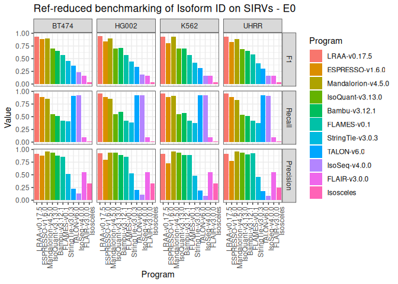<!-- -->

``` r
df %>% 
  filter(sirv_set == "E1") %>%
  ggplot(aes(x=Program, y=Value, fill=Program)) + geom_col() +
  facet_grid(vars(Metric), vars(cell_line)) +
  theme_bw() +
  theme(axis.text.x = element_text(angle = 90, hjust = 1)) +
  ggtitle("Ref-reduced benchmarking of Isoform ID on SIRVs - E1")
```

<!-- -->

``` r
df %>% 
  filter(sirv_set == "E2") %>%
  ggplot(aes(x=Program, y=Value, fill=Program)) + geom_col() +
  facet_grid(vars(Metric), vars(cell_line)) +
  theme_bw() +
  theme(axis.text.x = element_text(angle = 90, hjust = 1)) +
  ggtitle("Ref-reduced benchmarking of Isoform ID on SIRVs - E2")
```

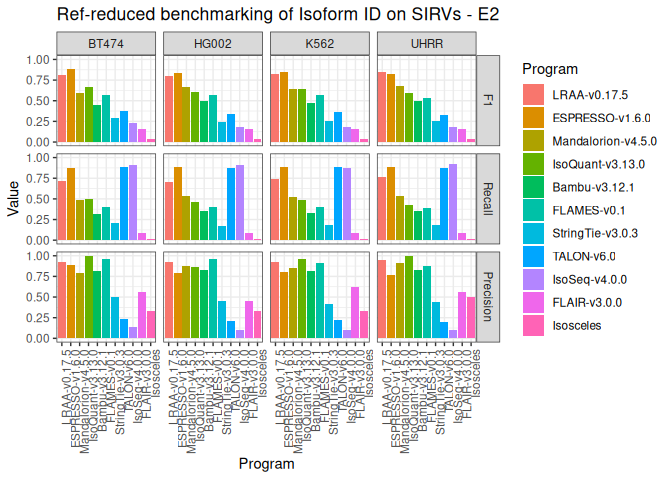<!-- -->

``` r
df %>% 
  group_by(Program, Metric, sirv_set) %>%
  summarize(mean_val = mean(Value), stderr_val = sd(Value)/sqrt(n())) %>%
  ggplot(aes(x=Program, y=mean_val)) + geom_col() +
  geom_errorbar(aes(x=Program, ymin=mean_val-stderr_val, ymax=mean_val+stderr_val)) +
  facet_grid(vars(Metric), vars(sirv_set)) +
  theme_bw() +
  theme(axis.text.x = element_text(angle = 90, hjust = 1)) +
  ggtitle("Ref-reduced benchmarking of Isoform ID on SIRVs")
```

    ## `summarise()` has regrouped the output.
    ## ℹ Summaries were computed grouped by Program, Metric, and sirv_set.
    ## ℹ Output is grouped by Program and Metric.
    ## ℹ Use `summarise(.groups = "drop_last")` to silence this message.
    ## ℹ Use `summarise(.by = c(Program, Metric, sirv_set))` for per-operation
    ##   grouping (`?dplyr::dplyr_by`) instead.

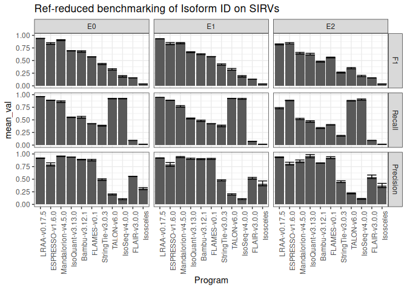<!-- -->

# rank each experiment separately.

``` r
get_ranked_df = function(sirv_set_val, data_df = df) {

  ranked_df = data_df %>%  filter(sirv_set == sirv_set_val) 

  ranked_progs = ranked_df %>% filter(Metric == "F1") %>% group_by(Program)  %>% 
    summarize(mean_F1 = mean(Value)) %>% arrange(dplyr::desc(mean_F1)) %>% pull(Program)

  ranked_df$Program = factor(ranked_df$Program, levels=ranked_progs)

  ranked_df = ranked_df %>% group_by(Program, Metric) %>% summarize(mean_val = mean(Value))
  
  return(ranked_df)
  
}
```

``` r
E0_ranked_df = get_ranked_df("E0")
```

    ## `summarise()` has regrouped the output.
    ## ℹ Summaries were computed grouped by Program and Metric.
    ## ℹ Output is grouped by Program.
    ## ℹ Use `summarise(.groups = "drop_last")` to silence this message.
    ## ℹ Use `summarise(.by = c(Program, Metric))` for per-operation grouping
    ##   (`?dplyr::dplyr_by`) instead.

``` r
E0_ranked_plot = E0_ranked_df %>% 
  ggplot(aes(x=Program, y=mean_val)) + geom_col() +
  facet_wrap(~Metric, ncol=1) +
  theme_bw() +
  theme(axis.text.x = element_text(angle = 90, hjust = 1)) +
  ggtitle("E0")

E0_ranked_plot
```

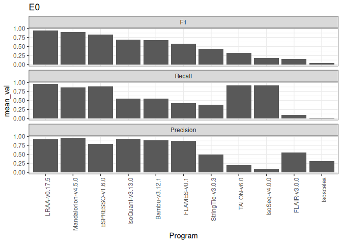<!-- -->

``` r
E1_ranked_df = get_ranked_df("E1")
```

    ## `summarise()` has regrouped the output.
    ## ℹ Summaries were computed grouped by Program and Metric.
    ## ℹ Output is grouped by Program.
    ## ℹ Use `summarise(.groups = "drop_last")` to silence this message.
    ## ℹ Use `summarise(.by = c(Program, Metric))` for per-operation grouping
    ##   (`?dplyr::dplyr_by`) instead.

``` r
E1_ranked_plot = E1_ranked_df %>% 
  ggplot(aes(x=Program, y=mean_val)) + geom_col() +
  facet_wrap(~Metric, ncol=1) +
  theme_bw() +
  theme(axis.text.x = element_text(angle = 90, hjust = 1)) +
  ggtitle("E1")

E1_ranked_plot
```

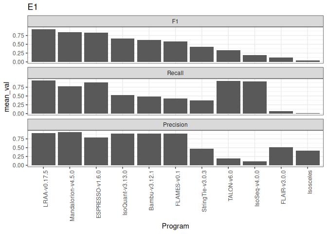<!-- -->

``` r
E2_ranked_df = get_ranked_df("E2")
```

    ## `summarise()` has regrouped the output.
    ## ℹ Summaries were computed grouped by Program and Metric.
    ## ℹ Output is grouped by Program.
    ## ℹ Use `summarise(.groups = "drop_last")` to silence this message.
    ## ℹ Use `summarise(.by = c(Program, Metric))` for per-operation grouping
    ##   (`?dplyr::dplyr_by`) instead.

``` r
E2_ranked_plot = E2_ranked_df %>% 
  ggplot(aes(x=Program, y=mean_val)) + geom_col() +
  facet_wrap(~Metric, ncol=1) +
  theme_bw() +
  theme(axis.text.x = element_text(angle = 90, hjust = 1)) +
  ggtitle("E2")

E2_ranked_plot
```

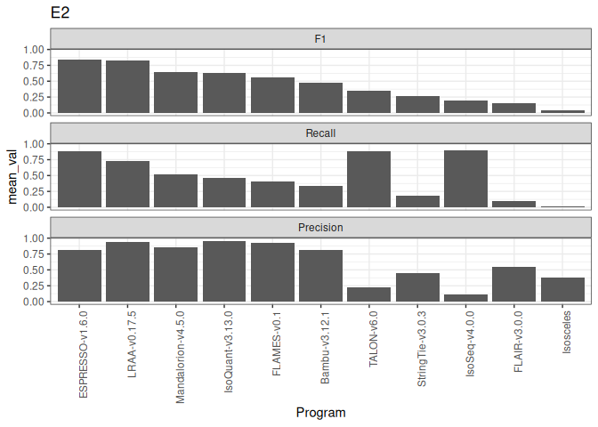<!-- -->

``` r
library(cowplot)
```

    ## 
    ## Attaching package: 'cowplot'

    ## The following object is masked from 'package:lubridate':
    ## 
    ##     stamp

``` r
plot_grid(E0_ranked_plot,
          E1_ranked_plot,
          E2_ranked_plot,
          nrow=1)
```

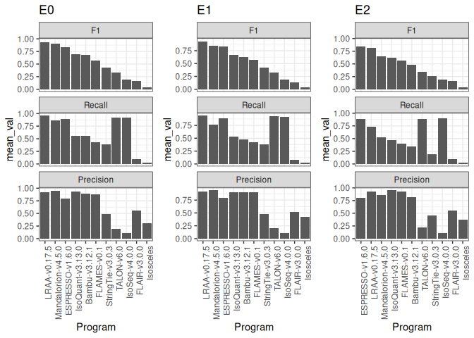<!-- -->

# use heatmap reprsentations for condensed view.

``` r
E0_ranked_tile_plot = E0_ranked_df %>%  
  mutate(Metric = factor(Metric, levels = c("Precision", "Recall", "F1"))) %>%
  ggplot(aes(x=Program, y=Metric, fill=mean_val)) +
   geom_tile(color = "white", size = 0.5) +
  geom_text(aes(label = round(mean_val, 2)), 
            size = 3, 
            color = "white") +
  #scale_fill_gradient(limits = c(0, 1), low = "white", high = "steelblue") +
  theme_bw() +
  theme(axis.text.x = element_text(angle = 90, hjust = 1)) +
  ggtitle("E0")
```

    ## Warning: Using `size` aesthetic for lines was deprecated in ggplot2 3.4.0.
    ## ℹ Please use `linewidth` instead.
    ## This warning is displayed once per session.
    ## Call `lifecycle::last_lifecycle_warnings()` to see where this warning was
    ## generated.

``` r
E0_ranked_tile_plot
```

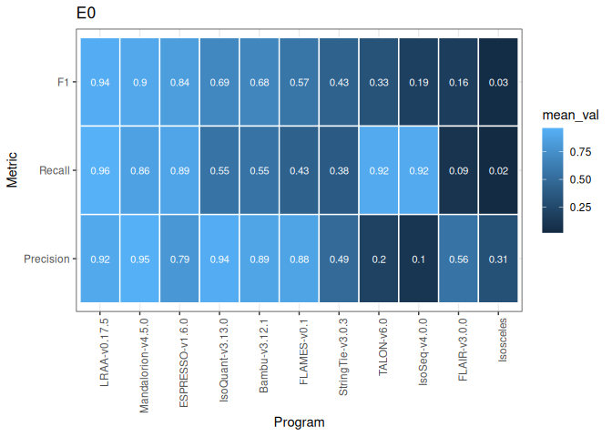<!-- -->

``` r
E1_ranked_tile_plot = E1_ranked_df %>% 
  
  mutate(Metric = factor(Metric, levels = c("Precision", "Recall", "F1"))) %>%
  ggplot(aes(x=Program, y=Metric, fill=mean_val)) +
   geom_tile(color = "white", size = 0.5) +
  geom_text(aes(label = round(mean_val, 2)), 
            size = 3, 
            color = "white") +
  #scale_fill_gradient(limits = c(0, 1), low = "white", high = "steelblue") +
  theme_bw() +
  theme(axis.text.x = element_text(angle = 90, hjust = 1)) +
  ggtitle("E1")

E1_ranked_tile_plot
```

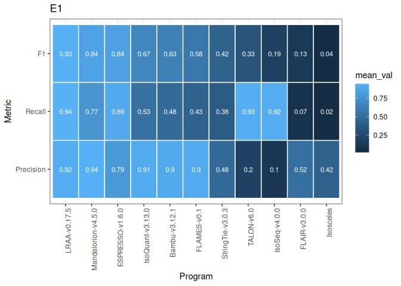<!-- -->

``` r
E2_ranked_tile_plot = E2_ranked_df %>%  
    mutate(Metric = factor(Metric, levels = c("Precision", "Recall", "F1"))) %>%
  ggplot(aes(x=Program, y=Metric, fill=mean_val)) +
   geom_tile(color = "white", size = 0.5) +
  geom_text(aes(label = round(mean_val, 2)), 
            size = 3, 
            color = "white") +
  #scale_fill_gradient(limits = c(0, 1), low = "white", high = "steelblue") +
  theme_bw() +
  theme(axis.text.x = element_text(angle = 90, hjust = 1)) +
  ggtitle("E2")

E2_ranked_tile_plot
```

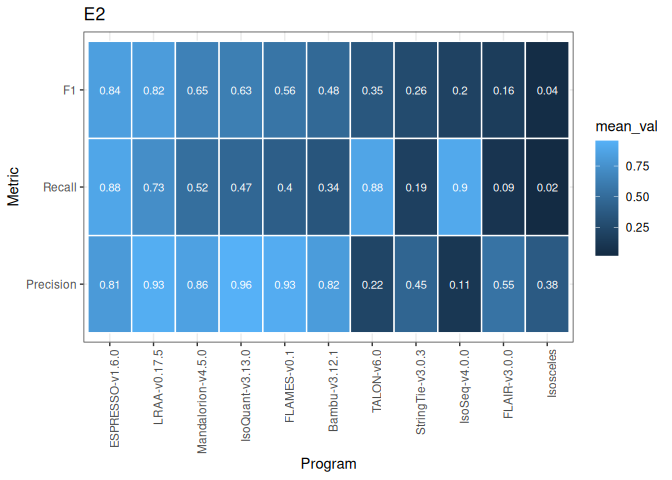<!-- -->

``` r
stacked_tile_plot = plot_grid(E0_ranked_tile_plot,
                              E1_ranked_tile_plot,
                              E2_ranked_tile_plot,
          ncol=1)

stacked_tile_plot 
```

<!-- -->

``` r
ggsave(stacked_tile_plot, file="SIRVs_sim_summary.pdf", width=8, height=8)
```

# heatmap restricted to latest tool versions, retaining unversioned and single-version tools.

``` r
get_latest_programs = function(data_df) {

  program_versions = data_df %>%
    distinct(Program) %>%
    mutate(Program = as.character(Program),
           Tool = str_remove(Program, "-v[0-9].*$"),
           Version = str_match(Program, "-v([0-9][0-9A-Za-z.\\-]*)$")[, 2])

  latest_versioned_programs = program_versions %>%
    filter(! is.na(Version)) %>%
    group_by(Tool) %>%
    arrange(dplyr::desc(numeric_version(Version)), .by_group = TRUE) %>%
    dplyr::slice(1) %>%
    ungroup()

  unversioned_programs = program_versions %>%
    filter(is.na(Version))

  bind_rows(latest_versioned_programs, unversioned_programs) %>%
    pull(Program)
}

latest_programs = get_latest_programs(df)

latest_programs
```

    ##  [1] "Bambu-v3.12.1"      "ESPRESSO-v1.6.0"    "FLAIR-v3.0.0"      
    ##  [4] "FLAMES-v0.1"        "IsoQuant-v3.13.0"   "IsoSeq-v4.0.0"     
    ##  [7] "LRAA-v0.17.5"       "Mandalorion-v4.5.0" "StringTie-v3.0.3"  
    ## [10] "TALON-v6.0"         "Isosceles"

``` r
latest_program_df = df %>%
  filter(as.character(Program) %in% latest_programs)

latest_program_ranking = latest_program_df %>%
  filter(Metric == "F1") %>%
  group_by(Program) %>%
  summarize(mean_F1 = mean(Value), .groups = "drop") %>%
  arrange(dplyr::desc(mean_F1)) %>%
  pull(Program)

latest_program_df$Program = factor(latest_program_df$Program,
                                   levels = latest_program_ranking)

make_ranked_tile_plot = function(ranked_df, plot_title) {

  ranked_df %>%
    mutate(Metric = factor(Metric, levels = c("Precision", "Recall", "F1"))) %>%
    ggplot(aes(x=Program, y=Metric, fill=mean_val)) +
    geom_tile(color = "white", size = 0.5) +
    geom_text(aes(label = round(mean_val, 2)),
              size = 3,
              color = "white") +
    theme_bw() +
    theme(axis.text.x = element_text(angle = 90, hjust = 1)) +
    ggtitle(plot_title)
}

latest_ranked_tile_plots = c("E0", "E1", "E2") %>%
  map(function(sirv_set_val) {
    get_ranked_df(sirv_set_val, latest_program_df) %>%
      make_ranked_tile_plot(sirv_set_val)
  })
```

    ## `summarise()` has regrouped the output.
    ## `summarise()` has regrouped the output.
    ## `summarise()` has regrouped the output.
    ## ℹ Summaries were computed grouped by Program and Metric.
    ## ℹ Output is grouped by Program.
    ## ℹ Use `summarise(.groups = "drop_last")` to silence this message.
    ## ℹ Use `summarise(.by = c(Program, Metric))` for per-operation grouping
    ##   (`?dplyr::dplyr_by`) instead.

``` r
latest_stacked_tile_plot = plot_grid(plotlist = latest_ranked_tile_plots,
                                     ncol=1)

latest_stacked_tile_plot
```

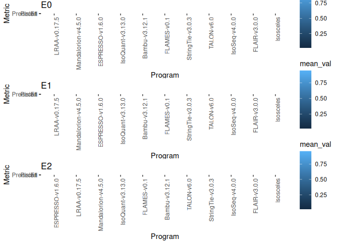<!-- -->

``` r
ggsave(latest_stacked_tile_plot,
       file="SIRVs_sim_summary.latest_tools.pdf",
       width=8,
       height=7.5)
```
