Internal TSSs behind 5’ fragment-shaped (ISM) isoforms, and the shorter
proteins they imply
================

**The question.** Are there isoforms that look like 5’ fragments of a
longer isoform (ISM), but whose start is a real internal promoter,
presumably giving a shorter protein?

**Answer: yes, but few.** LRAA v0.51.0 models hold 2,977 strict ISM S/L
pairs in PBMC and 5,208 in ALS, at 679 and 931 distinct TSSs. A sharp
read pile-up, cap signature and CAGE or refTSS peak together hold at 132
PBMC and 60 ALS TSSs. Of those, 68 and 34 are the gene’s own canonical
TSS, with L a longer upstream isoform, and many of the rest start in the
5’UTR and keep the coding start. 15 PBMC and 4 ALS TSSs imply an
N-terminally truncated protein, 31 more across the four bulk PacBio
libraries (sites may repeat between libraries); together 47 distinct
TSSs in 43 genes. The method recovers COMT’s textbook internal promoter
(the soluble form), which is the best evidence that the rest of the list
is worth reading. Most ISM S models are not of this kind: at uncapped
pile-ups CAGE hits are at background (3% vs 9% in PBMC, 5% vs 4% in
ALS), against 86% and 92% at capped ones.

The paper’s Supp Fig draws COMT, CORO1B and RECQL4 (chosen by the user)
and an FTD example chosen by rule (“The FTD example of the Supp Fig”
below); choosing a figure gene is the user’s decision. `candidates.tsv`
has every pair.

## Definitions

- **S/L pair:** S’s intron chain is a proper suffix of L’s, in
  transcript sense: only L’s 5’-most introns are dropped. S keeps at
  least one intron. Pairs come from each dataset’s basic and
  cluster-guided GTFs, de novo and ref-guided, with both models in the
  same GTF. Isoforms are named by splice hash, never by model ID. S
  models of one chain within 25 nt are one S TSS.
- **Strict ISM:** S’s 5’ end lies in the L exon that ends at S’s first
  donor. Since 2026-11-11 every pair also requires a shared 3’ end: S
  ends within 50 nt of an L model of the same model set
  (`FINDINGS_ism_survival.md`). **TSS_in_L_intron** (novel first exon)
  and **TSS_past_L_exon** (reaches over an L exon) are counted
  separately and left out of the strict counts.
- **Site:** the commonest read start within 5 nt of S’s TSS group, among
  reads whose first intron is S’s first intron (LRAA’s read filters and
  5’ end rules), then +-5 nt around it. All evidence is from the reads
  and atlases. LRAA having reported S counts for nothing, and its `TSS`
  flag is only a descriptive column.

Evidence, scored independently per S TSS:

| evidence | passes when |
|----|----|
| pile-up | \>= 5 reads at the site, \>= 50% of the reads starting within 50 nt, \>= 10% of reads using S’s first intron |
| cap | \>= 5 informative reads, \>= 2 capped, \>= 10% capped (LRAA’s per-site rule; `ev_cap_strong`: \>= 30%). Capped = G run above the library baseline: 0 G for PBMC and ALS, 1 G for bulk PacBio. A read whose genomic base before the start is G says nothing about the cap |
| atlas | same-strand FANTOM5 CAGE or refTSS v4.1 peak within 10 nt |
| annotation | a GENCODE v47 transcript that is not `mRNA_start_NF` starts within 50 nt and shares S’s first intron |
| differential usage | a DEXSeq site event at the site (ref-guided site table, PBMC and ALS only); supporting only |

The **core tier** is pile-up + cap + atlas. Background for the atlases:
10 random positions per S TSS in the same L exon, at least 10 nt from
its edges and more than 50 nt from the site.

## Where S’s 5’ ends lie

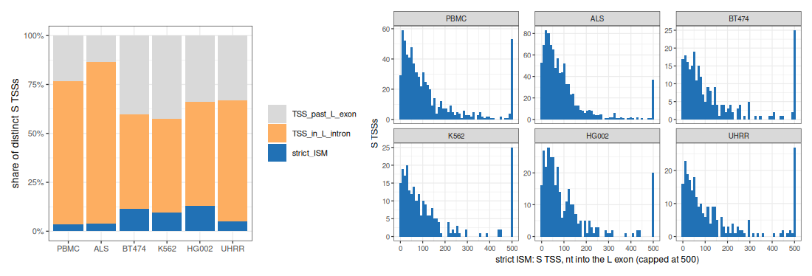<!-- -->

Strict ISM is the minority shape: most S models with a suffix chain
carry a first exon that reaches into L’s intron. Of the strict S TSSs,
0% sit within 5 nt of the L exon’s first base with no pile-up and no
LRAA `TSS` flag: a model starting at the graph’s exon edge, not a site
at all.

## Cap signature and CAGE agree, and split the pile-ups in two

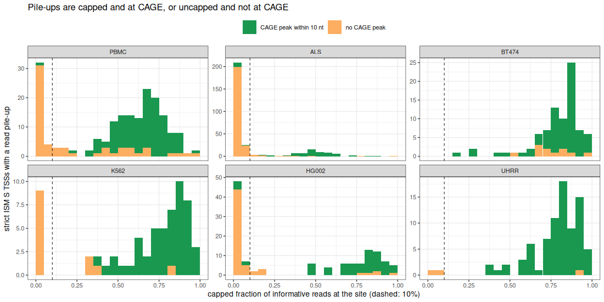<!-- -->

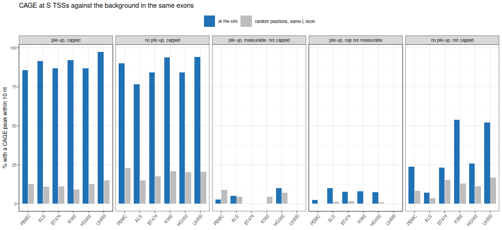<!-- -->

At capped pile-ups the CAGE hit rate is 86%-97%, against a same-exon
background of 9%-15% (those exons are enriched for peaks: the same
random draw over all S TSSs gives 5%-16%). The cap and CAGE are
independent measurements, one from the reads and one from FANTOM5, so
this is the main result: an uncapped pile-up behaves as truncation and a
capped one as a promoter. Off-peak read starts are 7% capped in PBMC and
3% in ALS; at CAGE 60% and 31%. The bulk libraries discriminate less
well by this measure (off-peak 13%-46%), because their reads are mostly
full length and cell-line TSSs are not all in FANTOM5.

Pile-ups whose cap cannot be measured (genomic G just before the start)
are at CAGE at a rate of only 0%-10%, so the blind spot is not hiding
many promoters.

## Tiers

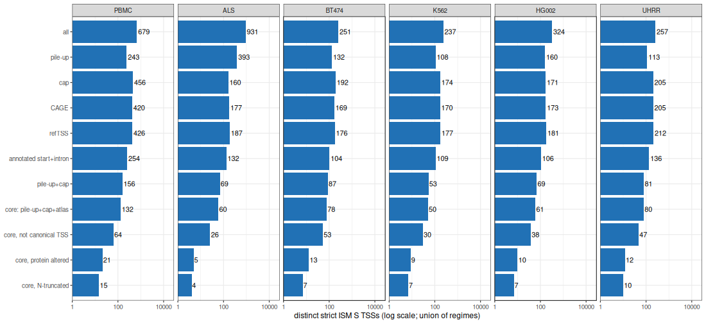<!-- -->

| dataset | regime | all | pile-up+cap | core: pile-up+cap+atlas | core, protein altered | core, N-truncated |
|:---|:---|:---|:---|:---|:---|:---|
| PBMC | denovo | 1,429 (749) | 270 (154) | 217 (132) | 43 (20) | 30 (15) |
| PBMC | refGuided | 1,548 (838) | 327 (188) | 254 (161) | 49 (24) | 33 (17) |
| ALS | denovo | 2,702 (955) | 94 (63) | 70 (52) | 8 (6) | 5 (5) |
| ALS | refGuided | 2,506 (835) | 102 (67) | 90 (63) | 9 (6) | 6 (5) |
| BT474 | denovo | 528 (298) | 166 (107) | 142 (96) | 27 (15) | 13 (8) |
| BT474 | refGuided | 529 (310) | 168 (108) | 144 (97) | 26 (15) | 12 (8) |
| K562 | denovo | 466 (270) | 105 (60) | 98 (57) | 27 (12) | 21 (10) |
| K562 | refGuided | 496 (289) | 114 (67) | 106 (64) | 27 (12) | 21 (10) |
| HG002 | denovo | 737 (403) | 145 (91) | 115 (79) | 15 (10) | 7 (7) |
| HG002 | refGuided | 717 (404) | 132 (88) | 117 (81) | 16 (11) | 8 (8) |
| UHRR | denovo | 522 (305) | 141 (99) | 140 (98) | 28 (21) | 24 (17) |
| UHRR | refGuided | 533 (324) | 142 (102) | 141 (101) | 29 (22) | 25 (18) |

Strict ISM: S/L pairs (S TSSs)

A “protein altered” or “N-truncated” count also needs at least 5 reads
over the L intron S drops (64 of the 132 PBMC core sites are away from a
MANE/canonical coding TSS; the rest are the gene’s main promoter, with L
an upstream isoform such as a read-through).

In the separate shape where S has a novel first exon in L’s intron, the
same tiers give 236 PBMC and 89 ALS core TSSs, 45 and 16 of them
N-truncating. These are not strictly ISM and are not in the examples
below; `candidates.tsv` has them (`class`).

## Protein consequence

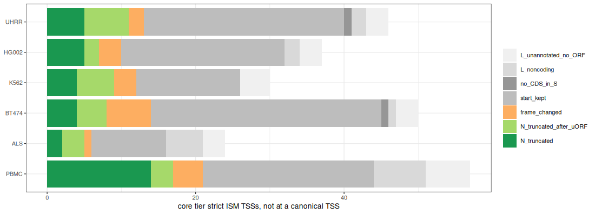<!-- -->

L’s CDS is GENCODE v47’s when L’s chain matches a coding transcript
(MANE first, then canonical, then longest) and otherwise pyTD’s
(PyTransDecoder v0.4.0, `bin/run_orfs.py`, since 2026-11-04; was
TransDecoder v6): the proteoform analysis’s settings
(`LRAA_proteoform_analyses/orf_settings.conf`: single best ORF \>= 50
aa, DIAMOND homology to GENCODE v47 proteins at e-value 1e-5,
target-decoy q \<= 0.05 for ORFs without a hit), complete ORFs only; run
only for L models whose S site has pile-up and cap evidence.
`N_truncated`: L’s ATG is lost and S’s first ATG is in L’s frame.
`N_truncated_after_uORF`: a shorter out-of-frame ORF (\< 30 aa) ends
before the first in-frame ATG, so the truncated form needs reinitiation
or leaky scanning. `frame_changed`: S’s first ATG opens a different,
longer ORF. `start_kept`: S starts in the 5’UTR and the protein is
unchanged, which is not a qualifying case.

## The 10 best examples

Rule: core tier, N-terminal truncation, S away from a canonical TSS, at
least 5 reads over L’s dropped intron, L a GENCODE coding chain, at
least 20 reads at the site. Evidence points: CAGE, refTSS, strong cap
(\>= 30%), pile-up, annotated start + intron, an annotated transcript
using the same downstream ATG, a high-confidence DEXSeq event, and core
status in 2 and in 3 libraries. Ties go to single-cell data, then cap
fraction. Each is drawn from the library with the most reads at the
site.

| ex | gene | drawn from | points | reads at site | site % of intron reads | capped % | L junction reads | CAGE | refTSS | core in | protein | Kozak |
|:---|:---|:---|---:|---:|---:|---:|---:|---:|---:|:---|:---|:---|
| ex01 | HTRA2 | BT474 denovo | 7 | 32 | 46 | 88 | 307 | 0 | 0 | BT474;HG002;UHRR | 426 -\> 167 aa (N_truncated_after_uORF) | strong |
| ex02 | COMT | BT474 denovo | 7 | 1193 | 47 | 47 | 597 | 0 | 0 | BT474;UHRR | 271 -\> 221 aa (N_truncated) | adequate |
| ex03 | BTBD8 | ALS refGuided | 6 | 88 | 51 | 50 | 70 | 0 | 0 | ALS | 1792 -\> 1279 aa (N_truncated_after_uORF) | weak |
| ex04 | CRYBG1 | PBMC refGuided | 6 | 333 | 62 | 45 | 270 | 0 | 0 | HG002;PBMC | 2131 -\> 802 aa (N_truncated) | adequate |
| ex05 | RECQL4 | BT474 denovo | 6 | 54 | 83 | 85 | 67 | 0 | 0 | BT474;K562;UHRR | 1208 -\> 851 aa (N_truncated_after_uORF) | adequate |
| ex06 | GGA1 | PBMC refGuided | 5 | 110 | 71 | 80 | 61 | 0 | 0 | PBMC | 639 -\> 93 aa (N_truncated) | weak |
| ex07 | CORO1B | PBMC denovo | 5 | 339 | 51 | 71 | 321 | 0 | 0 | PBMC | 489 -\> 171 aa (N_truncated) | strong |
| ex08 | RNF214 | PBMC refGuided | 5 | 44 | 65 | 70 | 71 | 0 | 0 | PBMC | 703 -\> 297 aa (N_truncated_after_uORF) | adequate |
| ex09 | SLC2A4RG | PBMC refGuided | 5 | 38 | 26 | 64 | 14 | 0 | 0 | PBMC | 387 -\> 282 aa (N_truncated) | strong |
| ex10 | TMTC4 | ALS refGuided | 5 | 38 | 64 | 58 | 14 | 0 | 0 | ALS | 760 -\> 223 aa (N_truncated_after_uORF) | adequate |

| gene | DEXSeq site events | high confidence | largest event (supporting only) |
|:---|---:|---:|:---|
| CRYBG1 | 9 | 7 | Cluster_1 vs Cluster_13: site gained, delta 0.52, alt_first_exon |
| GGA1 | 20 | 7 | Cluster_1 vs Cluster_6: site lost, delta 0.40, alt_first_exon |
| CORO1B | 12 | 12 | Cluster_11 vs Cluster_5: site gained, delta 0.91, alt_first_exon |
| RNF214 | 12 | 1 | Cluster_4 vs Cluster_0: site gained, delta 0.32, alt_first_exon |

| gene | UniProt features lost with the N-terminus |
|:---|:---|
| HTRA2 | Transit peptide Mitochondrion 1-31; Propeptide 32-133; Transmembrane Helical 105-125; Motif IAP-binding motif 134-137 |
| COMT | Transmembrane Helical; Signal-anchor for type II membrane protein 7-26 |
| BTBD8 | Domain BTB 1 58-127; Domain BTB 2 206-273 |
| CRYBG1 | Region Disordered 1-53; Region Disordered 104-370; Region Disordered 385-674; Region Disordered 688-707; Region Disordered 723-743; Region Disordered 758-791; Region Disordered 837-889; Region Disordered 926-947; Region Disordered 1041-1101; Region Disordered 1271-1302 |
| RECQL4 | Region Disordered 17-180; Region Disordered 201-333 |
| GGA1 | Domain VHS 17-147; Domain GAT 171-299; Region Interaction with ARF3 114-274; Region Unstructured hinge 300-509; Region Disordered 320-421; Region Disordered 434-492; Motif Autoinhibitory 358-362 |
| CORO1B | Repeat WD 1 18-72; Repeat WD 2 73-122; Repeat WD 3 123-166; Repeat WD 4 167-210; Repeat WD 5 211-256; Repeat WD 6 257-296 |
| RNF214 | Region Disordered 1-59; Region Disordered 104-134; Region Disordered 146-197; Coiled coil 220-379 |
| SLC2A4RG | Region Disordered 1-97 |
| TMTC4 | Transmembrane Helical 15-35; Transmembrane Helical 112-132; Transmembrane Helical 142-162; Transmembrane Helical 166-186; Transmembrane Helical 199-219; Transmembrane Helical 225-245; Transmembrane Helical 269-288; Transmembrane Helical 355-375; Transmembrane Helical 383-403; Transmembrane Helical 413-433; Transmembrane Helical 441-461; Repeat TPR 1 482-515 |

Reading them (hand-written at LRAA v0.47.0; rechecked against the
v0.50.0 tables on 2026-11-10, numbers inline):

- **COMT** is a positive control: S gives soluble S-COMT (221 aa) from
  the proximal promoter, and L membrane-bound MB-COMT (271 aa). The
  signal anchor in the lost 50 aa is exactly the known difference.
- **HTRA2**: the 259 aa lost include the transit peptide, propeptide and
  transmembrane anchor, and the downstream ATG is 126 aa past the
  N-terminus of the mature protein (residue 134). Whether anything
  stable is made is an open question. The site is 2 nt into the L exon
  and takes only 9% of reads against L, so it is a minor start at an
  exon edge, though capped and at CAGE in 3 libraries.
- **BTBD8** is drawn from ALS with 77% of its site reads from neurons,
  the cell types with the known truncation artefact, and loses both BTB
  domains; its annotated start and cap keep it here, but it is the
  example to distrust most. It was the Supp Fig’s FTD example until
  2026-11-08 (see below).
- **GGA1** would lose 546 of 639 aa, leaving a fragment; a transcript
  start, not obviously a stable protein.
- History: at v0.47.0 the ten also held MBP (the classic MBP promoter
  downstream of Golli-MBP) and FLNA. At v0.50.0 MBP has no S/L pair (the
  Golli-MBP L model, whose whole intron chain no read carries, is not
  kept by v0.50.0’s reference rule) and FLNA no longer has a pair that
  passes the example rule.

### HTRA2

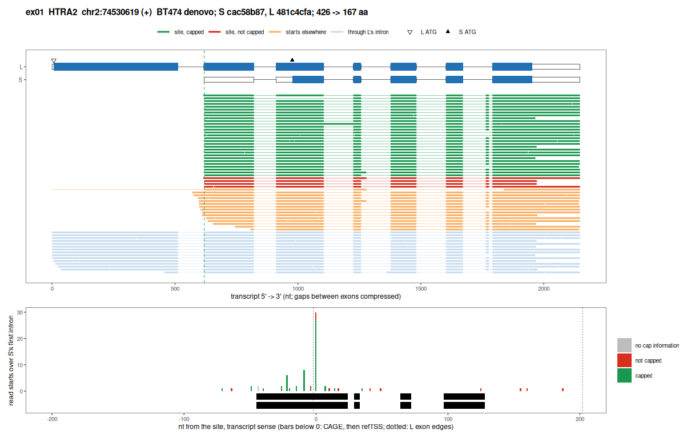<!-- -->

### COMT

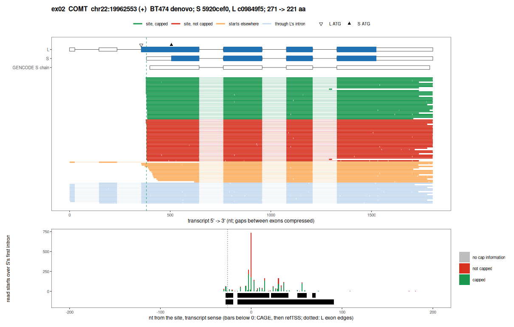<!-- -->

### BTBD8

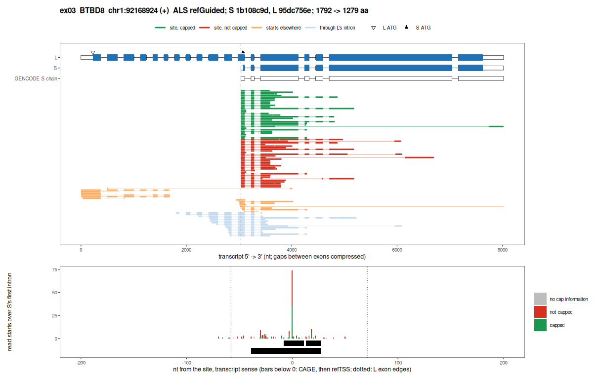<!-- -->

### CRYBG1

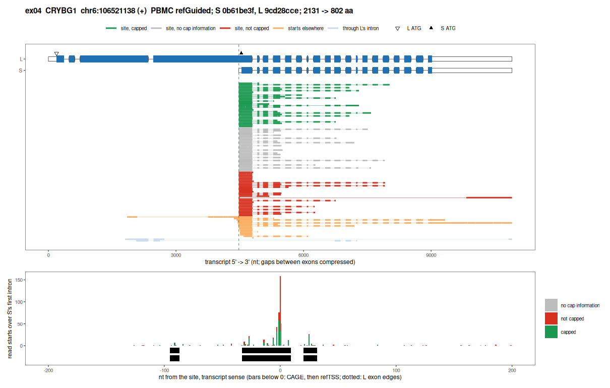<!-- -->

### RECQL4

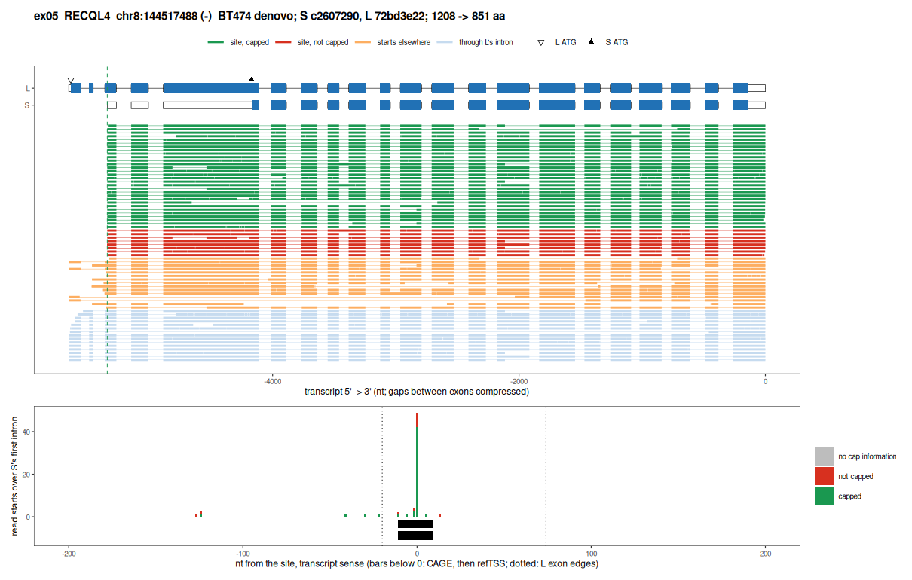<!-- -->

### GGA1

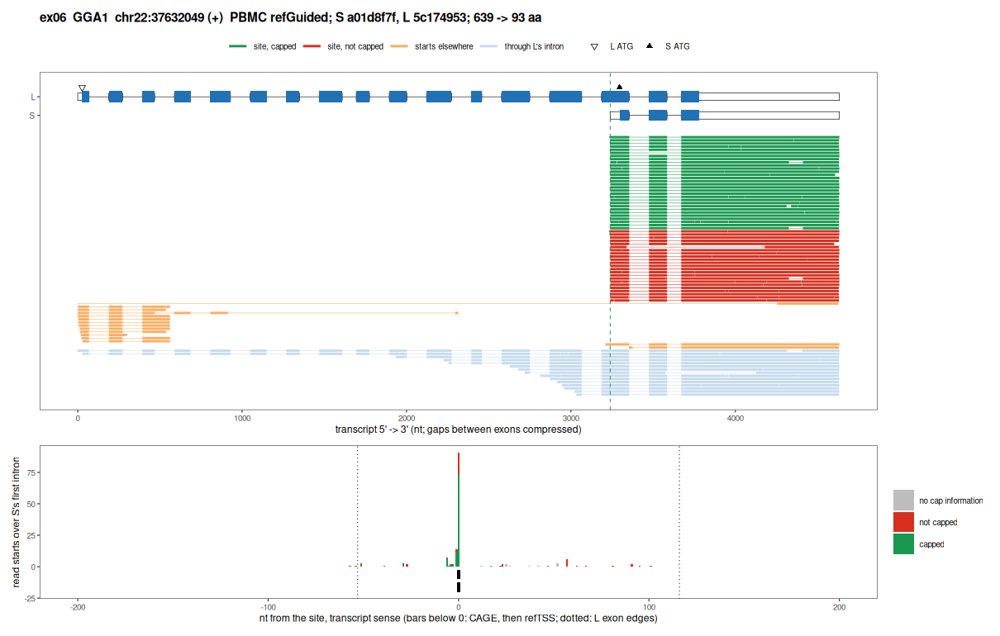<!-- -->

### CORO1B

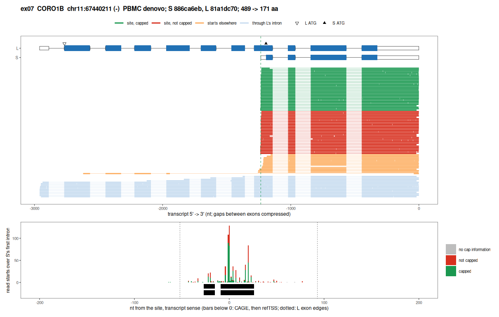<!-- -->

### RNF214

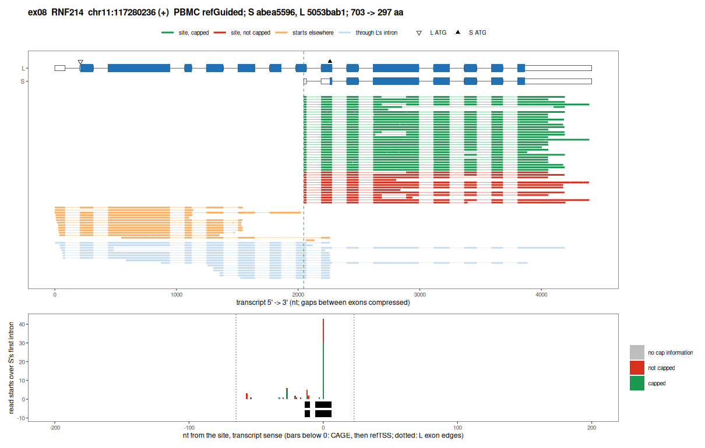<!-- -->

### SLC2A4RG

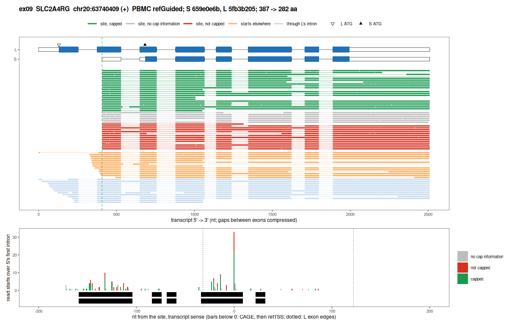<!-- -->

### TMTC4

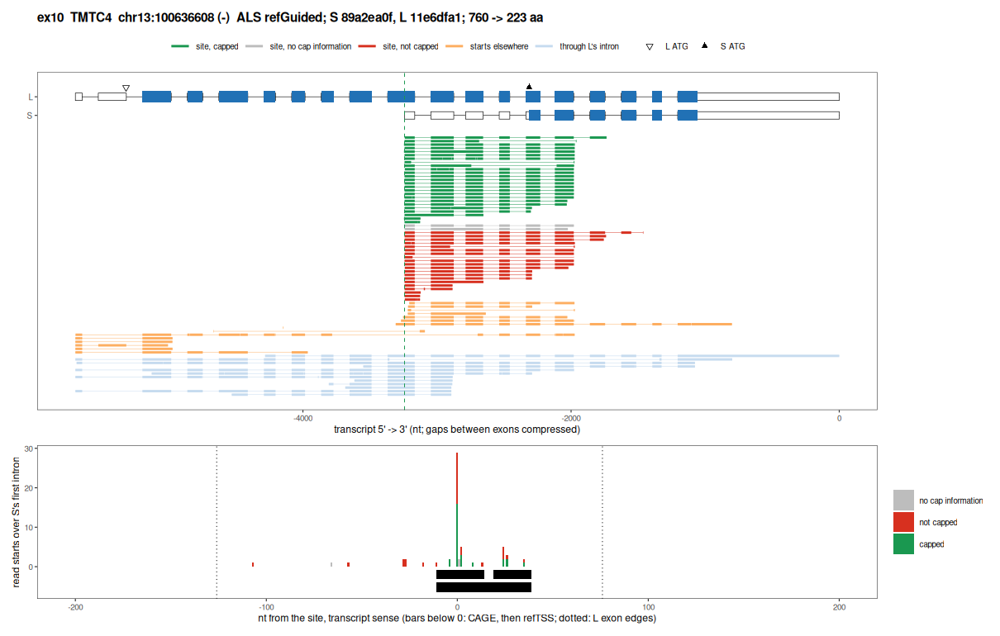<!-- -->

## The FTD example of the Supp Fig

The supplementary figure’s FTD panel (since 2026-11-04, replacing MBP)
comes from a rule, not a hand pick (`bin/select_ftd_example.py`): (1) an
FTD core internal TSS (pile-up, cap signature, CAGE or refTSS), strict
ISM, not canonical, at least 5 reads over L’s dropped intron; (2) an
N-terminally truncated S protein; (3) both L and S with full-chain (FSM)
read support, i.e. at least one read of the FTD BAM whose intron chain
is the model’s whole chain; (4, since 2026-11-08, after BTBD8, whose L
5’ end had 2 such reads) L’s CDS from GENCODE, and at least 10 reads
starting within 50 nt of L’s TSS that fit L (its first introns, in
order, and a 3’ end in the matching L exon). Ranked by reads at the
site, then by the smaller FSM count; one L/S pair per gene. All 4 FTD
sites that meet rules 1 and 2 are listed; 1 also passes rules 3 and 4.
The top one is **EPB41L3** (refGuided, scg): 15 reads at the site, 53%
capped, FSM reads 1 for L and 2 for S, 15 reads starting at L’s TSS, 865
-\> 318 aa (L’s CDS from GENCODE), with 0% of the site reads from neuron
clusters, the cell types with the 5’ truncation artefact.

| rank | passes | gene | regime | reads at site | capped % | L junction reads | L FSM reads | S FSM reads | reads at L’s TSS | protein | L CDS | neuron % |
|---:|:---|:---|:---|---:|---:|---:|---:|---:|---:|:---|:---|---:|
| 1 | TRUE | EPB41L3 | refGuided | 15 | 53 | 14 | 1 | 2 | 15 | 865 -\> 318 aa (N_truncated_after_uORF) | GENCODE | 0 |
| 2 | FALSE | BTBD8 | refGuided | 88 | 50 | 70 | 1 | 4 | 5 | 235 -\> 60 aa (N_truncated_after_uORF) | pyTD | 77 |
| 3 | FALSE | PTK2 | refGuided | 45 | 64 | 98 | 2 | 7 | 11 | 295 -\> 57 aa (N_truncated) | pyTD | 2 |
| 4 | FALSE | TMTC4 | refGuided | 38 | 58 | 14 | 1 | 5 | 1 | 741 -\> 223 aa (N_truncated_after_uORF) | GENCODE | 3 |

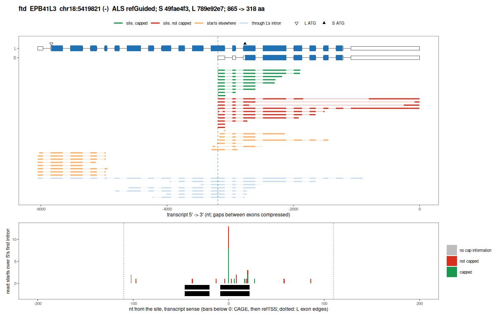<!-- -->

## Do the tools keep these sites?

Each tool is judged on its own strict ISM isoforms
(`bin/tool_own_ism.py`, the Supp Fig’s panel c since 2026-11-10): in
each bulk library, the tool’s de novo models S that are strict ISMs of a
longer model L of the same tool or of GENCODE v47, with \>= 5 reads over
L’s dropped intron and S’s start not a canonical TSS. Pairs and site
evidence come from the pool tables (`bin/make_pool_gtf.py` pools every
tool’s models with GENCODE, and the same read and atlas rules score the
pool); a pair counts for a tool when the tool has a model with S’s chain
starting in S’s TSS group and has L’s chain (or GENCODE does). Each
start (site + S’s first intron) is **supported** (pile-up, cap
signature, CAGE or refTSS peak), **truncation-like** (pile-up of \>= 5
informative reads, no cap signature, no atlas peak) or **not judged**
(too few reads, or mixed evidence). Cap evidence is LRAA’s own signal,
so CAGE and refTSS agreement is the independent part.

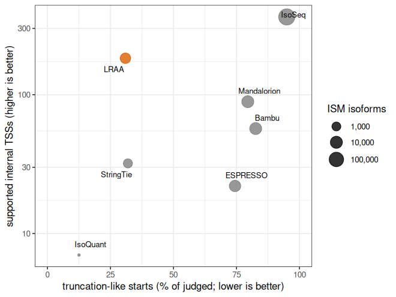<!-- -->

| tool | ISM isoforms | starts | supported | truncation-like | not judged | truncation-like % of judged |
|:---|:---|:---|---:|:---|:---|---:|
| IsoSeq | 773,644 | 741,852 | 363 | 6,813 | 734,676 | 94.9 |
| LRAA | 2,844 | 2,638 | 183 | 82 | 2,373 | 30.9 |
| Mandalorion | 9,238 | 9,182 | 89 | 345 | 8,748 | 79.5 |
| Bambu | 9,177 | 9,158 | 57 | 271 | 8,830 | 82.6 |
| StringTie | 1,151 | 1,105 | 32 | 15 | 1,058 | 31.9 |
| ESPRESSO | 5,843 | 5,819 | 22 | 64 | 5,733 | 74.4 |
| IsoQuant | 160 | 158 | 7 | 1 | 150 | 12.5 |

Four bulk libraries pooled. supported: higher is better; truncation-like
% of judged: lower is better; not judged: no verdict either way.

Most starts of every tool are not judged (90-99%). Of the judged starts,
30.9% of LRAA’s are truncation-like, with 183 supported internal TSSs
from 2,844 ISM isoforms. IsoSeq has more supported sites (363) but from
773,644 ISM isoforms, 94.9% of its judged starts truncation-like.
Mandalorion, Bambu and ESPRESSO keep most truncation products
(74.4-82.6%); StringTie and IsoQuant have lower shares but few ISM
isoforms and few supported sites.

History (v0.50.0, until 2026-11-10): the comparison scored every tool on
shared pool targets (`bin/tool_recall.py`, `out/tool_recall.tsv`). Most
of those targets existed only as IsoSeq models (84% of the uncapped
pile-up targets), so it was replaced; scored leave-one-out, its tool
positions did not change.

## The next candidates

| gene | drawn from | points | reads at site | capped % | core in | protein | Kozak |
|:---|:---|---:|---:|---:|:---|:---|:---|
| UXS1 | PBMC refGuided | 5 | 101 | 52 | PBMC | 425 -\> 50 aa (N_truncated_after_uORF) | weak |
| SEPTIN1 | PBMC denovo | 5 | 174 | 46 | PBMC | 372 -\> 45 aa (N_truncated) | weak |
| CFD | K562 denovo | 5 | 521 | 81 | K562;UHRR | 253 -\> 214 aa (N_truncated) | adequate |
| ALDH1A2 | UHRR refGuided | 5 | 52 | 73 | UHRR | 518 -\> 422 aa (N_truncated) | strong |
| TMEM8B | PBMC refGuided | 4 | 38 | 79 | PBMC | 338 -\> 160 aa (N_truncated) | weak |
| CERCAM | K562 refGuided | 4 | 53 | 87 | K562 | 595 -\> 259 aa (N_truncated) | weak |
| TFR2 | K562 refGuided | 4 | 20 | 85 | K562 | 801 -\> 748 aa (N_truncated) | adequate |
| AP1M2 | UHRR refGuided | 4 | 48 | 84 | UHRR | 423 -\> 68 aa (N_truncated_after_uORF) | weak |
| GPANK1 | K562 refGuided | 4 | 48 | 75 | K562 | 356 -\> 209 aa (N_truncated_after_uORF) | weak |
| CD1E | UHRR refGuided | 4 | 20 | 75 | UHRR | 290 -\> 160 aa (N_truncated_after_uORF) | adequate |
| SLF1 | UHRR denovo | 4 | 71 | 67 | UHRR | 1058 -\> 97 aa (N_truncated_after_uORF) | adequate |

## Truncation and the ALS neurons

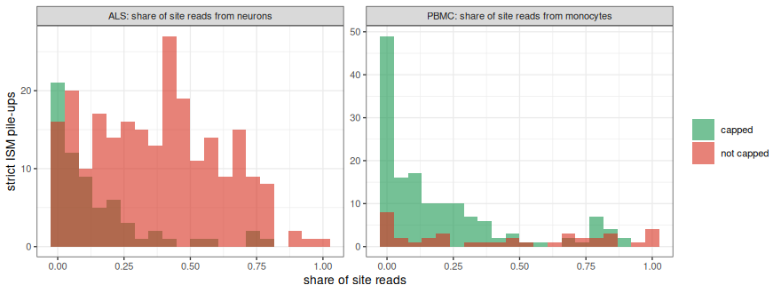<!-- -->

ALS has 237 uncapped pile-ups against 65 capped ones, the highest ratio
here, as the known truncation artefact predicts. The neuron share of
reads is 38% at the uncapped and 8% at the capped ones (medians). Only 4
ALS TSSs reach the N-truncated tier.

## Caveats

- The cap test is on the reads at the site, not on any one transcript’s
  protein. A capped start at CAGE supports a transcript start; none of
  this shows the truncated protein is made. No ribosome or
  mass-spectrometry data were used.
- CAGE tags can also come from recapped RNA, which would pass both the
  cap and CAGE tests.
- Since v0.46.0, LRAA prunes uncapped downstream TSSs, and the
  single-cell workflow’s cluster runs require a cap for new TSSs, so the
  S models with a `TSS` flag have already survived a cap filter.
  Ref-guided annotation-seeded TSSs are not judged. The tiers re-measure
  the cap, but the input set is enriched for capped S: of ALS S TSSs
  with a measurable cap, 18% pass de novo and 23% ref-guided.
- The pile-up rule needs 10% of the reads over S’s first intron, which
  can miss a real weak promoter in a gene dominated by truncated reads,
  most of all in ALS.
- `protein_class` is scanning-model logic from sequence: first ATG, no
  leaky-scanning or non-AUG starts. An `after_uORF` class depends on
  reinitiation. The ORF route gives less secure L proteins than the
  GENCODE route; all 10 examples use GENCODE. CDS comparison is to L, so
  if L is itself a minor isoform (as Golli-MBP was for MBP at v0.47.0)
  “truncated” says little about the main form.
- Annotation is GENCODE v47; the single-cell site work used v22 for its
  gene spans. Bulk reads are the same libraries as the benchmarks, and
  the bulk LRAA runs used those BAMs.
- UniProt features were read only for these genes, and apply only where
  the canonical length equals L’s CDS length (`out/uniprot_lost.tsv`).
- The cap signature is present in all six libraries used (calibrated: 0
  G baseline for PBMC and ALS, 1 G for bulk PacBio). It does not apply
  to SIRV spike-ins (uncapped), and MORF read clips are trimmed
  upstream, so those were not used. The SG-NEx ONT libraries have it at
  a 3 G baseline but were left out here.
