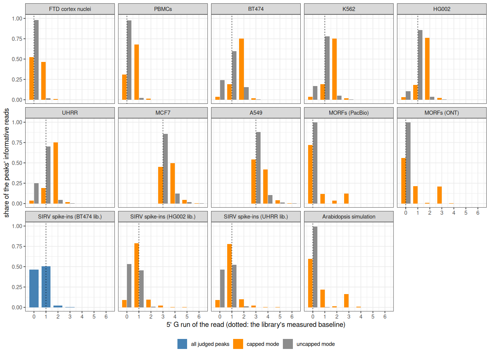
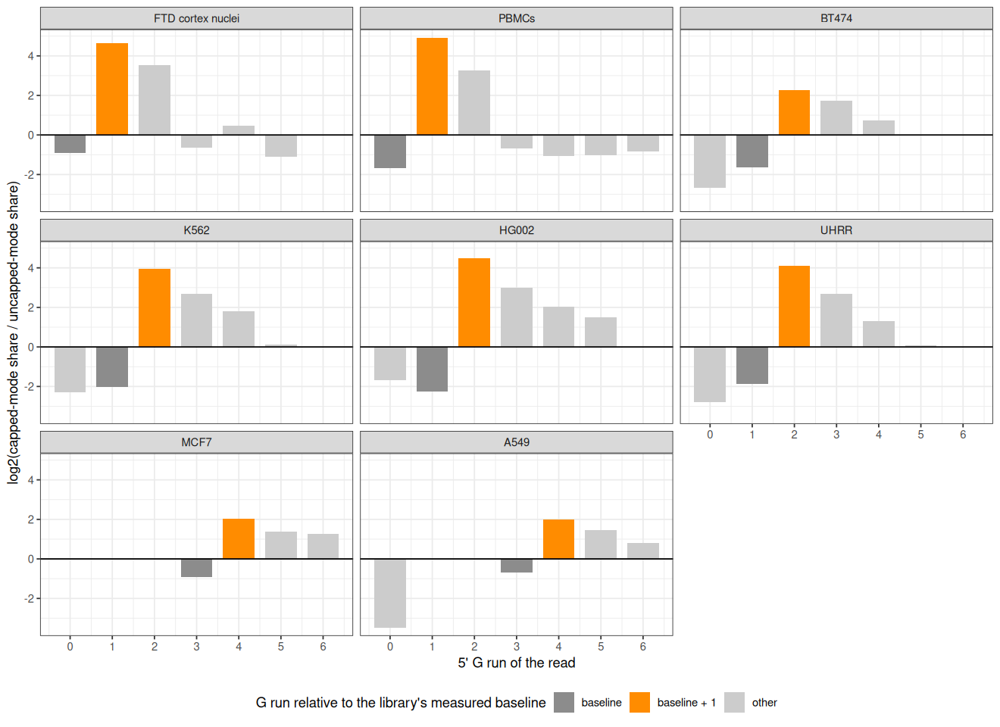
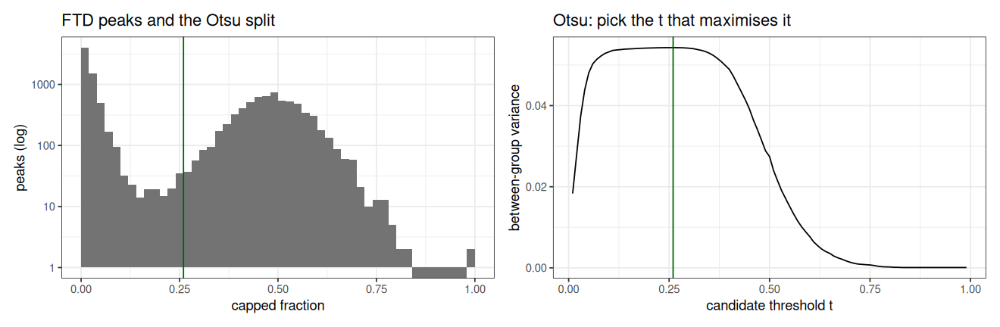
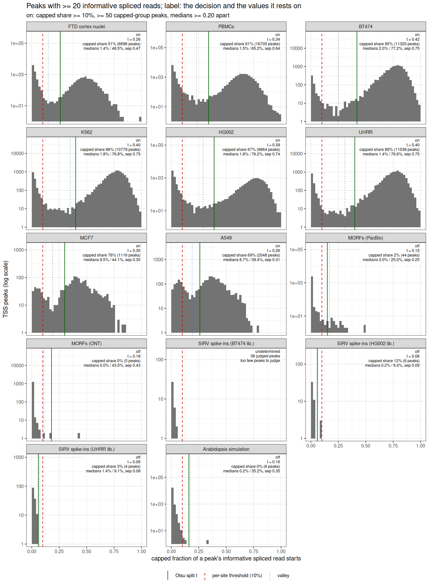
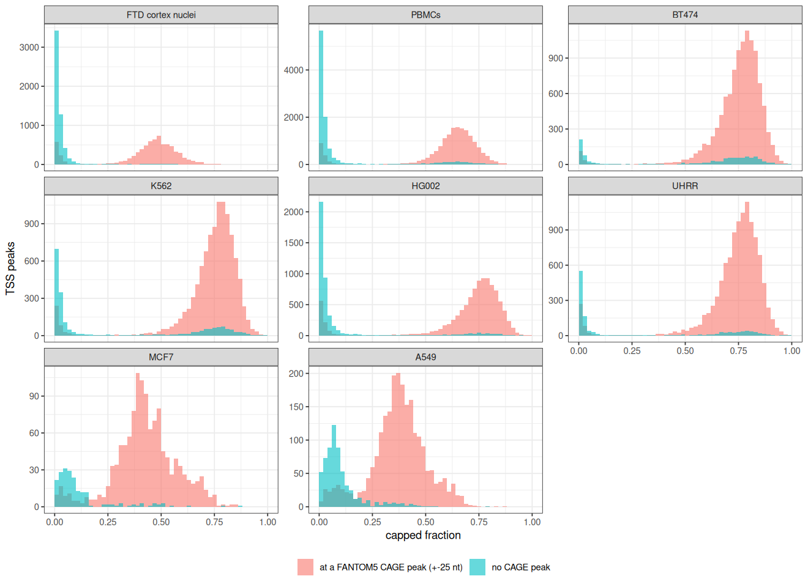
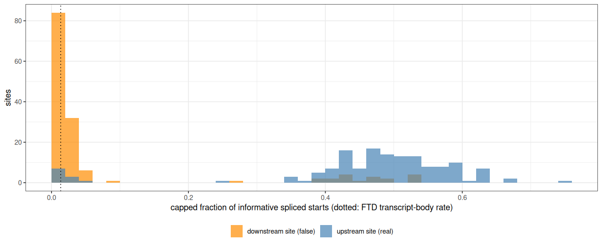

Library-level calibration of the TSS cap signature
================

A read whose 5’ end is a capped RNA end carries one more untemplated G
than the library’s uncapped reads (reverse transcriptase adds a C
opposite the cap; `../cap_signature_other_datasets/`). LRAA v0.46.0 used
that signature to prune TSSs that look like 5’ truncation products, but
decided *per splice graph* whether a library showed the signature at
all. In the genome-wide FTD run that decision failed locally: one deep
uncapped truncation pile-up (VIM) switched the rules off for a whole
chunk strand, and small cell clusters had too few reads to decide.

The fix being built for LRAA v0.47.0 decides once per **library**,
before any chunking, from the distribution of capped fractions over all
TSS peaks. This report shows that distribution for fourteen libraries,
the decision the pre-pass makes from it, and how the FTD sites we know
to be false look on it.

Tables: `Makefile` here, running LRAA’s own pre-pass module
(`pylib/TSS_cap_calibration.py`), so peaks, read rules and the decision
are exactly LRAA’s.

## Definitions

- **Read start.** A primary alignment’s 5’ end on its transcribed strand
  (minimap2 `ts` tag, LRAA’s `transcribed_strand`). It counts only if
  its 5’ soft clip is accounted for, as in LRAA’s `Pretty_alignment`:
  the clip is nothing but 1-3 G’s, or ends in a run of at least 3 G’s
  next to the alignment (ONT: adapter + primer + G run).
- **G run.** The run of G’s in that clip touching the alignment,
  recorded before LRAA strips it.
- **Informative.** A read whose genomic base just 5’ of its start is not
  G (otherwise a capped read’s extra G aligns and the read shows
  nothing). Only spliced informative reads enter the statistics:
  unspliced reads pile up at nuclear truncation points.
- **Baseline and capped.** The baseline is the most common G run among
  informative starts away from every peak (0 for sc Kinnex, 1 for bulk
  PacBio, 3 for ONT PCS109, whose primer carries GGG). A read is
  *capped* when its G run exceeds the baseline.
- **Peak.** A TSS candidate called as an LRAA graph build calls one: at
  least 5 read starts pooled within 50 nt
  (`aggregate_sites_within_window`), at least 5x the median of its
  non-zero neighbours within 50 nt (`filter_non_peaky_positions`). A
  peak’s reads are the informative spliced starts within 50 nt of it.
  Peaks with at least 20 such reads are judged.

## The baseline G run: evidence per library

The baseline is not set by platform: each library’s calibration measures
it, as the most common G run among informative spliced read starts away
from every peak. Two pieces of evidence that the measured value is
right:

| label | platform | G run 0 | G run 1 | G run 2 | G run 3 | G run 4 | G run 5 | baseline |
|:---|:---|:---|:---|:---|:---|:---|:---|---:|
| FTD cortex nuclei | sc Kinnex 10x 3’ | 92.7% | 6.7% | 0.2% | 0.3% | 0.1% | 0.0% | 0 |
| PBMCs | sc Kinnex 10x 3’ | 88.3% | 11.0% | 0.4% | 0.2% | 0.1% | 0.0% | 0 |
| BT474 | bulk PacBio | 12.5% | 57.7% | 28.8% | 1.0% | 0.1% | 0.0% | 1 |
| K562 | bulk PacBio | 11.0% | 66.7% | 21.4% | 0.7% | 0.1% | 0.0% | 1 |
| HG002 | bulk PacBio | 9.2% | 71.1% | 19.0% | 0.7% | 0.1% | 0.0% | 1 |
| UHRR | bulk PacBio | 19.7% | 64.3% | 15.3% | 0.6% | 0.1% | 0.0% | 1 |
| MCF7 | bulk ONT PCS109 | 0.2% | 0.0% | 0.0% | 72.2% | 23.7% | 3.3% | 3 |
| A549 | bulk ONT PCS109 | 0.2% | 0.0% | 0.0% | 77.3% | 19.7% | 2.4% | 3 |
| MORFs (PacBio) | trimmed, no cap | 99.2% | 0.6% | 0.2% | 0.1% | 0.0% | 0.0% | 0 |
| MORFs (ONT) | trimmed, no cap | 99.1% | 0.6% | 0.2% | 0.1% | 0.0% | 0.0% | 0 |
| SIRV spike-ins (BT474 lib.) | uncapped | 16.0% | 82.3% | 1.6% | 0.1% |  |  | 1 |
| SIRV spike-ins (HG002 lib.) | uncapped | 15.7% | 82.5% | 1.7% | 0.1% |  |  | 1 |
| SIRV spike-ins (UHRR lib.) | uncapped | 9.9% | 88.4% | 1.6% | 0.2% |  | 0.0% | 1 |
| Arabidopsis simulation | simulated | 99.3% | 0.5% | 0.1% | 0.1% | 0.0% | 0.0% | 0 |

1. Off-peak informative spliced starts by 5’ G run (share); the most
common is the baseline

**1. The off-peak distribution has one clear mode.** It is G run 0 for
the sc Kinnex libraries (92.7% and 88.3% of off-peak starts), 1 for bulk
PacBio (57.7%, 66.7%, 71.1%, 64.3% for BT474, K562, HG002, UHRR) and 3
for ONT PCS109 (72.2%, 77.3%). The next value up (1, 2 and 4
respectively) is the second most common because the off-peak pool also
holds capped starts that were not called peaks (section 4). The SIRV
spike-ins are an internal control: uncapped RNAs sequenced in the same
bulk PacBio libraries. Their off-peak starts carry exactly one G in
82.3%, 82.5% and 88.4% of reads (BT474, HG002, UHRR libraries), two in
only 1.6%-1.6%; at their peaks (the spike-ins’ real, uncapped 5’ ends,
figure below) reads carry zero or one G and almost never two. In BT474’s
own capped-mode peaks most reads carry two. So in this chemistry an
uncapped end shows at most one G and the cap adds the second: the
baseline of 1 is the library’s background, not an artefact of capped
reads in the pool. The likely source of that background G is an extra G
in the bulk Kinnex PCR adapters (B. Haas, 2026-10-29). The spike-ins
carry it too, and the uncapped 5’ ends show it on about half their
reads, so it may not survive adapter trimming on every read. The
calibration does not depend on the cause: it measures the baseline from
each library’s own reads.

**2. Uncapped-mode peaks sit at the baseline; capped-mode peaks carry
one G more.** The reads of the judged peaks, pooled by mode (split at
each library’s *t*), by G run:

<!-- -->

| label | capped mode_at baseline | capped mode_baseline + 1 | uncapped mode_at baseline | uncapped mode_baseline + 1 |
|:---|:---|:---|:---|:---|
| FTD cortex nuclei | 52.5% | 46.4% | 97.9% | 1.8% |
| PBMCs | 30.8% | 67.9% | 97.5% | 2.2% |
| BT474 | 19.0% | 75.1% | 59.5% | 15.7% |
| K562 | 19.2% | 75.4% | 78.0% | 4.9% |
| HG002 | 18.1% | 76.2% | 85.8% | 3.4% |
| UHRR | 19.0% | 75.3% | 70.2% | 4.4% |
| MCF7 | 45.2% | 49.7% | 85.6% | 12.2% |
| A549 | 54.0% | 41.7% | 87.7% | 10.5% |
| MORFs (PacBio) | 71.8% | 12.0% | 100.0% | 0.0% |
| MORFs (ONT) | 55.9% | 21.6% | 100.0% | 0.0% |
| SIRV spike-ins (HG002 lib.) | 78.6% | 9.4% | 45.6% | 1.0% |
| SIRV spike-ins (UHRR lib.) | 78.1% | 10.1% | 52.4% | 1.3% |
| Arabidopsis simulation | 59.6% | 21.9% | 99.5% | 0.4% |

2. Share of the peaks’ reads at the baseline G run and one above it, by
mode (for the MORFs, the SIRVs and the simulation the ‘capped mode’ is
only their sparse tail; the decision is off)

In every library with the signature, the reads of uncapped-mode peaks
are mostly at the baseline (the truncation products carry only the
library’s background G’s), and the capped-mode peaks gain reads at
exactly baseline + 1 (the extra G opposite the cap): 0 to 1 for sc
Kinnex, 1 to 2 for bulk PacBio, 3 to 4 for ONT. Runs two or more above
the baseline stay rare in both modes, so the signature is one G, not a
general lengthening. In the libraries without the signature nearly all
reads sit at the baseline; their few capped-looking peaks are the sparse
tail the share floor rejects. This is the same one-G-over-baseline
pattern measured at annotated TSSs against transcript bodies in
`../cap_signature_other_datasets/`.

The same data as enrichment: for each G run, the share of capped-mode
reads with that run over the share of uncapped-mode reads with it (log2;
0 = the two modes alike). Libraries whose decision is on only: without
the signature the “capped mode” is by construction the few peaks that
happen to carry stray G’s, set against an uncapped share near zero, so
the ratio is large and meaningless there. G runs with fewer than 20
reads in either mode are left out.

<!-- -->

| library | decision | baseline | baseline + 1 | capped / uncapped share | most enriched G run |
|:---|:---|---:|---:|:---|---:|
| FTD cortex nuclei | on | 0 | 1 | 25.1x | 1 |
| PBMCs | on | 0 | 1 | 30.3x | 1 |
| BT474 | on | 1 | 2 | 4.8x | 2 |
| K562 | on | 1 | 2 | 15.4x | 2 |
| HG002 | on | 1 | 2 | 22.2x | 2 |
| UHRR | on | 1 | 2 | 17.0x | 2 |
| MCF7 | on | 3 | 4 | 4.1x | 4 |
| A549 | on | 3 | 4 | 4.0x | 4 |

Enrichment at baseline + 1, and the most enriched G run

In every library with the signature, baseline + 1 is the most enriched G
run (4- to 30-fold: the cap’s extra G), and the baseline itself is
depleted. The next run up (baseline + 2) is enriched too, less strongly:
some capped molecules carry two extra G’s, as when reverse transcriptase
adds two C’s at the cap. Such reads are few (they barely show in the
share plot above), which is why “capped” is defined as any run above the
baseline rather than exactly one above it.

## How the calibration works: algorithm and code walkthrough

All of it lives in one LRAA module, `pylib/TSS_cap_calibration.py`. The
steps, with the function that does each:

    calibrate(bam, genome)                     # LRAA driver, or util/calibrate_TSS_cap_signature.py
     ├─ scan(bam, genome, cpu)                 # one worker per contig (largest first), in parallel
     │   └─ scan_contig(bam, genome, contig)   # both strands of one contig, one pass over its reads
     │       ├─ for each primary read:         #   transcribed strand (Util_funcs.transcribed_strand)
     │       │     _five_prime_start(read)     #   -> (5' position, G run or None, spliced?) or None
     │       │       └─ five_prime_clip(clip)  #   the 5' soft-clip rule (same as Pretty_alignment)
     │       ├─ peaks = LRAA's own TSS peak calling on all read starts of the strand
     │       └─ returns, per strand: off-peak G-run counts, and G-run counts at each peak
     ├─ decide(per_contig)                     # pools every contig strand -> one library answer
     │   ├─ baseline   = most common G run among off-peak starts
     │   ├─ fractions  = per peak: capped / informative (peaks with >= 20 informative reads)
     │   ├─ split      = _split_two_modes(fractions)          # Otsu threshold
     │   └─ decision   = on / off / undetermined (criteria below)
     ├─ overrides_from(...)                    # -> LRAA config keys
     └─ write_report / write_scan_table        # .json, .hist.tsv, .svg, .scan.tsv.gz

### Step 1: what one read contributes (`_five_prime_start`, `five_prime_clip`)

For each primary alignment (mapping quality at least LRAA’s
`min_mapping_quality`):

1.  Its **transcribed strand** sets which end is 5’: the left end on +,
    the right end on -.
2.  Its **5’ soft clip** is read in the genomic frame (on - the 5’ G run
    appears as C’s at the head of the right clip). The **G run** is the
    run of G’s touching the alignment.
3.  The read’s **5’ end is trusted** – taken as the first base of the
    molecule it came from – only if the clip is accounted for, the rule
    `Pretty_alignment` applies before assembly: the clip is nothing but
    1-3 G’s, or the G run next to the alignment is at least 3 (ONT:
    adapter + primer + G run). Anything else (a clip with unexplained
    bases) means the true 5’ end is not known, and the read is skipped.
    A trusted 5’ end is a real molecule end, not necessarily a TSS: most
    trusted ends away from peaks are truncated or degraded molecules,
    which is why the off-peak ones measure the uncapped baseline.
4.  It is **informative** only if the genomic base just upstream of the
    start is not G. Otherwise a capped read’s extra G matches the
    genome, aligns, and no clip is left to see.
5.  Only **spliced** reads enter the cap statistics (unspliced reads
    pile up at nuclear truncation points); all accepted starts, spliced
    or not, are used to call peaks.

Two different questions are asked of every read, and the libraries
answer them differently because their reads arrive in different shapes.
LRAA applies the same rules to every library and does not know the
platform.

- **Can the start be trusted?** (step 3) A clip of unexplained bases
  means the read may be misaligned or truncated, so its start is not a
  transcript 5’ end. The clip must be accounted for. Kinnex and Iso-Seq
  reads arrive with the template-switch oligo already trimmed, so at
  most the untemplated G’s remain: the clip must be nothing but 1-3 G’s.
  ONT PCS109 reads still carry adapter + the strand-switching primer,
  whose 3’ end is **GGG** (it anneals to the C’s reverse transcriptase
  adds at the RNA’s end). So **\>= 3 G’s next to the alignment does not
  mean capped**: it means the clip ends in the primer, the base after it
  is the true first base of the cDNA, and the rest of the clip is
  adapter. Every strand-switched ONT read has those three G’s, capped or
  not.
- **Is the read capped?** Decided against the library’s baseline, the G
  count of its uncapped starts: 0 for Kinnex, 1 for bulk PacBio (likely
  an extra G in the bulk Kinnex PCR adapters), 3 for ONT (the primer’s
  GGG). A capped end carries **one G more** than the baseline, from the
  C reverse transcriptase adds opposite the cap.

Examples (+ strand reads, LRAA defaults), each in the library type that
produces it:

| library (baseline) | 5’ clip | G run | start trusted? | capped? |
|----|----|----|----|----|
| sc Kinnex (0) | (none) | 0 | yes | no |
| sc Kinnex (0) | `G` | 1 | yes: the clip is all G | **yes** (1 \> 0) |
| sc Kinnex (0) | `GG` | 2 | yes: the clip is all G | **yes** |
| sc Kinnex (0) | `A` | 0 | no: an unexplained base | (not counted) |
| sc Kinnex (0) | `AG` | 1 | no: not all G, and fewer than 3 G’s | (not counted) |
| bulk PacBio (1) | `G` | 1 | yes | no (1 = baseline) |
| bulk PacBio (1) | `GG` | 2 | yes | **yes** (2 \> 1) |
| ONT PCS109 (3) | adapter + `...GGG` | 3 | yes: the clip ends in the primer | no (3 = baseline) |
| ONT PCS109 (3) | adapter + `...GGGG` | 4 | yes | **yes** (4 \> 3) |
| ONT PCS109 (3) | adapter + `...GG` | 2 | no: the clip does not end in the primer | (not counted) |

An uncapped ONT end can still show a 4th G when only two of the primer’s
G’s anneal to the three C’s, leaving one C to template an extra G. That
is why ONT’s uncapped mode sits higher (section 1) and its two modes are
closer together.

`pylib/test_TSS_cap_calibration.py` checks that `five_prime_clip` gives
the same G run and the same verdict as `Pretty_alignment` for these
clips, on both strands.

### Step 2: peaks and per-peak counts (`scan_contig`)

Per contig strand, all accepted read starts go into a position counter,
and peaks are called exactly as a splice-graph build calls TSS
candidates:

- `aggregate_sites_within_window`: positions with at least 5 starts
  pooled within 50 nt, keeping the strongest position of each cluster;
- `filter_non_peaky_positions`: a peak must have at least 5x the median
  count of its non-zero neighbours within 50 nt (a sharp pile-up, not a
  smear).

Each informative spliced start within 50 nt of a peak is counted for
that peak by its G run (`G0`..`G8`); every other informative spliced
start goes to the strand’s **off-peak** counts. A worker returns only
these counts, so the parent can pool contigs without the reads.

### Step 3: the library decision (`decide`, `_split_two_modes`)

    baseline   = argmax_g  off_peak_count[g]            # e.g. 0 Kinnex, 1 PacBio, 3 ONT
    for each peak with n = informative reads >= 20:
        capped_frac = (reads with G run > baseline) / n
    if number of such peaks < 50:            -> undetermined   ("too few peaks to judge")

    t = Otsu threshold over capped_frac      # the cut t in 0.01..0.99 maximising
                                             #   w_lo * w_hi * (mean_hi - mean_lo)^2
    lo = peaks with capped_frac <  t         # uncapped group
    hi = peaks with capped_frac >= t         # capped group
    share = |hi| / (|lo| + |hi|)
    sep   = median(hi) - median(lo)

    if share >= 0.10 and |hi| >= 50 and sep >= 0.20:   -> on
    elif share >= 0.10 and sep >= 0.20:                 -> undetermined   (clear but thin: |hi| < 50)
    else:                                               -> off

In the Otsu criterion, for a candidate threshold *t*:

- **w_lo** is the fraction of judged peaks with capped fraction below
  *t*, and **mean_lo** their mean capped fraction (the uncapped group);
- **w_hi** = 1 - w_lo is the fraction at or above *t*, and **mean_hi**
  their mean (the capped group).

w_lo \* w_hi \* (mean_hi - mean_lo)^2 is the between-group variance
written compactly. In full it is w_lo \* (mean_lo - mu)^2 + w_hi \*
(mean_hi - mu)^2, each group’s weight times the squared distance of its
mean from the overall mean mu = w_lo \* mean_lo + w_hi \* mean_hi;
substituting mu gives the compact form. The total variance of the peaks
is fixed and equals this between-group part plus the within-group
spread, so the *t* that maximises it is also the one leaving the two
groups tightest, which is the valley of a bimodal histogram. The weights
stop a cut that isolates a handful of extreme peaks from scoring well:
w_lo \* w_hi is largest for an even split and goes to 0 as either group
empties.

The **valley** reported alongside is the emptiest 2% histogram bin
between the two medians; it is not used in the decision.

`overrides_from` turns the answer into LRAA config keys: “on” or “off”
sets `TSS_cap_signature` and `TSS_cap_G_baseline`, so every splice-graph
build applies the library’s answer and estimates nothing; “undetermined”
sets nothing, and each graph build decides from its own reads as before
(`TSS_cap_signature` “auto”).

### Worked example: FTD

<!-- -->

For FTD (49639 peaks called genome-wide):

1.  **Baseline**: off-peak starts are mostly G run 0, so baseline = 0; a
    read with one or more untemplated G’s counts as capped.
2.  **Judged peaks**: 13149 peaks have at least 20 informative spliced
    reads.
3.  **Split**: the between-group variance peaks at t = 0.26 (right
    panel). The curve is nearly flat from about 0.1 to 0.35: so few
    peaks sit in the valley that any cut there gives almost the same two
    groups, which is why the decision does not hinge on exactly where
    the cut falls. Below it, 6453 peaks with median capped fraction
    1.4%; above it, 6696 peaks with median 48.5%.
4.  **Criteria**: capped share 50.9% (needs \>= 10%), capped-group peaks
    6696 (needs \>= 50), separation 0.47 (needs \>= 0.20): all pass, so
    the decision is **on**, and every graph build gets
    `TSS_cap_signature` “on” with `TSS_cap_G_baseline` 0.

For the libraries without the signature, the split still finds a
“capped” group (Otsu always splits), but it is a sparse tail of peaks
with a few stray G’s, so the share criterion fails: the Arabidopsis
simulation’s capped group is 0.0% of its peaks (6 peaks; t = 0.16), the
MORFs’ 1.7% (PacBio) and 0.4% (ONT): **off**. Their medians are far
enough apart (separation 0.35 for the simulation), so the share floor is
what rejects them. The SIRVs of the BT474 library give only 38 judged
peaks: **undetermined**; those of the HG002 and UHRR libraries give 51
and 141, with modes only 0.09 and 0.08 apart: **off**.

The split *t* itself is not tested: it always lies between the two group
medians, so with medians at least 0.20 apart it sits well above the
uncapped mode. Measured, *t* is 0.26-0.42 where the decision is on, and
0.06-0.18 where it is off.

### After the decision: the per-site rules

The calibration only says whether the signature exists and what the
baseline is. The rules that remove sites are unchanged, and use it per
site (a site’s informative reads within 50 nt):

- **Pooled / basic runs** (`prune_uncapped_alt_TSS`): a TSS downstream
  of a capped TSS, on any splice-graph path, is pruned when it has at
  least 5 informative reads and under 10% capped. A gene’s upstream-most
  TSS is never judged.
- **Cluster runs** (`require_cap_for_new_TSS`, set by the single-cell
  workflow): a TSS not within 50 nt of a guide 5’ end needs at least 5
  informative reads, at least 2 capped, and at least 10% capped.

### Where it runs

- **LRAA**: at the start of a discovery run with `TSS_cap_signature`
  “auto” (in chunked mode after the library read count); the answer
  reaches every chunk worker with the forwarded config. Quant-only runs
  skip it.
- **Standalone**:
  `util/calibrate_TSS_cap_signature.py --bam --genome --output_prefix`,
  or `--scan_table` to re-decide from a saved scan; it writes a
  `.config.json` for LRAA’s `--config_update`, with `TSS_cap_prepass`
  false so no later run re-calibrates on its own reads.
- **WDL**: `LRAA.wdl` runs the standalone step once on the whole bam
  before sharding and merges the answer into every shard’s config;
  `LRAA-singlecell.wdl` hands the init run’s answer to every cluster
  run, so a cluster never decides from its own sparse reads.

## 1. Per-peak capped fractions are bimodal when the library has the signature

<!-- -->

| library | platform | decision | baseline G | peaks judged | uncapped mode median | capped mode median | capped mode share | separation | valley | reason |
|:---|:---|:---|---:|---:|:---|:---|:---|---:|---:|:---|
| FTD cortex nuclei | sc Kinnex 10x 3’ | on | 0 | 13149 | 1.4% | 48.5% | 50.9% | 0.47 | 0.15 |  |
| PBMCs | sc Kinnex 10x 3’ | on | 0 | 27586 | 1.5% | 65.2% | 60.6% | 0.64 | 0.23 |  |
| BT474 | bulk PacBio | on | 1 | 11959 | 2.0% | 77.2% | 94.7% | 0.75 | 0.25 |  |
| K562 | bulk PacBio | on | 1 | 12535 | 1.8% | 76.8% | 86.0% | 0.75 | 0.35 |  |
| HG002 | bulk PacBio | on | 1 | 14762 | 1.8% | 76.2% | 66.8% | 0.74 | 0.29 |  |
| UHRR | bulk PacBio | on | 1 | 12346 | 1.4% | 76.6% | 89.4% | 0.75 | 0.31 |  |
| MCF7 | bulk ONT PCS109 | on | 3 | 1472 | 9.5% | 44.1% | 75.8% | 0.35 | 0.19 |  |
| A549 | bulk ONT PCS109 | on | 3 | 2972 | 8.7% | 39.4% | 68.9% | 0.31 | 0.19 |  |
| MORFs (PacBio) | trimmed, no cap | off | 0 | 2565 | 0.0% | 25.0% | 1.7% | 0.25 | 0.17 | capped mode 1.7% of peaks; capped mode 44 peaks |
| MORFs (ONT) | trimmed, no cap | off | 0 | 1266 | 0.0% | 43.5% | 0.4% | 0.43 | 0.11 | capped mode 0.4% of peaks; capped mode 5 peaks |
| SIRV spike-ins (BT474 lib.) | uncapped | undetermined | 1 | 38 |  |  |  | NA | NA | too few peaks to judge |
| SIRV spike-ins (HG002 lib.) | uncapped | off | 1 | 51 | 0.2% | 9.4% | 11.8% | 0.09 | 0.05 | capped mode 6 peaks; modes 0.09 apart |
| SIRV spike-ins (UHRR lib.) | uncapped | off | 1 | 141 | 1.4% | 9.1% | 2.8% | 0.08 | 0.07 | capped mode 2.8% of peaks; capped mode 4 peaks; modes 0.08 apart |
| Arabidopsis simulation | simulated | off | 0 | 18297 | 0.2% | 35.2% | 0.0% | 0.35 | 0.17 | capped mode 0.0% of peaks; capped mode 6 peaks |

LRAA’s library decision (TSS_cap_calibration.decide)

Every library made with template switching has two modes: peaks whose
reads are almost never capped (uncapped-mode medians 1.4% to 9.5%), and
peaks whose reads mostly are (capped-mode medians 39.4% to 77.2%). The
libraries without the signature have one mode at zero. The ONT
libraries’ modes are broader and closer together, and their uncapped
mode sits higher (9.5% and 8.7%): an uncapped end can still carry a
fourth G when only two of the primer’s G’s anneal.

**The decision.** The fractions are split into two groups where they
separate best (Otsu). The signature is present when the capped group
holds at least 10% of the judged peaks and at least 50 peaks, and its
median exceeds the uncapped group’s by at least 0.20. With fewer than 50
judged peaks, or a clear but thin capped mode, the result is
*undetermined*: nothing is set, and each graph build decides for itself
as before. The MORF reads (5’ ends trimmed upstream) show a sparse tail
of capped-looking peaks (1.7% of peaks) that the 10% floor rejects.

**The valley** (emptiest 2% bin between the two medians) lies at or
above the per-site threshold LRAA uses (`min_TSS_cap_frac` 10%) in every
library with the signature, so the per-site rule cuts inside the
uncapped mode’s upper tail or at the valley, never into the capped mode.

## 2. The capped mode is the CAGE-supported one

<!-- -->

| label             | 0-5%       | 5-10%     | 10-20%    | \>=20%      |
|:------------------|:-----------|:----------|:----------|:------------|
| FTD cortex nuclei | 5827 (15%) | 432 (14%) | 120 (28%) | 6770 (97%)  |
| PBMCs             | 9497 (15%) | 856 (16%) | 333 (20%) | 16900 (91%) |
| BT474             | 464 (34%)  | 45 (31%)  | 37 (41%)  | 11413 (93%) |
| K562              | 1445 (23%) | 155 (25%) | 66 (24%)  | 10869 (93%) |
| HG002             | 4110 (20%) | 445 (18%) | 178 (24%) | 10029 (94%) |
| UHRR              | 1120 (33%) | 71 (24%)  | 35 (46%)  | 11120 (96%) |
| MCF7              | 103 (33%)  | 79 (23%)  | 67 (37%)  | 1223 (98%)  |
| A549              | 216 (21%)  | 318 (22%) | 238 (40%) | 2200 (97%)  |

Peaks per capped-fraction band (share at a CAGE peak)

In FTD, 97% of capped-mode peaks (\>= 20%) sit at a CAGE peak, against
15% of uncapped-mode peaks (\< 5%); in PBMCs 91% against 15%. The
uncapped-mode peaks that do overlap CAGE (854 in FTD) are probably
FANTOM5’s exon-internal peaks, common at recapping and cleavage sites:
VIM’s downstream site is one (0 capped of 108 informative reads, on a
CAGE peak). The PBMC capped mode includes non-CAGE peaks (9%): capped
starts FANTOM5 lacks, which the cap rule keeps.

## 3. Sites known to be false sit with the transcript body

The FTD event pairs (`ext/`, the v0.45.0 high-confidence TSS switches
where a neuron cluster favours the downstream site, before any cap
rule): the downstream sites are 5’ truncation products by every other
measure (no CAGE support, neuron nuclei’s short reads; see
`../../../../LRAA_paper-FTD_study/__Site_Usage_Analysis`). Their capped
fractions, from the same read rules:

<!-- -->

|  | sites | median capped | middle half | sites \<= 3% | sites \>= 10% |
|----|----|----|----|----|----|
| upstream (real) sites | 145 | 48.4% | 42.9%-54.1% | 10 | 134 |
| downstream (false) sites | 142 | 1.6% | 1.0%-3.0% | 106 | 19 |
| FTD transcript body |  | 1.34% |  |  |  |
| FTD library: uncapped / capped mode median |  | 1.4% / 48.5% |  |  |  |

The false downstream sites have the transcript body’s cap rate and sit
in the library’s uncapped mode; their real upstream partners sit in the
capped mode. The 19 downstream sites at \>= 10% are candidates for
genuine alternative promoters, which the cap rule keeps. The body rates
come from the 5’ completeness tables (`../`; reads starting \> 100 nt
inside single-TSS genes): FTD 1.34%, PBMC 1.48%.

## 4. Why the decision does not use a non-peak background

v0.46.x compared peaks against read starts away from every peak. That
“background” is not uncapped: it holds real capped starts that were not
called peaks.

| distance_to_peak | reads_starting_at_position | FTD | PBMC | BT474 |
|:---|:---|:---|:---|:---|
| at peak (\<=50 nt) | any | 34.8% (165024) | 67.4% (2840006) | 78.3% (571156) |
| 51-200 nt | 1 | 10.9% (5236) | 18.3% (8510) | 48.3% (3369) |
| 51-200 nt | 2-4 | 10.1% (5384) | 17.8% (10670) | 53.6% (3706) |
| 51-200 nt | \>=5 | 9.6% (3140) | 23.7% (8847) | 67.6% (3871) |
| 201-1000 nt | 1 | 6.6% (9220) | 9.9% (12399) | 34.7% (2958) |
| 201-1000 nt | 2-4 | 6.3% (6054) | 11.4% (10396) | 30.8% (2346) |
| 201-1000 nt | \>=5 | 5.4% (2327) | 16.0% (3741) | 40.5% (1114) |
| 1001-5000 nt | 1 | 6.8% (16518) | 7.3% (16875) | 9.3% (5130) |
| 1001-5000 nt | 2-4 | 10.5% (6437) | 9.2% (10063) | 11.7% (2909) |
| 1001-5000 nt | \>=5 | 20.0% (1801) | 21.3% (2998) | 33.6% (693) |
| 5001-inf nt | 1 | 8.7% (26121) | 11.9% (11599) | 12.3% (18579) |
| 5001-inf nt | 2-4 | 21.7% (7435) | 21.9% (5610) | 25.5% (8433) |
| 5001-inf nt | \>=5 | 38.5% (2047) | 46.7% (1742) | 60.6% (2477) |

chr19: capped share of informative spliced starts (n reads), by distance
to the nearest peak and by how many reads start at the same position

Starts just outside a peak’s 50 nt window are often capped (promoters
spread their starts), and so are positions far from any peak where
several reads start (real promoters the peak filter missed: broad, or
lowly expressed). Even single starts far from any peak run above the
transcript-body rate. The per-peak distribution needs no such
background: the uncapped mode *is* the truncation background, measured
where it matters.

## 5. Sensitivity to the read floor for judged peaks

| label             | floor | peaks | \< 10% | 10-20% | \>= 20% |
|:------------------|------:|------:|:-------|:-------|:--------|
| FTD cortex nuclei |    10 | 15312 | 49.2%  | 1.4%   | 49.4%   |
| FTD cortex nuclei |    20 | 13149 | 47.6%  | 0.9%   | 51.5%   |
| FTD cortex nuclei |    50 |  7900 | 44.8%  | 0.6%   | 54.6%   |
| PBMCs             |    10 | 30589 | 39.8%  | 1.5%   | 58.7%   |
| PBMCs             |    20 | 27586 | 37.5%  | 1.2%   | 61.3%   |
| PBMCs             |    50 | 20802 | 31.6%  | 0.9%   | 67.6%   |
| BT474             |    10 | 12366 | 4.9%   | 0.4%   | 94.7%   |
| BT474             |    20 | 11959 | 4.3%   | 0.3%   | 95.4%   |
| BT474             |    50 | 10260 | 3.7%   | 0.2%   | 96.1%   |
| K562              |    10 | 12965 | 13.8%  | 0.6%   | 85.6%   |
| K562              |    20 | 12535 | 12.8%  | 0.5%   | 86.7%   |
| K562              |    50 | 10645 | 10.4%  | 0.4%   | 89.2%   |
| HG002             |    10 | 15527 | 32.4%  | 1.4%   | 66.2%   |
| HG002             |    20 | 14762 | 30.9%  | 1.2%   | 67.9%   |
| HG002             |    50 | 11506 | 24.1%  | 0.9%   | 75.1%   |
| UHRR              |    10 | 12898 | 10.5%  | 0.3%   | 89.2%   |
| UHRR              |    20 | 12346 | 9.6%   | 0.3%   | 90.1%   |
| UHRR              |    50 | 10211 | 8.9%   | 0.2%   | 90.9%   |
| MCF7              |    10 |  1644 | 14.5%  | 5.2%   | 80.3%   |
| MCF7              |    20 |  1472 | 12.4%  | 4.6%   | 83.1%   |
| MCF7              |    50 |   953 | 8.7%   | 3.1%   | 88.1%   |
| A549              |    10 |  3224 | 19.4%  | 8.6%   | 72.1%   |
| A549              |    20 |  2972 | 18.0%  | 8.0%   | 74.0%   |
| A549              |    50 |  1964 | 13.0%  | 6.0%   | 81.0%   |
| MORFs (PacBio)    |    10 |  2730 | 97.9%  | 0.8%   | 1.3%    |
| MORFs (PacBio)    |    20 |  2565 | 97.8%  | 0.9%   | 1.3%    |
| MORFs (PacBio)    |    50 |  2025 | 98.4%  | 0.8%   | 0.8%    |

Share of peaks per band at three read floors

The between-mode band stays thin at every floor; a lower floor adds
binomial noise to both modes, a higher one drops the lowly expressed
genes. LRAA uses 20.

## Possible extension: a fitted mixture model (not pursued now)

Recorded 2026-10-29 for later; the threshold rule above is kept for its
simplicity. The per-peak counts (informative reads *n*, capped reads
*k*) could be fitted with a two-component **beta-binomial mixture**
(EM): the binomial part weighs each peak by its depth, the beta part
allows real spread within a mode. It would give

- a model-based library decision in place of the Otsu split: two
  components preferred over one (BIC) *and* effect-size criteria on the
  fitted parameters (capped weight \>= 10%, means \>= 0.20 apart,
  separation such as Ashman’s D \>= 2), since with thousands of peaks
  BIC alone prefers two components for any heterogeneity (the MORF tail
  would pass);
- per-site posteriors in place of the fixed 10% threshold: a site’s
  probability of belonging to the uncapped mode given its *n* and *k*.
  Thin sites (5 reads, none capped) would no longer be pruned on weak
  evidence, and the cut would adapt per library (the ONT uncapped mode
  reaches past 10%).

First step if taken up: fit the mixture to these fourteen libraries’
peak tables and compare its decisions with the table in section 1. Also
recorded in LRAA `docs/TSS_cap_calibration.md`.

## Caveats

- **Mixed bams.** A bam merging libraries of different chemistries has
  more than one baseline (sc Kinnex 0, PacBio bulk 1, ONT 3); one
  library-wide answer would be wrong for part of it. None of our
  datasets is mixed.
- **The genomic-G blind spot** is unchanged: a site whose genomic base
  just upstream is G has no informative reads and is never judged per
  site.
- **ONT** keeps more uncapped sites, because its uncapped mode reaches
  past the 10% per-site threshold. A per-library threshold at the valley
  would fix that; it is reported here (`valley`) but not used.

Generated 2026-11-16 with LRAA’s pre-pass module from the branch that
becomes v0.47.0.
