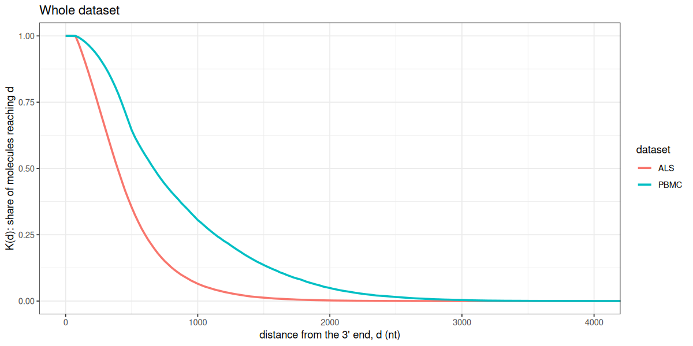
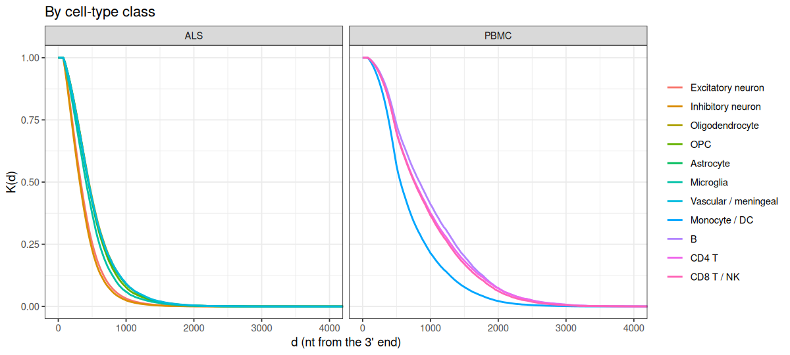
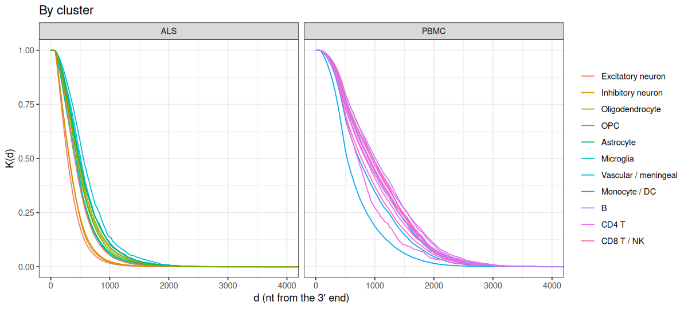
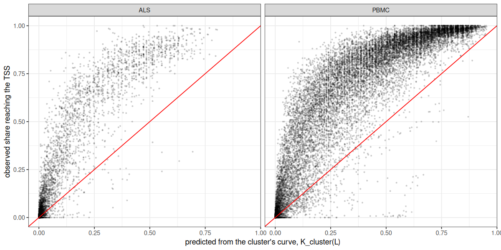
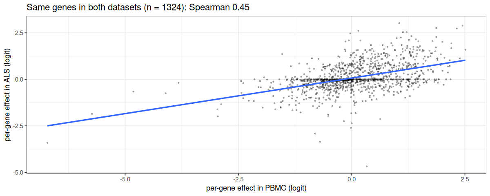
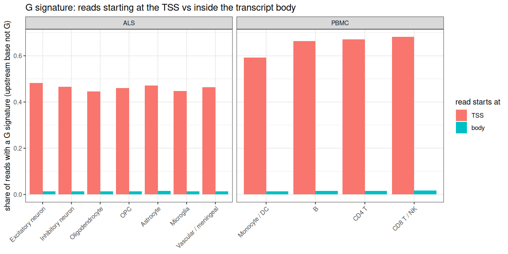
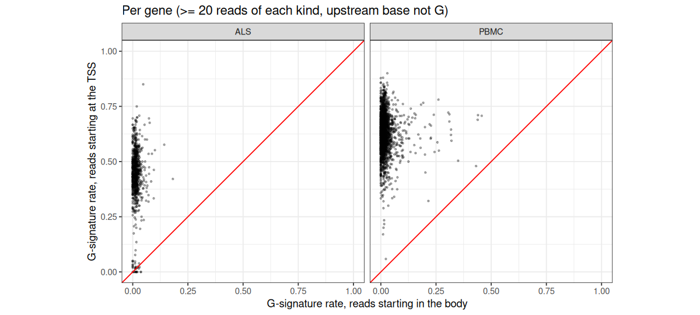
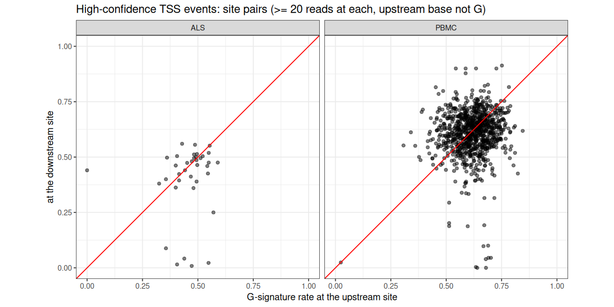

Read 5’ completeness and the cap (untemplated-G) signature: PBMC vs ALS
================

Measurement only, to review before any change to LRAA’s TSS calling. In
ALS cortex nuclei, most high-confidence TSS switches have a neuron
cluster favouring a downstream TSS, and the reads of housekeeping genes
rarely reach the TSS (`ALS_LRAA_eval/__TSS_Truncation_Check`). This
report asks:

- **A.** How 5’ completeness falls with distance from the 3’ end,
  globally and per cluster.
- **B.** How much of the variation is per cluster and how much per gene.
- **C.** Whether the untemplated-G signature that template switching
  leaves at a capped 5’ end separates reads that start at a TSS from
  reads that start inside a transcript body.
- **D.** What a completeness-aware degradation threshold would do to the
  high-confidence TSS events of each dataset.

Tables: `util/sc/tss_5prime_completeness.py` (LRAA), via the `Makefile`
here. Reads are taken with LRAA’s read filters and transcribed-strand
rule. Each read’s 5’ clip, and whether LRAA strips it as untemplated
G’s, come from LRAA’s `Pretty_alignment`. The exact rules are in the
script’s header and in `README.md`.

| dataset | status                         | cage   |    N |
|:--------|:-------------------------------|:-------|-----:|
| ALS     | no_transcript_starting_at_site |        |  595 |
| ALS     | ok                             | multi  |  790 |
| ALS     | ok                             | none   |   97 |
| ALS     | ok                             | single | 3909 |
| ALS     | too_short_or_no_reads          | multi  |    7 |
| ALS     | too_short_or_no_reads          | none   |    6 |
| ALS     | too_short_or_no_reads          | single |   26 |
| PBMC    | no_reads                       |        |    4 |
| PBMC    | no_transcript_starting_at_site |        |  404 |
| PBMC    | ok                             | multi  |  894 |
| PBMC    | ok                             | none   |   61 |
| PBMC    | ok                             | single | 5388 |
| PBMC    | too_short_or_no_reads          | multi  |   16 |
| PBMC    | too_short_or_no_reads          | none   |    5 |
| PBMC    | too_short_or_no_reads          | single |   46 |

Genes with exactly one LRAA TSS site, by outcome. Used: status ok and
CAGE single or none.

## A. 5’ completeness curves

For each gene and group of cells, S(d) is the share of its
polyA-anchored reads whose 5’ extent from the 3’ end is at least d nt,
for d up to the gene’s length L. Reads starting within 50 nt of the TSS
count as full length. K(d) is the mean of S(d) over genes with L \>= d
and at least 20 anchored reads in that group, so each gene counts once
whatever its expression. Groups are a whole dataset, a cell-type class,
or a cluster.

<!-- -->

<!-- -->

<!-- -->

| dataset | class                |  500 | 1000 | 1500 | 2000 | 3000 |
|:--------|:---------------------|-----:|-----:|-----:|-----:|-----:|
| ALS     | Astrocyte            | 0.42 | 0.09 | 0.02 | 0.00 | 0.00 |
| ALS     | Excitatory neuron    | 0.25 | 0.03 | 0.00 | 0.00 | 0.00 |
| ALS     | Inhibitory neuron    | 0.23 | 0.02 | 0.00 | 0.00 | 0.00 |
| ALS     | Microglia            | 0.37 | 0.06 | 0.01 | 0.00 | 0.00 |
| ALS     | OPC                  | 0.42 | 0.08 | 0.02 | 0.00 | 0.00 |
| ALS     | Oligodendrocyte      | 0.44 | 0.09 | 0.02 | 0.00 | 0.00 |
| ALS     | Vascular / meningeal | 0.43 | 0.09 | 0.02 | 0.00 | 0.00 |
| PBMC    | B                    | 0.73 | 0.41 | 0.20 | 0.07 | 0.01 |
| PBMC    | CD4 T                | 0.70 | 0.38 | 0.18 | 0.07 | 0.01 |
| PBMC    | CD8 T / NK           | 0.70 | 0.37 | 0.17 | 0.06 | 0.00 |
| PBMC    | Monocyte / DC        | 0.57 | 0.21 | 0.08 | 0.02 | 0.00 |

K(d) by class at selected distances from the 3’ end

## B. Cluster vs gene: where the variation is

Per gene and cluster (at least 50 anchored reads): observed share
reaching the TSS against the share predicted by the cluster’s curve at
the gene’s length, K_cluster(L).

<!-- -->

| dataset | gene_clusters | genes | cor_pred_obs | median_abs_err |
|:--------|--------------:|------:|-------------:|---------------:|
| ALS     |          9795 |  2474 |        0.953 |          0.000 |
| PBMC    |         17464 |  3484 |        0.947 |          0.236 |

**Variance decomposition.** A binomial GLM of the per gene x cluster
reach counts, adding terms in turn: log(L), then cluster, then gene. The
table gives each term’s share of the null deviance and what is left
over. The residual is the gene x cluster interaction plus binomial
noise; its ratio to the residual degrees of freedom shows how much is
beyond binomial noise.

| dataset | term | share_of_null_deviance | cluster_alone | resid_dev_per_df |
|:---|:---|---:|---:|---:|
| PBMC | log(L) | 0.697 | NA | NA |
| PBMC | \+ cluster | 0.050 | 0.146 | NA |
| PBMC | \+ gene (beyond its length) | 0.244 | NA | NA |
| PBMC | residual (gene x cluster) | 0.009 | NA | 5.076 |
| ALS | log(L) | 0.901 | NA | NA |
| ALS | \+ cluster | 0.049 | 0.097 | NA |
| ALS | \+ gene (beyond its length) | 0.043 | NA | NA |
| ALS | residual (gene x cluster) | 0.007 | NA | 1.232 |

Mixed model: reach ~ log(L) + cluster + (1 \| gene)

| dataset | gene SD (logit) | cluster range (logit, max - min) | length effect per SD of log L (logit) |
|:---|---:|---:|---:|
| PBMC | 1.03 | 1.47 | -4.04 |
| ALS | 1.08 | 1.67 | -6.38 |

Spearman correlation of the per-gene effect (higher = reaches the TSS
more often than its length and cluster predict) with gene features

| dataset | GC of first 100 nt | log length | first exon length | log reads (expression) |
|:---|---:|---:|---:|---:|
| ALS | 0.02 | 0.06 | -0.06 | 0.09 |
| PBMC | 0.08 | -0.01 | 0.08 | 0.03 |

<!-- -->

## C. The untemplated-G (cap) signature

What the reads carry at their 5’ ends (transcript orientation), on a
sample of chr12 reads:

- **PBMC:** 66% have no clip and 25% a 1-base clip. Among clipped reads
  the proximal base is mostly a single G (about 42k of 66k); the next
  most common is a single A.
- **ALS:** 79% have no clip and 11% a 1-base clip. That clip is mostly a
  single A (about 13.5k) and less often a single G (about 5.9k).

LRAA strips a whole clip of 1-3 G’s, or a proximal run of at least 3
G’s, as untemplated G’s (`clip = G` below). An untemplated G aligns when
the genome itself has a G just upstream of the start, so it leaves no
clip there. Signature rates are therefore given separately for reads
whose upstream genomic base is G (`upstream_G = 1`) and is not.

| dataset | upstream_G | five_class |     G | noclip | other |
|:--------|-----------:|:-----------|------:|-------:|------:|
| ALS     |          0 | TSS        | 0.467 |  0.463 | 0.070 |
| ALS     |          0 | near       | 0.050 |  0.686 | 0.264 |
| ALS     |          0 | body       | 0.013 |  0.845 | 0.142 |
| ALS     |          1 | TSS        |    NA |  0.715 | 0.285 |
| ALS     |          1 | near       |    NA |  0.682 | 0.318 |
| ALS     |          1 | body       |    NA |  0.815 | 0.185 |
| PBMC    |          0 | TSS        | 0.655 |  0.251 | 0.094 |
| PBMC    |          0 | near       | 0.101 |  0.798 | 0.101 |
| PBMC    |          0 | body       | 0.014 |  0.771 | 0.215 |
| PBMC    |          1 | TSS        |    NA |  0.732 | 0.268 |
| PBMC    |          1 | near       |    NA |  0.822 | 0.178 |
| PBMC    |          1 | body       | 0.000 |  0.818 | 0.182 |

Share of reads by 5’ clip class. TSS: starts within 50 nt of the gene’s
TSS; near: 50-100 nt downstream; body: \> 100 nt downstream

<!-- -->

<!-- -->

| dataset | genes | median_TSS | median_body | share_genes_TSS_higher |
|:--------|------:|-----------:|------------:|-----------------------:|
| ALS     |   879 |       0.45 |        0.01 |                   0.98 |
| PBMC    |  2398 |       0.63 |        0.01 |                   1.00 |

### At the high-confidence TSS events’ sites

The same signature for reads starting within 25 nt of each event’s
upstream (U) and downstream (D) site, pooled over clusters, for reads
whose upstream base is not G. Within a 25 nt window the upstream base
varies from read to read, so most sites have enough such reads.

<!-- -->

| dataset | site_pairs | median_U | median_D | share_D_lower |
|:--------|-----------:|---------:|---------:|--------------:|
| ALS     |         37 |     0.48 |     0.46 |          0.59 |
| PBMC    |        896 |     0.63 |     0.62 |          0.54 |

## D. A completeness-aware degradation threshold, simulated on the existing events

Suppose every molecule of a gene started at the upstream site U. A read
would still start in the 50 nt window around the downstream site D
whenever the molecule’s read stops there. In cluster c, the expected
number of such reads per read that reaches U is

r_c = (K_c(d_D - 25) - K_c(d_D + 25)) / K_c(d_U)

where d_U and d_D are the distances of U and D from the 3’ end, taken as
the median aligned distances of the reads that start at U, and K_c is
cluster c’s curve from A. This applies only when D lies inside the
molecules that start at U: at least half of the U-start reads have D in
an aligned exon. Otherwise a truncated U molecule cannot start at D, and
the event is exempt (AIF1-type alternative first exons).

Two rules, on the cluster where D’s share of the U + D reads is higher
(`fav`):

- **flag 1, truncation-consistent:** D_fav \<= 2 x U_fav x r_fav. Then
  at least half of D’s reads could be truncated U molecules. This is the
  completeness-aware analogue of LRAA’s fixed
  `max_frac_alt_TSS_from_degradation = 0.20`.
- **flag 2, corrected shift:** subtract the expected truncation reads,
  D’\_c = max(0, D_c - U_c r_c), and recompute D’s share in both
  clusters. Flag if the corrected shift is \< 0.2, or less than half the
  observed U-vs-D shift.

Not assessable: K_c(d_U) \< 0.02, where the curve is too thin to divide
by.

| dataset | outcome                       | events | genes |
|:--------|:------------------------------|-------:|------:|
| ALS     | exempt (D not in U molecules) |     99 |    24 |
| ALS     | flagged                       |     18 |     3 |
| ALS     | not assessable                |      7 |     2 |
| ALS     | retained                      |     16 |     6 |
| PBMC    | exempt (D not in U molecules) |   2443 |   290 |
| PBMC    | flagged                       |     28 |    15 |
| PBMC    | not assessable                |     16 |     3 |
| PBMC    | retained                      |   2557 |   401 |

High-confidence TSS events under the simulated threshold (factor 2,
corrected shift 0.2)

| dataset | flag1 | flag2 | both | assessable |
|:--------|------:|------:|-----:|-----------:|
| ALS     |    18 |     6 |    6 |         34 |
| PBMC    |     4 |    28 |    4 |       2585 |

Which rule flags

| dataset | events | 1.5 |   2 |   3 |
|:--------|-------:|----:|----:|----:|
| ALS     |    140 |  12 |  18 |  18 |
| PBMC    |   5044 |  28 |  28 |  39 |

Flagged events by the flag-1 factor

| dataset | fav_class            | events | flagged | exempt |
|:--------|:---------------------|-------:|--------:|-------:|
| ALS     | Excitatory neuron    |     44 |       5 |     27 |
| ALS     | Astrocyte            |     23 |       0 |     19 |
| ALS     | Oligodendrocyte      |     20 |       0 |     18 |
| ALS     | Inhibitory neuron    |     20 |      12 |      8 |
| ALS     | Vascular / meningeal |     14 |       1 |      8 |
| ALS     | OPC                  |     12 |       0 |     12 |
| ALS     | Microglia            |      7 |       0 |      7 |
| PBMC    | Monocyte / DC        |   1892 |      13 |    662 |
| PBMC    | CD4 T                |   1349 |       6 |    870 |
| PBMC    | CD8 T / NK           |   1179 |       7 |    632 |
| PBMC    | B                    |    624 |       2 |    279 |

By the class of the cluster favouring D

| dataset | gene_symbol | events | flagged | exempt | retained | median_D_in_U_body | median_r_fav |
|:---|:---|---:|---:|---:|---:|---:|---:|
| PBMC | AIF1 | 9 | 0 | 9 | 0 | 0.001 | 0.043 |
| PBMC | EMP3 | 35 | 0 | 0 | 35 | 0.932 | 0.068 |
| PBMC | SELENOH | 33 | 0 | 0 | 33 | 0.999 | 0.052 |

Showcase genes

| monocyte_favours_downstream | events | flagged | exempt |
|:----------------------------|-------:|--------:|-------:|
| TRUE                        |   1892 |      13 |    662 |
| FALSE                       |   3152 |      15 |   1781 |

PBMC: events where a monocyte / DC cluster favours the downstream site

| dataset | outcome | events | agree | agree_strong | disagree_strong |
|:---|:---|---:|---:|---:|---:|
| ALS | exempt (D not in U molecules) | 23 | 0.91 | 7 | 0 |
| ALS | retained | 2 | 0.00 | 0 | 0 |
| PBMC | exempt (D not in U molecules) | 1886 | 0.94 | 1233 | 11 |
| PBMC | flagged | 21 | 0.90 | 0 | 0 |
| PBMC | not assessable | 16 | 0.50 | 6 | 0 |
| PBMC | retained | 1982 | 0.84 | 1018 | 2 |

CAGE direction agreement (events with CAGE at both sites and separable
cell types) by outcome

| dataset | outcome                       | events | no_CAGE_peak_at_a_site |
|:--------|:------------------------------|-------:|-----------------------:|
| ALS     | exempt (D not in U molecules) |     99 |                     13 |
| ALS     | flagged                       |     18 |                     18 |
| ALS     | not assessable                |      7 |                      7 |
| ALS     | retained                      |     16 |                      7 |
| PBMC    | exempt (D not in U molecules) |   2443 |                    224 |
| PBMC    | flagged                       |     28 |                      5 |
| PBMC    | not assessable                |     16 |                      0 |
| PBMC    | retained                      |   2557 |                    168 |

Events lacking a CAGE peak at one of the two sites, by outcome

| gene_symbol | fav | oth | D_A | U_A | D_B | U_B | D_in_U_body | d_U | d_D | r_fav | obs_shift | corr_shift | outcome |
|:---|:---|:---|---:|---:|---:|---:|---:|---:|---:|---:|---:|---:|:---|
| S100A13 | Cluster_10 | Cluster_7 | 1 | 22 | 11 | 0 | 0.042 | 579.0 | 734 | 0.091 | 0.96 | 1.00 | exempt (D not in U molecules) |
| RTN4 | Cluster_8 | Cluster_3 | 1 | 14 | 52 | 3 | 0.000 | 1474.0 | NA | NA | 0.88 | NA | exempt (D not in U molecules) |
| ZNF638 | Cluster_2 | Cluster_3 | 32 | 0 | 6 | 34 | 0.000 | 839.0 | NA | NA | 0.85 | NA | exempt (D not in U molecules) |
| DST | Cluster_0 | Cluster_2 | 1 | 63 | 88 | 14 | 0.000 | 888.0 | NA | NA | 0.85 | NA | exempt (D not in U molecules) |
| EEF1D | Cluster_1 | Cluster_10 | 9 | 61 | 80 | 6 | 0.838 | 979.0 | 260 | 6.258 | 0.80 | 0.88 | not assessable |
| ZBTB20 | Cluster_7 | Cluster_9 | 25 | 7 | 0 | 20 | 0.000 | 457.5 | NA | NA | 0.78 | NA | exempt (D not in U molecules) |
| MIR9-1HG | Cluster_3 | Cluster_8 | 14 | 4 | 0 | 27 | 0.004 | 569.0 | 644 | 0.118 | 0.78 | 0.77 | exempt (D not in U molecules) |
| SSNA1 | Cluster_3 | Cluster_8 | 19 | 9 | 1 | 29 | 0.969 | 882.0 | 715 | 0.271 | 0.65 | 0.65 | retained |
| CALD1 | Cluster_3 | Cluster_10 | 29 | 51 | 74 | 1 | 0.000 | 686.5 | NA | NA | 0.62 | NA | exempt (D not in U molecules) |
| ARPP19 | Cluster_8 | Cluster_0 | 7 | 11 | 145 | 2 | 0.000 | 1217.0 | NA | NA | 0.60 | NA | exempt (D not in U molecules) |
| HOOK2 | Cluster_0 | Cluster_1 | 8 | 13 | 30 | 1 | 0.000 | 803.0 | NA | NA | 0.59 | NA | exempt (D not in U molecules) |
| TNRC6B | Cluster_4 | Cluster_3 | 23 | 3 | 8 | 17 | 0.000 | 498.0 | NA | NA | 0.56 | NA | exempt (D not in U molecules) |
| HSP90AB1 | Cluster_1 | Cluster_7 | 60 | 36 | 11 | 105 | 0.016 | 804.0 | 602 | 0.665 | 0.53 | 0.50 | exempt (D not in U molecules) |
| S100A6 | Cluster_10 | Cluster_8 | 38 | 50 | 228 | 11 | 0.728 | 669.0 | 433 | 0.250 | 0.52 | 0.70 | retained |
| PANTR1 | Cluster_8 | Cluster_3 | 10 | 19 | 50 | 8 | 0.010 | 603.5 | 87 | 0.127 | 0.52 | 0.56 | exempt (D not in U molecules) |

ALS: largest observed shifts, one event per gene

### For comparison: a cap-signature rule at the event sites

The same events, classified by the G signature alone. “D uncapped-like”
means the downstream site’s G-signature rate is under a quarter of the
upstream site’s (at least 20 reads each, upstream base not G). This is
not part of the completeness threshold above.

| dataset | capclass | events | genes | no_CAGE_peak_at_a_site | CAGE_assessable | CAGE_agree |
|:---|:---|---:|---:|---:|---:|---:|
| ALS | D capped-like | 107 | 28 | 0.19 | 21 | 0.86 |
| ALS | D uncapped-like | 31 | 5 | 0.81 | 3 | 1.00 |
| ALS | too few reads | 2 | 1 | 0.00 | 1 | 0.00 |
| PBMC | D capped-like | 5011 | 641 | 0.07 | 3899 | 0.89 |
| PBMC | D uncapped-like | 23 | 7 | 0.96 | 1 | 0.00 |
| PBMC | too few reads | 10 | 5 | 0.50 | 5 | 1.00 |

Cap-signature class vs the completeness threshold’s outcome

| dataset | capclass        | completeness_outcome          |    N |
|:--------|:----------------|:------------------------------|-----:|
| ALS     | D capped-like   | exempt (D not in U molecules) |   87 |
| ALS     | D capped-like   | flagged                       |    5 |
| ALS     | D capped-like   | retained                      |   15 |
| ALS     | D uncapped-like | exempt (D not in U molecules) |   10 |
| ALS     | D uncapped-like | flagged                       |   13 |
| ALS     | D uncapped-like | not assessable                |    7 |
| ALS     | D uncapped-like | retained                      |    1 |
| ALS     | too few reads   | exempt (D not in U molecules) |    2 |
| PBMC    | D capped-like   | exempt (D not in U molecules) | 2418 |
| PBMC    | D capped-like   | flagged                       |   26 |
| PBMC    | D capped-like   | not assessable                |   16 |
| PBMC    | D capped-like   | retained                      | 2551 |
| PBMC    | D uncapped-like | exempt (D not in U molecules) |   18 |
| PBMC    | D uncapped-like | flagged                       |    2 |
| PBMC    | D uncapped-like | retained                      |    3 |
| PBMC    | too few reads   | exempt (D not in U molecules) |    7 |
| PBMC    | too few reads   | retained                      |    3 |

| gene_symbol | U_site | D_site | U_G | U_n | D_G | D_n | capclass |
|:---|:---|:---|---:|---:|---:|---:|:---|
| SELENOH | TSS:chr11:57741491:+ | TSS:chr11:57741570:+ | 0.56 | 2572 | 0.69 | 3173 | D capped-like |
| EMP3 | TSS:chr19:48325357:+ | TSS:chr19:48325540:+ | 0.45 | 3881 | 0.51 | 5729 | D capped-like |
| AIF1 | TSS:chr6:31615242:+ | TSS:chr6:31615991:+ | 0.61 | 11557 | 0.67 | 1117 | D capped-like |
| AIF1 | TSS:chr6:31615242:+ | TSS:chr6:31616043:+ | 0.61 | 11557 | 0.58 | 1297 | D capped-like |

## Notes

- **Curves are means over genes, and only one TSS per gene is used.** A
  gene’s own truncation can differ from its cluster’s curve; section B
  measures by how much. The threshold in D uses only the cluster’s
  curve.
- **Distances come from reads, so the threshold can’t see positional
  hotspots.** d_U and d_D are aligned distances of the reads that start
  at U, which keeps the threshold independent of annotation. Truncation
  hotspots, where reads pile up at a specific position (for example ACTB
  near its 3’ end), are not in a smooth curve. The threshold therefore
  under-predicts truncation at such positions.
- **Measurement only.** Nothing here changes LRAA’s TSS calling or the
  site-usage results.
