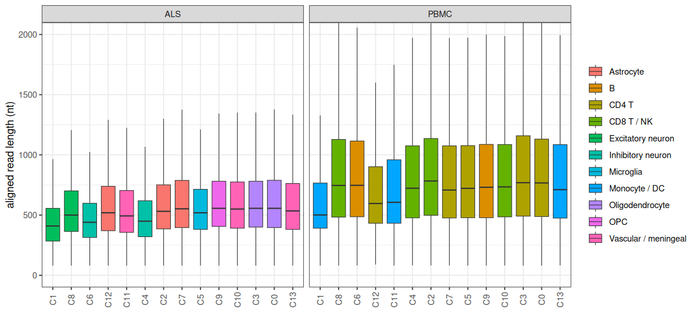
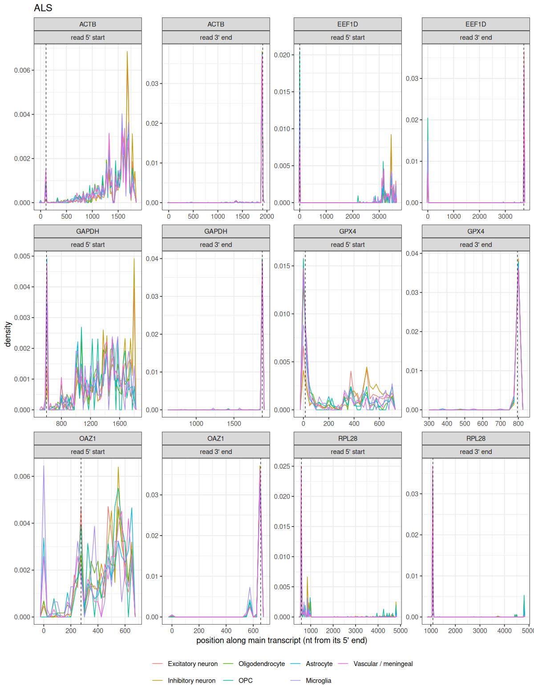
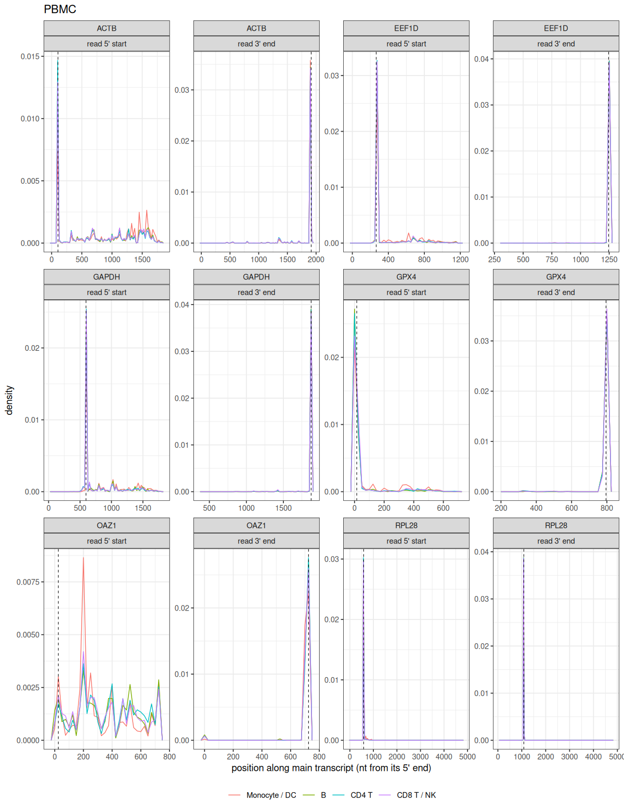
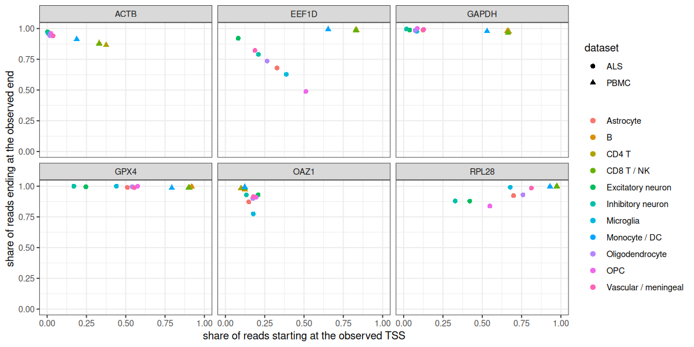
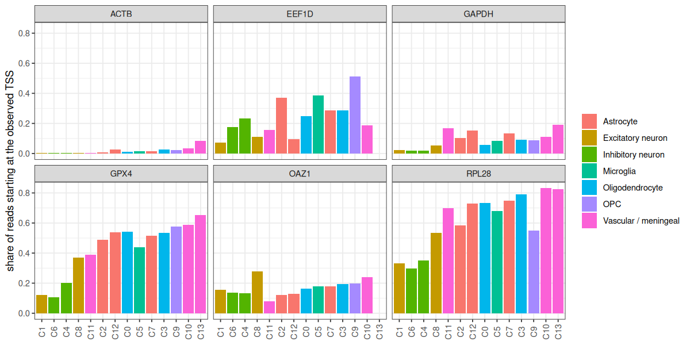

Are the ALS TSS switches 5’ truncation? Read lengths and read ends by
cell type
================

In ALS (LP00714, cortex nuclei), most high-confidence site-level TSS
switches have a neuron cluster favouring the downstream TSS, the
downstream site rarely has a FANTOM5 CAGE peak, and the genes are
housekeeping genes. If that comes from reads that stop short of the 5’
end, a gene like GAPDH or ACTB should show, in neurons, read 3’ ends at
the same polyA site as in other cells but read 5’ ends spread downstream
of the TSS.

Reads are taken per gene with LRAA’s read filters and strand rule
(`util/sc/read_end_profile_by_cluster.py`), kept if their introns are
annotated introns of the gene, and placed along the gene’s main
annotated transcript (the one most reads match exactly). Positions are
nt from that transcript’s 5’ end. Because GENCODE models can extend past
where reads start (RPL28’s main model starts ~590 nt upstream), each
read’s start is also measured from the gene’s **observed TSS**, the most
common read-start position (10 nt bins) within the main transcript’s
first exon, over all cells of the dataset (anchored to the first exon
because in some genes truncated reads pile up near the 3’ end and
outnumber the reads that start at the TSS), and its end from the most
common read end. PBMC (whole cells) is the contrast.

## 1. Read lengths, genome-wide sample, by cluster

<!-- -->

| dataset | cluster_n | class                |     n | median_len | q25 |  q75 |
|:--------|:----------|:---------------------|------:|-----------:|----:|-----:|
| ALS     | 1         | Excitatory neuron    | 58889 |        409 | 284 |  556 |
| ALS     | 6         | Inhibitory neuron    | 14664 |        440 | 314 |  598 |
| ALS     | 4         | Inhibitory neuron    | 24676 |        449 | 320 |  619 |
| ALS     | 11        | Vascular / meningeal |  4562 |        493 | 356 |  704 |
| ALS     | 8         | Excitatory neuron    | 37692 |        500 | 364 |  701 |
| ALS     | 12        | Astrocyte            |  5027 |        519 | 370 |  739 |
| ALS     | 5         | Microglia            | 16178 |        519 | 381 |  714 |
| ALS     | 2         | Astrocyte            | 43239 |        531 | 385 |  751 |
| ALS     | 13        | Vascular / meningeal |  2844 |        534 | 381 |  762 |
| ALS     | 10        | Vascular / meningeal |  8063 |        550 | 391 |  775 |
| ALS     | 7         | Astrocyte            | 23827 |        552 | 396 |  788 |
| ALS     | 0         | Oligodendrocyte      | 24219 |        556 | 396 |  789 |
| ALS     | 3         | Oligodendrocyte      | 17505 |        556 | 400 |  781 |
| ALS     | 9         | OPC                  | 18754 |        556 | 406 |  781 |
| PBMC    | 1         | Monocyte / DC        | 69202 |        501 | 391 |  766 |
| PBMC    | 12        | CD4 T                |  4815 |        596 | 432 |  902 |
| PBMC    | 11        | Monocyte / DC        | 14014 |        606 | 432 |  959 |
| PBMC    | 7         | CD4 T                | 17052 |        708 | 476 | 1075 |
| PBMC    | 13        | Monocyte / DC        |  9756 |        711 | 475 | 1085 |
| PBMC    | 5         | CD4 T                | 25348 |        722 | 478 | 1077 |
| PBMC    | 4         | CD8 T / NK           | 36649 |        723 | 477 | 1075 |
| PBMC    | 9         | B                    | 17879 |        731 | 478 | 1087 |
| PBMC    | 10        | CD8 T / NK           |  7227 |        734 | 485 | 1086 |
| PBMC    | 8         | CD8 T / NK           | 11017 |        746 | 483 | 1128 |
| PBMC    | 6         | B                    | 16015 |        747 | 486 | 1115 |
| PBMC    | 0         | CD4 T                | 28828 |        767 | 488 | 1131 |
| PBMC    | 3         | CD4 T                | 20792 |        769 | 491 | 1159 |
| PBMC    | 2         | CD8 T / NK           | 22241 |        783 | 498 | 1136 |

## 2. Where reads start and end, per gene

Each panel: read 5’ starts (left) and 3’ ends (right) along the gene’s
main transcript, by cell type, as a share of that cell type’s reads.
Dashed line: the observed TSS / end.

<!-- -->

<!-- -->

## 3. Share of reads reaching the TSS and the 3’ end, by cell type

`reach TSS`: read starts within 50 nt of the observed TSS. `reach end`:
read ends within 50 nt of the observed end. `median start offset`: nt
downstream of the observed TSS.

<!-- -->

| dataset | gene | class | reads | median_len | reach_TSS | reach_end | median_start_offset |
|:---|:---|:---|---:|---:|---:|---:|---:|
| ALS | ACTB | Vascular / meningeal | 932 | 423.5 | 0.04 | 0.94 | 1371.0 |
| ALS | ACTB | OPC | 367 | 407.0 | 0.02 | 0.96 | 1399.0 |
| ALS | ACTB | Oligodendrocyte | 1749 | 428.0 | 0.02 | 0.94 | 1371.0 |
| ALS | ACTB | Microglia | 422 | 372.0 | 0.01 | 0.95 | 1438.0 |
| ALS | ACTB | Astrocyte | 1930 | 381.0 | 0.01 | 0.95 | 1424.0 |
| ALS | ACTB | Inhibitory neuron | 1001 | 279.0 | 0.00 | 0.97 | 1529.0 |
| ALS | ACTB | Excitatory neuron | 5418 | 301.0 | 0.00 | 0.97 | 1506.0 |
| PBMC | ACTB | CD4 T | 30849 | 1142.0 | 0.38 | 0.87 | 545.0 |
| PBMC | ACTB | B | 7349 | 1040.0 | 0.33 | 0.88 | 585.0 |
| PBMC | ACTB | CD8 T / NK | 31604 | 1028.5 | 0.33 | 0.87 | 585.0 |
| PBMC | ACTB | Monocyte / DC | 66124 | 656.0 | 0.19 | 0.91 | 1147.0 |
| ALS | EEF1D | OPC | 43 | 570.0 | 0.51 | 0.49 | -5.0 |
| ALS | EEF1D | Microglia | 51 | 392.0 | 0.39 | 0.63 | 3225.0 |
| ALS | EEF1D | Astrocyte | 343 | 464.0 | 0.33 | 0.68 | 3171.5 |
| ALS | EEF1D | Oligodendrocyte | 227 | 471.0 | 0.26 | 0.74 | 3199.0 |
| ALS | EEF1D | Inhibitory neuron | 200 | 260.0 | 0.21 | 0.79 | 3453.0 |
| ALS | EEF1D | Vascular / meningeal | 101 | 521.0 | 0.19 | 0.82 | 3168.5 |
| ALS | EEF1D | Excitatory neuron | 403 | 260.0 | 0.08 | 0.92 | 3453.0 |
| PBMC | EEF1D | B | 2590 | 982.0 | 0.83 | 0.99 | 1.0 |
| PBMC | EEF1D | CD4 T | 10734 | 982.0 | 0.83 | 0.99 | 1.0 |
| PBMC | EEF1D | CD8 T / NK | 5599 | 982.0 | 0.83 | 0.98 | 1.0 |
| PBMC | EEF1D | Monocyte / DC | 5178 | 981.0 | 0.65 | 0.99 | 1.0 |
| ALS | GAPDH | Vascular / meningeal | 406 | 578.0 | 0.13 | 0.99 | 721.0 |
| ALS | GAPDH | Astrocyte | 1268 | 578.0 | 0.12 | 0.99 | 701.0 |
| ALS | GAPDH | OPC | 110 | 522.5 | 0.09 | 1.00 | 758.5 |
| ALS | GAPDH | Microglia | 87 | 481.0 | 0.08 | 0.98 | 816.5 |
| ALS | GAPDH | Oligodendrocyte | 671 | 544.0 | 0.07 | 0.98 | 746.5 |
| ALS | GAPDH | Excitatory neuron | 1855 | 404.0 | 0.04 | 0.99 | 873.0 |
| ALS | GAPDH | Inhibitory neuron | 457 | 372.0 | 0.02 | 1.00 | 907.0 |
| PBMC | GAPDH | CD4 T | 6293 | 1280.0 | 0.67 | 0.98 | -2.0 |
| PBMC | GAPDH | CD8 T / NK | 5422 | 1280.0 | 0.66 | 0.96 | -4.0 |
| PBMC | GAPDH | B | 1234 | 1280.0 | 0.66 | 0.98 | -2.0 |
| PBMC | GAPDH | Monocyte / DC | 14440 | 1177.0 | 0.53 | 0.98 | -2.0 |
| ALS | GPX4 | OPC | 40 | 691.5 | 0.58 | 1.00 | 6.0 |
| ALS | GPX4 | Vascular / meningeal | 169 | 753.0 | 0.55 | 0.99 | 6.0 |
| ALS | GPX4 | Oligodendrocyte | 208 | 740.5 | 0.54 | 1.00 | 23.0 |
| ALS | GPX4 | Astrocyte | 471 | 668.0 | 0.51 | 0.99 | 28.0 |
| ALS | GPX4 | Microglia | 69 | 490.0 | 0.44 | 1.00 | 139.0 |
| ALS | GPX4 | Excitatory neuron | 646 | 396.5 | 0.25 | 1.00 | 404.0 |
| ALS | GPX4 | Inhibitory neuron | 240 | 323.0 | 0.17 | 1.00 | 463.0 |
| PBMC | GPX4 | B | 790 | 782.0 | 0.92 | 1.00 | -4.0 |
| PBMC | GPX4 | CD4 T | 3185 | 782.0 | 0.91 | 0.99 | -4.0 |
| PBMC | GPX4 | CD8 T / NK | 1706 | 780.0 | 0.90 | 0.99 | -4.0 |
| PBMC | GPX4 | Monocyte / DC | 4554 | 778.0 | 0.79 | 0.99 | -4.0 |
| ALS | OAZ1 | Excitatory neuron | 1079 | 303.0 | 0.21 | 0.93 | 205.0 |
| ALS | OAZ1 | OPC | 56 | 295.0 | 0.20 | 0.91 | 236.0 |
| ALS | OAZ1 | Microglia | 71 | 345.0 | 0.18 | 0.77 | 97.5 |
| ALS | OAZ1 | Vascular / meningeal | 127 | 274.0 | 0.18 | 0.91 | 229.5 |
| ALS | OAZ1 | Oligodendrocyte | 248 | 284.5 | 0.17 | 0.90 | 211.0 |
| ALS | OAZ1 | Astrocyte | 328 | 299.0 | 0.15 | 0.87 | 211.0 |
| ALS | OAZ1 | Inhibitory neuron | 310 | 275.0 | 0.13 | 0.93 | 234.0 |
| PBMC | OAZ1 | B | 392 | 471.0 | 0.12 | 0.97 | 337.0 |
| PBMC | OAZ1 | Monocyte / DC | 6524 | 487.0 | 0.12 | 0.99 | 219.0 |
| PBMC | OAZ1 | CD8 T / NK | 1045 | 481.0 | 0.12 | 0.98 | 278.0 |
| PBMC | OAZ1 | CD4 T | 1219 | 450.0 | 0.10 | 0.98 | 353.0 |
| ALS | RPL28 | Vascular / meningeal | 381 | 496.0 | 0.81 | 0.98 | 2.0 |
| ALS | RPL28 | Oligodendrocyte | 586 | 496.0 | 0.76 | 0.93 | 2.0 |
| ALS | RPL28 | Astrocyte | 473 | 495.0 | 0.70 | 0.92 | 2.0 |
| ALS | RPL28 | Microglia | 125 | 495.0 | 0.68 | 0.99 | 2.0 |
| ALS | RPL28 | OPC | 68 | 494.0 | 0.55 | 0.84 | 5.0 |
| ALS | RPL28 | Excitatory neuron | 622 | 398.0 | 0.42 | 0.88 | 125.0 |
| ALS | RPL28 | Inhibitory neuron | 293 | 305.0 | 0.33 | 0.88 | 274.0 |
| PBMC | RPL28 | CD4 T | 139105 | 496.0 | 0.98 | 1.00 | 2.0 |
| PBMC | RPL28 | B | 31844 | 496.0 | 0.97 | 1.00 | 2.0 |
| PBMC | RPL28 | CD8 T / NK | 63143 | 496.0 | 0.97 | 1.00 | 2.0 |
| PBMC | RPL28 | Monocyte / DC | 65250 | 496.0 | 0.93 | 1.00 | 2.0 |

## 4. Per cluster (ALS)

<!-- -->
